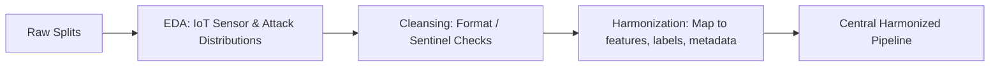

# BoT-IoT Pipeline

## Workflow & Deliverables

## Structure
- `raw/`: Raw official train/test CSV splits.
- `download.py`: Verifies or generates benchmark splits with verified SHA-256 hashes.
- `cleansing.ipynb`: Standard cleansing chunk processor.
- `eda.ipynb`: Exploratory data analysis.
- `feature_engineering.ipynb`: Feature verification and distributions.
- `harmonization.ipynb`: Produces standardized `features.csv`, `labels.csv`, and `metadata.csv` in `output/harmonized/`.
- `output/`: Cleansed and harmonized outputs.

