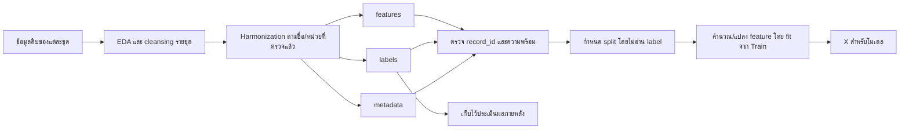
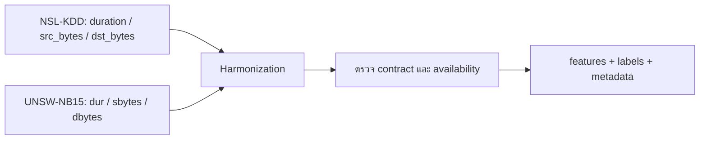

# คู่มือ Dataset กลาง (/CENTRAL): รวม 4 ชุดข้อมูล (NSL-KDD, UNSW-NB15, CIC-IDS2017, BoT-IoT)

เอกสารนี้อธิบายโครงสร้างของ **Dataset กลาง (/CENTRAL)** ซึ่งนำตาราง harmonized จากชุดข้อมูลต้นทางมารวม แยก features/labels/metadata และเตรียม training splits; สามารถใช้ **Borderline-SMOTE** สร้างตัวอย่างสังเคราะห์ของ class ที่กำหนดได้

> **สถานะของตัวเลขเดิม:** 747,504, 629,582 และ 511,643 เป็นผลจากการรันก่อนหน้าใน working copy; CIC/BoT รอบนั้นมาจาก generator ที่สร้างข้อมูลตัวอย่าง ไม่ใช่ raw benchmark ทางการ และ output ปัจจุบันยังเป็นผลจากรอบเดิม เพราะยังไม่ได้ execute notebooks รุ่นที่จัดใหม่นี้ อย่าอ้างตัวเลขดังกล่าวเป็นผล benchmark ทางการ

ข้อมูลดิบและผลลัพธ์ pipeline ไม่ถูกอัปโหลดเข้า Git; สมาชิกที่ clone repository ใหม่ต้องเตรียมไฟล์ raw และรัน workflow ปัจจุบันก่อน ตัวเลขเดิมเป็นประวัติผลจาก working copy ไม่รับประกันว่าจะมีในทุก clone


> **อัปเดตโครงสร้าง 4 พฤศจิกายน 2026:** cleansing/harmonization ของ CIC-IDS2017 และ BoT-IoT อยู่ใน `../../sub-dataset/CIC-IDS2017/*.ipynb` และ `../../sub-dataset/BoT-IoT/*.ipynb`; Borderline-SMOTE อยู่ใน `../borderline_smote.ipynb` และ master runner execute code cells เหล่านั้น ส่วน CENTRAL builder สี่ยังใช้ `build_dataset.py`. รายละเอียดเส้นทางปัจจุบันดู [`PIPELINE_FILE_GUIDE.md`](../../PIPELINE_FILE_GUIDE.md); ขั้นตอนที่อ้าง `common/` ด้านล่างเป็นเอกสาร workflow รุ่นก่อน

## ภาพรวม: หนึ่ง record เดินทางอย่างไร



ตัวอย่างตัวเลขสาธิตหนึ่งแถว (ไม่ใช่สถิติจากไฟล์จริง):

| จุดที่ดู             | ค่า                                                                                                | ทำไมจึงมีขั้นนี้ / ผลที่เห็น                                                                |
| ---------------------------- | ----------------------------------------------------------------------------------------------------- | -------------------------------------------------------------------------------------------------------------------- |
| ต้นทาง UNSW            | `dur=2`, `sbytes=120`, `dbytes=30`, `label=1`, `attack_cat=DoS`                             | แต่ละชุดตั้งชื่อคอลัมน์ต่างกัน; label เป็นคำตอบอ้างอิง                 |
| หลัง harmonization       | `duration=2`, `bytes_forward=120`, `bytes_backward=30`; label ย้ายไปตาราง `labels` | สูตรกลางอ่านชื่อเดียวกันได้; ค่า`label=1` ไม่กลายเป็น feature             |
| หลัง feature engineering | `log_duration=ln(3)≈1.099`; `signed_log_bytes_ratio=ln(121)-ln(31)≈1.36`                        | log บีบช่วงค่าที่ยาว และ signed ratio เก็บว่าทิศทางขาใดมี bytes มากกว่า |
| ตอนประเมิน         | โมเดลให้ score ก่อน แล้วค่อย join`label_binary` ด้วย `record_id`          | วัดผลได้โดยไม่ให้คำตอบรั่วเข้า`fit()`                                                |

ตัวอย่างนี้สมมติว่าทิศทาง bytes ผ่านการตรวจสอบตาม contract แล้ว ค่า `record_id`/metadata จะช่วยระบุแถวและแหล่งที่มา แต่ต้องไม่ป้อนเข้า `X`

## 1. Dataset กลางคืออะไร

แต่ละ dataset มีรูปแบบและฟิลด์ของตัวเอง ตัวอย่างเช่น NSL-KDD ใช้ `duration`, `protocol_type`, `src_bytes`, `dst_bytes`; UNSW-NB15 ใช้ `dur`, `proto`, `sbytes`, `dbytes` ขั้น harmonization จึงแปลงเฉพาะฟิลด์ที่นิยามพอจะเทียบกันได้ให้ใช้ชื่อกลางเดียวกัน



การรวมไม่ได้หมายถึงเอาทุกคอลัมน์มาต่อกันแล้วเติมศูนย์ ช่องที่ไม่มีในบางแหล่งคงเป็น null ในตาราง harmonized พร้อม availability mask และต้องผ่านการพิจารณาก่อนเลือกเป็น feature ที่ใช้ฝึกร่วม

## 2. เส้นทางข้อมูลและหน้าที่ของแต่ละขั้น

| ขั้น                        | ทำอะไร                                                                                                    | ได้อะไร / ข้อควรระวัง                                                                                                             |
| ------------------------------- | --------------------------------------------------------------------------------------------------------------- | --------------------------------------------------------------------------------------------------------------------------------------------------- |
| 1. Raw                          | เก็บต้นฉบับจากแหล่งข้อมูล                                                              | ห้ามเขียนทับไฟล์ต้นฉบับ; checksum ใช้ตรวจว่าข้อมูลที่ผ่าน cleansing ตรงกับ raw รุ่นเดิม |
| 2. EDA                          | ตรวจ header, ชนิดข้อมูล, missing, ค่าที่ไม่ซ้ำ และ label                           | ช่วยรู้ schema จริงก่อน mapping; อย่าสรุปจากชื่อคอลัมน์อย่างเดียว                                    |
| 3. Cleansing รายชุด       | normalize ช่องว่าง/sentinel, ทำเครื่องหมายแถวซ้ำ, เก็บลำดับแถว           | ไม่ลบ record โดยอัตโนมัติ; เก็บผลไว้ใต้`Dataset/output/cleansing/`                                                   |
| 4. Harmonization รายชุด   | แปลงฟิลด์ตาม adapter ของ NSL หรือ UNSW                                                       | เขียน`features`, `labels`, `metadata` แยกกันและใช้ `record_id` ร่วมกัน                                              |
| 5. Build กลาง               | โหลดเฉพาะผล harmonized ที่ตรวจผ่าน, สร้าง split และรายงานความพร้อม | รักษา official Train/Test; ไม่ใช้ label เพื่อแบ่ง/สุ่ม Train                                                                |
| 6. Feature engineering กลาง | คำนวณ log features, fit scaler/encoder จาก Train                                                        | ใช้ transformer เดิมแปลง validation/test; label และ metadata ยังคงแยกไฟล์                                                 |

ในโครงสร้างปัจจุบัน Notebook มีโค้ดของขั้นตอนนั้นอยู่ในตัวโดยตรง ไม่ต้อง import ฟังก์ชันจากไฟล์ Python แยก: `build_dataset.ipynb` รวมตาราง harmonized และสร้าง split ส่วน `feature_engineering.ipynb` สร้าง feature กลาง กฎ schema และรายชื่อชุดข้อมูลอยู่ใน `feature_contract.json` และ `dataset_registry.json` ตามลำดับ

## 3. ตารางกลางสามชุด: อย่าสับสน X, y และ metadata

ทุกตารางเชื่อมกันด้วย `record_id` และต้องมีแถวเรียงตรงกัน ไฟล์จัดเก็บเป็น CSV เพื่อเปิดตรวจด้วยเครื่องมือทั่วไปได้

| ตาราง   | ข้อมูลสำคัญ                                                                                                      | ใช้ทำอะไร                                                                                | ป้อนเข้าโมเดลไหม                                                                         |
| ------------ | --------------------------------------------------------------------------------------------------------------------------- | ------------------------------------------------------------------------------------------------- | -------------------------------------------------------------------------------------------------------- |
| `features` | `duration`, `protocol`, `bytes_forward`, `bytes_backward`, extensions และ `record_id`                          | ตัวแปรพฤติกรรมของ traffic                                                        | ใช้เฉพาะคอลัมน์ feature; ต้อง drop`record_id` ก่อน fit/predict                  |
| `labels`   | `label_raw`, `label_source_category`, `attack_category`, `label_binary`                                             | คำตอบอ้างอิงสำหรับสรุป/ประเมินผล                                   | **ไม่ใช้ตอน fit Isolation Forest**; ใช้คำนวณ metrics หลังโมเดลทำนาย |
| `metadata` | dataset ต้นทาง,`orig_row_id`, split, capture time, split group, sample weight, duplicate flag, masks, quality flags | ตรวจสอบย้อนกลับ, แบ่งชุด, วิเคราะห์คุณภาพ/ความพร้อม | ไม่ใช่ feature model                                                                               |

`record_id` เป็นกุญแจ join ไม่ใช่สัญญาณโจมตี ตัวอย่าง `UNSW-NB15:UNSW_NB15_training-set.csv:000000123` มีไว้ชี้กลับไปยังแถวต้นทางเท่านั้น

### ตอบสั้น ๆ เรื่อง unsupervised

- **Train Isolation Forest:** ใช้ `X` เท่านั้น ไม่ส่ง `y` หรือคอลัมน์ label เข้า `fit()`
- **ประเมินหลัง train:** นำ score/prediction ไปเทียบกับ `label_binary` หรือ label รายประเภทที่เก็บแยกอยู่ได้
- **ข้อควรระวัง:** unsupervised ไม่ได้แปลว่าทุก attack จะถูกตรวจพบแน่นอน โมเดลหา record ที่ “ไม่เหมือนรูปแบบที่เรียนรู้” หาก traffic โจมตีมีอยู่บ่อยในข้อมูลฝึก โมเดลอาจมองเป็นรูปแบบปกติได้

ตัวอย่างแยกตาราง:

```text
features.csv:  record_id, duration, bytes_forward, bytes_backward, ...
labels.csv:    record_id, label_binary, attack_category, ...
metadata.csv:  record_id, source_dataset, data_split, ...

X = features.drop(columns=["record_id"])
y = labels["label_binary"]        # เก็บไว้ประเมินทีหลัง ไม่ส่งให้ IsolationForest.fit
```

## 4. ฟีเจอร์กลางและที่มา

### Core candidates

| ชื่อกลาง   | NSL-KDD           | UNSW-NB15  | หน่วย/การเตรียม                                                                    |
| ------------------ | ----------------- | ---------- | ------------------------------------------------------------------------------------------------ |
| `duration`       | `duration`      | `dur`    | วินาที; ต้องไม่ติดลบ; สร้าง`log_duration`                               |
| `protocol`       | `protocol_type` | `proto`  | จัดเป็น tcp/udp/icmp/other; One-Hot Encoder เรียนรู้จาก Train เท่านั้น |
| `bytes_forward`  | `src_bytes`     | `sbytes` | byte ในทิศทาง source → destination; สร้าง log feature                              |
| `bytes_backward` | `dst_bytes`     | `dbytes` | byte ในทิศทาง destination → source; สร้าง log feature                              |

ทั้งสี่เป็น **ผู้สมัคร** สำหรับ profile ร่วม ไม่ใช่คำยืนยันว่าความหมายตรงกันแล้วโดยอัตโนมัติ ต้องตรวจหน่วย ทิศทาง และนิยามจากเอกสารจริงทั้งสองชุด และตรวจว่าไม่มี missing ในแหล่งที่เข้าร่วม

### Feature Engineering ที่ส่งเข้าโมเดล

โปรไฟล์ `joint_v1` มี model features 19 คอลัมน์ บวก `record_id` ที่เก็บไว้เชื่อมตาราง รวมแล้วไฟล์ `features.csv` จึงมี 20 คอลัมน์ ตารางด้านล่างอธิบาย **ทุก model feature แยกทีละคอลัมน์**:

|  # | คอลัมน์ output      | มาจาก / วิธีได้ค่า                                                                                           | คอลัมน์นี้บอกโมเดลว่า…                                                                                                                                                                                         |
| -: | -------------------------- | --------------------------------------------------------------------------------------------------------------------------- | ------------------------------------------------------------------------------------------------------------------------------------------------------------------------------------------------------------------------------------ |
|  1 | `log_duration`           | `duration` (NSL `duration`, UNSW `dur`); คำนวณ `log1p(duration)` แล้ว StandardScaler                       | การเชื่อมต่อใช้เวลาสั้น/ยาวแค่ไหนเมื่อเทียบกับค่า Train; ค่าบวก/ลบหลัง scale หมายถึงสูง/ต่ำกว่าค่าเฉลี่ย Train ไม่ใช่เวลาบวก/ลบ |
|  2 | `log_bytes_forward`      | `bytes_forward` (NSL `src_bytes`, UNSW `sbytes`); `log1p(bytes_forward)` แล้ว StandardScaler                    | ปริมาณข้อมูลในทิศทางต้นทาง → ปลายทาง สูงหรือต่ำเมื่อเทียบกับ Train                                                                                                          |
|  3 | `log_bytes_backward`     | `bytes_backward` (NSL `dst_bytes`, UNSW `dbytes`); `log1p(bytes_backward)` แล้ว StandardScaler                  | ปริมาณข้อมูลในทิศทางปลายทาง → ต้นทาง สูงหรือต่ำเมื่อเทียบกับ Train                                                                                                          |
|  4 | `signed_log_bytes_ratio` | `log1p(bytes_forward) - log1p(bytes_backward)` แล้ว StandardScaler                                                    | ความไม่สมดุลของ traffic ที่ยังเก็บทิศทางไว้; บวกคือขาไปมากกว่า ลบคือขากลับมากกว่า ใกล้ศูนย์คือปริมาณใกล้เคียง                        |
|  5 | `protocol_tcp`           | One-Hot จาก `protocol`; 1 เมื่อหมวดเป็น `tcp`, นอกนั้น 0                                         | record ใช้ TCP หรือไม่                                                                                                                                                                                                     |
|  6 | `protocol_udp`           | One-Hot จาก `protocol`; 1 เมื่อหมวดเป็น `udp`                                                           | record ใช้ UDP หรือไม่                                                                                                                                                                                                     |
|  7 | `protocol_icmp`          | One-Hot จาก `protocol`; 1 เมื่อหมวดเป็น `icmp`                                                          | record ใช้ ICMP หรือไม่                                                                                                                                                                                                    |
|  8 | `protocol_other`         | One-Hot จาก `protocol`; 1 เมื่อเป็น `other` หรือค่าที่ไม่รู้จักถูก map มา `other` | protocol ไม่อยู่ในสามหมวดข้างต้นหรือไม่; ค่าว่างไม่ถูกนับเป็น `other` แต่ทำให้ขั้นตอนหยุด                                                                     |
|  9 | `service_dns`            | One-Hot จาก `service_group`; รวม alias ที่ mapping ไว้ เช่น `dns`, `domain`, `domain_u`             | บริการถูกจัดเป็น DNS หรือไม่                                                                                                                                                                                  |
| 10 | `service_ftp`            | One-Hot จาก `service_group`; รวม `ftp` และ `ftp_data`                                                        | บริการถูกจัดเป็น FTP หรือไม่                                                                                                                                                                                  |
| 11 | `service_http`           | One-Hot จาก `service_group`; รวม `http` และ alias เช่น `www`                                             | บริการถูกจัดเป็น HTTP หรือไม่                                                                                                                                                                                 |
| 12 | `service_https_ssl`      | One-Hot จาก `service_group`; รวม `https`/`ssl`                                                                  | บริการถูกจัดเป็น HTTPS/SSL หรือไม่                                                                                                                                                                            |
| 13 | `service_smtp`           | One-Hot จาก `service_group`; 1 เมื่อถูก map เป็น `smtp`                                                  | บริการถูกจัดเป็น SMTP หรือไม่                                                                                                                                                                                 |
| 14 | `service_ssh`            | One-Hot จาก `service_group`; 1 เมื่อถูก map เป็น `ssh`                                                   | บริการถูกจัดเป็น SSH หรือไม่                                                                                                                                                                                  |
| 15 | `service_other`          | One-Hot จาก `service_group`; 1 เมื่อเป็น `other` หรือค่าที่ mapping ไม่รู้จัก            | บริการไม่อยู่ในหกกลุ่มข้างต้นหรือไม่; ไม่ได้แปลว่า record เสียหรือเป็น attack                                                                                            |
| 16 | `conn_state_established` | One-Hot จาก `conn_state_group`; mapping รวมสถานะเช่น `sf`, `fin`, `con`                              | สถานะถูกจัดอยู่กลุ่ม established หรือไม่                                                                                                                                                                  |
| 17 | `conn_state_no_reply`    | One-Hot จาก `conn_state_group`; mapping รวมสถานะเช่น `s0`, `int`, `req`                              | สถานะถูกจัดอยู่กลุ่ม no-reply หรือไม่; เป็นหมวดหยาบตาม mapping ไม่ใช่คำยืนยันว่าไม่มี packet ตอบกลับในทุกความหมาย                                |
| 18 | `conn_state_reset`       | One-Hot จาก `conn_state_group`; mapping รวมสถานะเช่น `rej`, `rsto`, `rstr`, `rstos0`, `rst`      | สถานะถูกจัดอยู่กลุ่ม reset หรือไม่                                                                                                                                                                        |
| 19 | `conn_state_other`       | One-Hot จาก `conn_state_group`; ใช้กับสถานะอื่นที่ไม่เข้า 3 กลุ่มข้างต้น          | สถานะที่รู้ค่าแล้วแต่ไม่เข้ากลุ่มย่อยที่กำหนด; ค่าว่างยังคงเป็นข้อผิดพลาด ไม่ถูกซ่อนเป็น `other`                                              |

ทุกคอลัมน์ One-Hot มีค่าเป็น 0 หรือ 1 และในแต่ละกลุ่ม (`protocol_*`, `service_*`, `conn_state_*`) ต้องมีค่า 1 **หนึ่งคอลัมน์ต่อแถวพอดี** ตัวอย่าง `protocol_tcp=0` ไม่ได้แปลว่าไม่มี protocol เพราะแถวเดียวกันต้องมี protocol หมวดอื่นเป็น 1 ด้วย ชื่อ `conn_state_no_reply` ใช้ underscore ใน output แม้ชื่อหมวดกลางใน contract จะเขียน `no-reply`

`record_id` เป็นคอลัมน์ที่ 20 ในไฟล์ output ใช้ join กับ labels/metadata เท่านั้น ไม่อยู่ใน 19 คอลัมน์ข้างบนและต้องตัดออกก่อนส่ง `X` เข้าโมเดล

ตัวอย่าง: ถ้า bytes ขาไป = 120 และขากลับ = 30, signed ratio คือ `ln(121) - ln(31) ≈ 1.36` ซึ่งเป็นค่าบวกเพราะขาไปมากกว่า; เมื่อสลับค่าเป็น 30 กับ 120 ผลจะเป็นค่าลบประมาณ `-1.36` จึงเก็บทิศทางได้สมมาตร

โปรไฟล์หลักพัก `log_total_bytes` ไว้เพราะเป็นผลรวมที่คำนวณซ้ำจาก bytes สองทิศทาง และพัก `log_bytes_per_second` เพราะการแทน duration ศูนย์ด้วย epsilon อาจสร้างอัตราที่สูงเกินความหมายของข้อมูล

ปัจจุบัน Notebook สร้างเฉพาะ model features 19 คอลัมน์ของ `joint_v1` ตามตารางด้านบน ไม่มีการสร้างหรือส่งออกฟีเจอร์ทดลองเพิ่มเติม ส่วน `record_id` ยังคงอยู่ในไฟล์เพื่อเชื่อม features กับ labels/metadata และต้องตัดออกก่อนส่งข้อมูลเข้าโมเดล

`StandardScaler` และ One-hot encoders ใช้หมวดมาตรฐานที่กำหนดใน contract และ fit จาก `train` เท่านั้น ตัวแปลงชุดเดียวกันใช้กับ `train_full`, `validation` และ `test`; ค่าหมวดที่ไม่รู้จักกลายเป็น `other`, แต่ค่าว่างในฟีเจอร์บังคับทำให้กระบวนการหยุดพร้อมรายงาน ไม่เติมศูนย์และไม่ลบแถวเงียบ ๆ

### ทำ Feature Engineering จริงทีละขั้นอย่างไร

Notebook `common/feature_engineering.ipynb` รับข้อมูลจาก `common/output/splits/` ซึ่งสร้างโดย `build_dataset.ipynb` แล้วทำงานตามลำดับนี้:

1. **อ่านตารางที่เตรียมไว้แล้ว** — แต่ละ split มี `features.csv`, `labels.csv` และ `metadata.csv` แยกกัน Notebook ตรวจว่า `record_id` ตรงกันทั้งสามตาราง และปฏิเสธกรณี label หรือ metadata หลุดปนอยู่ในตาราง features
2. **ตรวจว่ามี input ที่จำเป็น** — ต้องมี `duration`, `bytes_forward`, `bytes_backward`, `protocol`, `service_group` และ `conn_state_group` ครบทุก split ถ้าคอลัมน์หรือค่าที่จำเป็นหาย กระบวนการหยุดพร้อมแจ้งข้อผิดพลาด ไม่เติมศูนย์และไม่ทิ้งแถวเพื่อให้จำนวนแถวดูครบ
3. **คำนวณตัวเลขจากข้อมูลพฤติกรรมเดิม** — ใช้ `log1p(x) = ln(1+x)` กับ duration และ bytes เพื่อบีบค่าที่มีช่วงห่างมาก ส่วน signed ratio หาผลต่างหลัง log ของ bytes สองทิศทาง จึงเก็บได้ทั้งกรณีขาไปมากกว่าและขากลับมากกว่า ขั้นนี้สร้างมุมมองใหม่จากคอลัมน์เดิม ไม่ได้เพิ่มข้อมูลจาก sensor
4. **จัดหมวดหมู่ให้สะอาดและเข้ารหัส** — แปลงข้อความเป็นตัวพิมพ์เล็กและตัดช่องว่างก่อนจับเข้าหมวดมาตรฐาน หมวดที่ไม่อยู่ใน vocabulary เช่น protocol ที่ไม่รู้จัก ส่งไป `other`; ค่าว่างไม่ถือว่าเป็น `other` แต่ทำให้หยุดเพื่อไม่ปกปิดปัญหาต้นทาง จากนั้น One-Hot สร้างคอลัมน์ 0/1 แยกแต่ละหมวด
5. **เรียนรู้สเกลจาก `train` เท่านั้น** — `StandardScaler` เรียนรู้ค่าเฉลี่ยและส่วนเบี่ยงเบนมาตรฐานของฟีเจอร์ตัวเลขจากแถวใน Train; encoder ใช้ vocabulary คงที่ตาม contract และ fit กับ Train เช่นกัน ไม่อ่าน label เพื่อเลือกแถวหรือปรับค่า ใน Train รุ่นที่สร้างคู่มือนี้ มี 201,556 แถวจาก NSL-KDD และ UNSW-NB15
6. **ใช้ตัวแปลงชุดเดิมกับทุก split** — นำ scaler/encoder ที่ fit แล้วไปแปลง Train, `train_full`, Validation และ Test; ตรวจว่าค่าตัวเลขไม่เป็น missing/อนันต์ และแต่ละกลุ่ม One-Hot มีค่า `1` เพียงหนึ่งคอลัมน์ต่อแถว แล้วเขียนผลโดยคง `record_id`, labels และ metadata แยกกัน

เหตุผลที่ fit เฉพาะ Train คือป้องกันข้อมูล Validation/Test มีส่วนกำหนดค่าเฉลี่ยหรือสเกลที่โมเดลได้เห็นล่วงหน้า หาก Validation/Test ไม่ได้มีค่าเฉลี่ย 0 หรือส่วนเบี่ยงเบนมาตรฐาน 1 ก็ไม่ได้แปลว่าคำนวณผิด แต่แสดงว่าข้อมูลส่วนนั้นมีการกระจายต่างจาก Train ซึ่งอาจเป็นสัญญาณของความต่างระหว่างแหล่งหรือช่วงข้อมูลได้

### ตัวอย่างเดินจากค่าต้นทางไปถึงตัวเลขใน `X`

สมมติ record หนึ่งมี `duration=2` วินาที, bytes ขาไป `120`, bytes ขากลับ `30`, protocol เป็น `tcp`, บริการถูก map เป็น `http` และสถานะเป็น `established` ตัวอย่างนี้เป็นค่าจำลองเพื่ออธิบาย ไม่ใช่การกล่าวว่า record จริงมีค่าชุดนี้:

| ขั้น       | คำนวณ/ค่าที่ได้                                                                                                                  | แปลว่าอะไร                                                                                                                                                                                                                                                                          |
| -------------- | ---------------------------------------------------------------------------------------------------------------------------------------------- | --------------------------------------------------------------------------------------------------------------------------------------------------------------------------------------------------------------------------------------------------------------------------------------------- |
| Input กลาง | `duration=2`, `bytes_forward=120`, `bytes_backward=30`                                                                                   | ชื่อกลางเหล่านี้มาจากการ map ฟิลด์ที่ตรวจแล้ว เช่น NSL `src_bytes/dst_bytes` หรือ UNSW `sbytes/dbytes`; ทิศทางต้องตีความตาม source mapping                                                                             |
| Log transform  | `log_duration=ln(3)=1.099`; `log_bytes_forward=ln(121)=4.796`; `log_bytes_backward=ln(31)=3.434`                                         | ค่าก่อน scale; log ลดอิทธิพลของค่าที่ใหญ่มาก แต่ยังรักษาลำดับค่าบวกไว้                                                                                                                                                               |
| Signed ratio   | `ln(121)-ln(31)=1.362`                                                                                                                       | เป็นบวกเพราะขาไปมี bytes มากกว่า; ถ้าสลับเป็น 30/120 จะได้ประมาณ `-1.362`                                                                                                                                                                    |
| StandardScaler | `log_duration≈0.681`, `log_bytes_forward≈0.013`, `log_bytes_backward≈-0.007`, `signed_log_bytes_ratio≈0.021`                       | ตัวอย่างผลหลังใช้ scaler ที่เรียนรู้จาก Train ปัจจุบัน; ค่าใกล้ 0 หมายถึงใกล้ค่าเฉลี่ย Train ส่วนค่าลบหมายถึงต่ำกว่าค่าเฉลี่ย ไม่ได้หมายถึง duration หรือ bytes ติดลบ |
| One-Hot        | protocol `[tcp=1, udp=0, icmp=0, other=0]`; service `http=1`; state `established=1` และคอลัมน์อื่นในกลุ่มเป็น 0 | เปลี่ยนชื่อหมวดข้อความให้เป็นตัวเลข โดยไม่บอกว่าหมวดหนึ่ง “มากกว่า” อีกหมวดหนึ่ง                                                                                                                                 |

ค่าหลัง StandardScaler ในตารางเป็น **ตัวอย่างที่คำนวณด้วยค่าเฉลี่ย/สเกลจาก output ชุดปัจจุบัน** หากข้อมูล Train หรือรุ่น dataset เปลี่ยน ตัวเลขมาตรฐานของตัวอย่างนี้ก็เปลี่ยนตาม แต่สูตรและความหมายของคอลัมน์ควรคงเดิมตาม contract

เมื่อบันทึกจริง แถวนี้ยังมี `record_id` อยู่หน้าตารางสำหรับ join กลับไปหา label/metadata แต่ `record_id` ไม่ใช่หนึ่งใน 19 model features และต้องตัดออกก่อน `fit()` หรือ `predict()` สำหรับ Isolation Forest นั้น `label_binary=1` หรือ `attack_category=DoS/DDoS` ยังคงอยู่ใน `labels.csv` เพื่อประเมินภายหลัง ไม่ได้ถูกใช้สร้างตัวเลขข้างต้นหรือสอนให้โมเดลตอบว่าเป็น attack

### ไฟล์ผลลัพธ์และการอ่านความหมาย

| ไฟล์/โฟลเดอร์                                     | เก็บอะไร                                                                            | ควรตีความอย่างไร                                                                                                                                                           |
| ------------------------------------------------------------- | ------------------------------------------------------------------------------------------- | ------------------------------------------------------------------------------------------------------------------------------------------------------------------------------------------ |
| `output/feature_engineering/{split}/features.csv`           | `record_id` และคอลัมน์ที่แปลงแล้ว 19 คอลัมน์                  | เป็น **input ที่เตรียมให้โมเดล** ไม่ใช่ผลทำนาย ไม่ใช่คะแนน anomaly และยังไม่บอกว่าแถวใดเป็น attack              |
| `output/feature_engineering/{split}/labels.csv`             | label ดั้งเดิมและ label กลางที่เชื่อมด้วย `record_id`         | ใช้ตรวจผลหลังโมเดลให้คะแนนแล้วเท่านั้นในงาน unsupervised นี้                                                                                 |
| `output/feature_engineering/{split}/metadata.csv`           | แหล่งข้อมูล, split, รหัสต้นทาง, flags และข้อมูลตรวจสอบ | ใช้ตามรอย/แยกวิเคราะห์ผล ไม่ส่งเข้า `X`                                                                                                                 |
| `output/feature_engineering/feature_schema.json`            | ชื่อ 19 ฟีเจอร์ สูตร กลุ่ม One-Hot และ split ที่ใช้ fit        | เป็นสัญญาว่าโมเดลต้องรับคอลัมน์อะไรและเรียงลำดับอย่างไร                                                                             |
| `output/feature_engineering/preprocessor.joblib`            | scaler และ encoder ที่ fit แล้ว                                                   | ใช้แปลงข้อมูลใหม่ด้วยกติกาเดียวกับ Train; ห้าม fit ใหม่จาก Test ของบริษัท/แหล่งเป้าหมายหากกำลังวัด zero-shot |
| `output/feature_engineering/feature_engineering_report.csv` | จำนวนแถว จำนวน model features และ source ต่อ split                       | ใช้เช็กว่าทำครบและขนาดตรงคาด ไม่ใช่รายงานคุณภาพการตรวจจับของโมเดล                                                          |

รายงานที่อยู่ในเครื่องตอนจัดทำคู่มือนี้ระบุว่า `train` มี 201,556 แถว, `train_full` 241,051, `validation` 60,263 และ `test` 104,876; ทุกชุดมี 19 model features และไม่มีค่าขาด/อนันต์ในฟีเจอร์ที่ส่งเข้าโมเดล ตัวเลขนี้เป็น snapshot ของ output ปัจจุบัน และอาจเปลี่ยนเมื่อข้อมูลต้นทางหรือการสร้าง split เปลี่ยน

**ผลลัพธ์นี้บอกได้:** pipeline สร้างรูปแบบ input ร่วมตาม contract สำเร็จ รักษาจำนวนแถว/รหัสเชื่อม และแยก `X`, labels และ metadata ออกจากกัน

**ผลลัพธ์นี้ยังบอกไม่ได้:** ว่า Isolation Forest ตรวจ attack ได้ดีขึ้น, ว่า feature ใดเป็นสาเหตุจริงของ attack, หรือว่าโมเดลจะใช้ได้กับบริษัทใหม่ การตอบคำถามเหล่านี้ต้องฝึก/ให้คะแนนโมเดลและประเมินบนชุดทดสอบที่ไม่ใช้เลือก feature หรือ threshold โดยดูผลแยกตาม source เสมอ

## 5. Extensions ที่ไม่ควรยัดเข้าฟีเจอร์ร่วมทันที

| กลุ่ม             | คอลัมน์กลาง                                                                   | มีในชุดใดตาม contract                                        | วิธีจัดการ                                                                                                                         |
| ---------------------- | ---------------------------------------------------------------------------------------- | ------------------------------------------------------------------------ | -------------------------------------------------------------------------------------------------------------------------------------------- |
| Packet counts          | `packets_forward`, `packets_backward`                                                | UNSW มี`spkts`/`dpkts`; NSL ไม่มีค่าที่เทียบตรง | เก็บค่า UNSW และ null ใน NSL พร้อม`has_packet_stats`; ไม่เข้า core profile โดยอัตโนมัติ                |
| Packet size            | `mean_packet_size`                                                                     | คำนวณจาก UNSW bytes และ packet counts                         | หารเฉพาะเมื่อ packet count > 0; UNSW-only extension                                                                             |
| TTL / TCP window       | `ttl_forward/backward`, `tcp_window_forward/backward`                                | UNSW-only (`sttl/dttl`, `swin/dwin`)                                 | คงไว้ตรวจวิเคราะห์; ต้องมีโปรไฟล์เฉพาะหรือข้อมูลเทียบเคียงก่อนรวม model input |
| NSL content            | `nsl_hot`, `nsl_logged_in`, `nsl_failed_logins`, `nsl_root_shell`                | NSL-KDD เท่านั้น                                                 | เก็บได้เป็น source-specific features แต่ไม่ใส่ร่วมกับ UNSW โดยอัตโนมัติ                               |
| NSL connection windows | `nsl_count_2s`, `nsl_srv_count_2s`, `nsl_same_srv_rate_2s`, `nsl_serror_rate_2s` | NSL-KDD เท่านั้น                                                 | ไม่ถือว่าเทียบกับตัวนับ UNSW ได้ หากนิยาม window ไม่ตรงกัน                                        |

ค่าที่ไม่มีในแหล่งหนึ่งไม่ได้แปลว่าเป็นศูนย์ ตัวอย่างเช่น NSL ไม่มี packet count จึงต้องเป็น null ไม่ใช่ `packets_forward = 0` เพราะศูนย์จะสื่อว่า “วัดแล้วพบว่าไม่มี packet” ซึ่งต่างจาก “แหล่งนี้ไม่มีคอลัมน์นี้”

Availability masks เช่น `has_packet_stats` อยู่ใน metadata เพื่อบอกความพร้อม ไม่ถูกป้อนเข้าโมเดลโดยอัตโนมัติ เพราะโมเดลอาจเรียนรู้ว่า “มาจาก dataset ไหน” แทนที่จะเรียนรู้พฤติกรรม traffic

## 6. ฟิลด์ที่ห้ามเป็น model features

| คอลัมน์/กลุ่ม                                                       | ทำไมไม่ป้อนเข้าโมเดล                                                                          |
| ------------------------------------------------------------------------------- | ----------------------------------------------------------------------------------------------------------------- |
| `label_raw`, `label_source_category`, `attack_category`, `label_binary` | เป็นเฉลย ถ้าป้อนเข้าไปจะเกิด target leakage                                            |
| `source_dataset`                                                              | โมเดลอาจแยกแหล่งข้อมูลแทนการแยกพฤติกรรมโจมตี                          |
| `record_id`, `orig_row_id`                                                  | เป็นรหัสอ้างอิง ไม่ได้อธิบายพฤติกรรม network                                   |
| `capture_time`, timestamp ดิบ, `split_group`                             | ใช้จัดกลุ่ม/ตรวจสอบเวลา; อาจเผย split หรือช่วงเก็บข้อมูล            |
| `sample_weight`                                                               | metadata สำหรับการวิเคราะห์/ถ่วงน้ำหนัก ไม่ใช่สัญญาณใน record          |
| `dedup_flag`, availability masks, invalid-value flags                         | ใช้ audit คุณภาพ/ความพร้อม ไม่ใช่ network behavior                                        |
| `difficulty_level` (NSL), raw IP, Flow ID                                     | benchmark/source identifier หรือข้อมูลเฉพาะ environment เสี่ยงให้โมเดลจำที่มา |

ก่อนส่ง `X` เข้าโมเดล ให้เลือกเฉพาะชื่อที่อยู่ใน `feature_schema.json`; ถ้าอ่านไฟล์ต้นทางเอง ต้องตัด label และ identifier ที่กล่าวมาด้วย

## 7. การแบ่ง Train / Validation / Test

- NSL-KDD และ UNSW-NB15 รักษา official Train และ official Test ไว้
- สุ่ม 20% ของ official Train ไปเป็น Validation ด้วย seed คงที่ โดย **ไม่ดู label**; ส่วนที่เหลือเป็น Train
- `train_full` เก็บ Train เต็มหลังแยก Validation; `train` เป็นตัวอย่าง Train ที่สุ่มให้จำนวนแถวเท่ากันต่อแหล่ง เมื่อมีทั้งสองแหล่ง
- การสุ่มให้เท่ากันทำตาม source ไม่ได้ปรับสมดุลจำนวน Normal/Attack และไม่ได้ใช้ label กรองเฉพาะ Normal
- `sample_weight` ถูกเก็บใน metadata เท่านั้น ไม่ได้เข้า feature matrix ปัจจุบัน
- `KDDTest-21` เป็น view ที่อ้างถึงบาง record ใน official KDD Test ไม่ใช่ dataset เพิ่มหรือแถวที่นำมาต่อซ้ำ

รายงาน `common/output/reports/split_counts.csv` แสดงจำนวนจริงของไฟล์ที่เขียนออกมา โดยแยก `train` (หลังสุ่ม), `train_full` (ก่อนสุ่ม), `validation` และ `test` ออกจากกัน จึงใช้เทียบกับจำนวนแถวในโฟลเดอร์ `common/output/splits/` ได้โดยตรง

**ข้อจำกัดของ split ปัจจุบัน:** Validation ถูกสุ่มตามแถวจาก Train ไม่ใช่ time-based หรือ group-based split ส่วน official train/test ถูกคงตามชุดต้นทาง ดังนั้นควรตรวจ duplicate/group leakage และรายงานผลแยกตาม `source_dataset` เสมอ โดยเฉพาะเมื่อทดสอบการ generalize ข้าม dataset

## 8. “พร้อมรวม” ในรายงานหมายถึงอะไร

`common/build_dataset.ipynb` สร้าง `dataset_readiness.csv`, `feature_compatibility.json`, `build_report.json` และ split counts ไว้ใน `common/output/reports/`

- `usable_in_current_build`: feature มีและครบใน source ที่พร้อมอยู่ใน build ครั้งนี้ จึงใช้สร้าง diagnostic profile ได้
- `eligible_for_joint_profile`: ทั้ง NSL-KDD และ UNSW-NB15 พร้อม และคอลัมน์นั้นมีค่าไม่ missing ครบตามที่โค้ดตรวจ
- `source_local_diagnostic`: มีเพียงบาง source เช่น NSL-KDD อย่างเดียว ไม่ควรอธิบายว่าเป็นผลฝึกร่วมข้าม dataset

การตรวจครบ/ไม่ครบเป็นเพียง **ประตูเชิงเทคนิค** ไม่ได้พิสูจน์เชิงวิทยาศาสตร์ว่า units, ทิศทาง, วิธีเก็บ หรือ distribution เท่ากัน การอนุมัติ feature สำหรับงานร่วมยังต้องตรวจ source documentation และทดลองผลแยก source

## 9. ไฟล์ output อยู่ตรงไหน

```text
data-pipeline/
├── sub-dataset/NSL-KDD/output/harmonized/        # harmonized triplet ของ NSL-KDD
├── sub-dataset/UNSW-NB15/output/harmonized/      # harmonized triplet ของ UNSW-NB15 เมื่อรันผ่าน
└── common/output/
    ├── harmonized/                   # ข้อมูลจาก source ที่พร้อมใน build
    ├── splits/{train,train_full,validation,test}/
    │   ├── features.csv
    │   ├── labels.csv
    │   └── metadata.csv
    ├── feature_engineering/{split}/  # ตารางพร้อมแปลงแล้ว และ label/metadata แยก
    └── reports/                       # readiness, compatibility, split และ build reports
```

ผล feature engineering มี `record_id` เพื่อ join กลับ; ต้อง drop ก่อน fit/predict สัญญารายละเอียดของชื่อฟีเจอร์อยู่ใน `common/output/feature_engineering/feature_schema.json` หลังรันสำเร็จ ส่วนกฎที่คาดหวังอยู่ใน `common/feature_contract.json`

## 10. ขั้นตอนรันตั้งแต่ต้นจนได้ชุดกลาง

จาก project root:

```powershell
python -m pip install -r data-pipeline/requirements.txt
python data-pipeline/sub-dataset/UNSW-NB15/download.py
```

จากนั้นรัน notebook ตามลำดับ: EDA → Cleansing → Harmonization ของแต่ละ dataset, แล้ว `common/build_dataset.ipynb`, และสุดท้าย `common/feature_engineering.ipynb` ตรวจไฟล์รายงานก่อนนำไปเทรนทุกครั้ง ถ้า UNSW ยังไม่มีไฟล์ ระบบควรแจ้ง incomplete/partial build ไม่ควรเรียกว่า combined dataset

## 11. ข้อเสนอแนะสำหรับทดลอง Isolation Forest

1. เริ่มจาก baseline ที่ฝึก NSL-only และประเมิน NSL Test เพื่อให้มีจุดเปรียบเทียบที่ตรวจซ้ำได้
2. เมื่อ UNSW พร้อม ให้ฝึก joint profile แล้วรายงานผลแยก UNSW Test และ NSL Test ไม่รายงานแต่ค่าเฉลี่ยรวมอย่างเดียว
3. ทดลอง train/test ข้ามแหล่ง (เช่น train NSL, test UNSW และกลับด้าน) เพื่อดู domain shift
4. แสดงทั้ง anomaly rate, confusion matrix/precision/recall และผลแยก attack category; เลือก threshold จาก validation ไม่เลือกจาก test
5. แยกผลของการเปลี่ยน feature, sampling และ contamination/threshold ทีละอย่าง เพื่อรู้ว่าอะไรทำให้ผลเปลี่ยน
6. ถ้าต้องการฝึกเฉพาะ traffic ปกติ ต้องกำหนดวิธีคัด normal อย่างชัดเจนใน **การทดลองแยก**; pipeline กลางปัจจุบันไม่ใช้ label เพื่อคัด normal ให้ Train

ข้อมูลกลางเป็นจุดเริ่มต้นที่ช่วยให้ฟิลด์มีรูปแบบร่วมกัน ไม่ใช่หลักประกันว่าโมเดลที่ฝึกกับสอง dataset จะทำงานดีในทุกเครือข่าย
