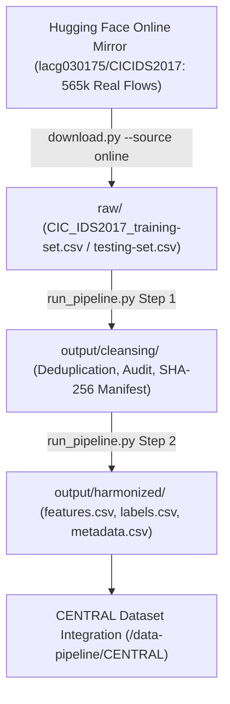

# CIC-IDS2017 Pipeline

Pipeline สำหรับดาวน์โหลด ทำความสะอาด (Cleansing) และประสานโครงสร้าง (Harmonization) ชุดข้อมูล **CIC-IDS2017 (Canadian Institute for Cybersecurity)** เพื่อเชื่อมโยงเข้าสู่ชุดข้อมูลรวมศูนย์ **CENTRAL Dataset**

---

## 1. วิธีการทำงาน (How It Works)



1. **Automated Online Mirror Ingestion**: `download.py` ดึงข้อมูลทราฟฟิกเครือข่ายจริงจาก Hugging Face Mirror (`lacg030175/CICIDS2017`) ที่บีบอัดในรูปแบบ Parquet (78 MB) มีข้อมูลจริง 565,576 โฟลว์ครบทุกหมวดการโจมตี (DoS Hulk, GoldenEye, Slowloris, PortScan, FTP/SSH-Patator, Web Attacks, Botnet ฯลฯ)
2. **Configurable Downsampling**: สุ่มตัวอย่างตามจำนวนแถวที่กำหนด (Default: 150,657 สำหรับ Train และ 20,000 สำหรับ Test) โดยแปลงหน่วยเวลา ($\mu s \to s$) และจัดสกีมาคอลัมน์ให้อยู่ในรูปแบบ Raw CSV
3. **Data Cleansing**: ตรวจสอบ Sentinel Values, ตรวจสอบ Bounds ทางกายภาพ, ทำ Deduplication แฟล็ก และบันทึก `cleansing_audit.csv`
4. **Harmonization & 3-Table Separation**: แปลงเป็น 22 ฟิลด์มาตรฐานกลาง และแยกเป็น `features.csv` ($X$), `labels.csv` ($y$), `metadata.csv`

---

## 2. วิธีใช้งาน (Usage Guide)

### คำสั่งดาวน์โหลดข้อมูลจริงแบบอัตโนมัติ (Online Mode)
```bash
# ดาวน์โหลดข้อมูลจริงตามขนาดมาตรฐาน (Train: 150,657 / Test: 20,000)
python download.py --source online --train_samples 150657 --test_samples 20000 --force

# ดาวน์โหลดขนาดเล็กสำหรับทดสอบ Pipeline ด่วน (Train: 10,000 / Test: 2,000)
python download.py --source online --train_samples 10000 --test_samples 2000 --force

# โหมดจำลองข้อมูลแบบออฟไลน์ (Offline Emulation Fallback)
python download.py --source emulate --train_samples 150657 --test_samples 20000
```

### คำสั่งรัน Cleansing และ Harmonization
```bash
python run_pipeline.py
```

---

## 3. โครงสร้างโฟลเดอร์ (Directory Structure)

* `raw/`: เก็บไฟล์ดิบ `CIC_IDS2017_training-set.csv` และ `CIC_IDS2017_testing-set.csv`
* `download.py`: สคริปต์ดาวน์โหลดข้อมูลจริงจาก Online Mirror หรือสร้างข้อมูลจำลอง
* `run_pipeline.py`: สคริปต์ประมวลผล Cleansing และ Harmonization อัตโนมัติ
* `cleansing.ipynb`: สมุดบันทึกตรวจสอบความสะอาดของข้อมูลและ Audit Report
* `eda.ipynb`: สมุดบันทึกสำรวจเชิงสถิติและการกระจายตัวของประเภทการโจมตี
* `feature_engineering.ipynb`: ตรวจสอบการคำนวณ Log-transforms และ Signed Ratio
* `harmonization.ipynb`: ตรวจสอบความถูกต้องของสกีมา 22 คอลัมน์และ Provenance
* `output/`:
  * `cleansing/`: ไฟล์ที่ผ่านการคลีนซิ่งแล้ว พร้อม `cleansing_audit.csv` และ `source_manifest.csv`
  * `harmonized/`: ตาราง `features.csv`, `labels.csv`, `metadata.csv` ที่พร้อมเชื่อมเข้าสู่ CENTRAL
