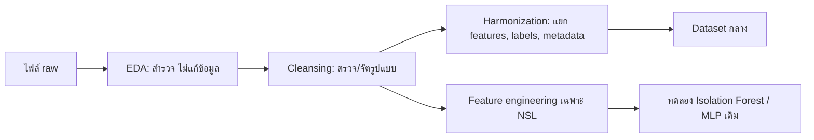

# NSL-KDD

## ลำดับงานและสิ่งที่จะได้

| ก่อน | หลัง | เกิดอะไรขึ้น |
|---|---|---|
| `src_bytes=120`, `dst_bytes=30`, `label=neptune` | ในตารางกลางเป็น `bytes_forward=120`, `bytes_backward=30`; `label` อยู่คนละตาราง | เปลี่ยนชื่อให้เข้ากับ schema กลาง โดยไม่เปลี่ยนค่าหรือใช้คำตอบเป็น feature |
| `KDDTest-21` มี record ที่อยู่ใน `KDDTest+` | เก็บเป็น evaluation view ที่อ้างถึง record เดิม | ทำให้ประเมินชุดย่อยได้โดยไม่เพิ่มแถวซ้ำเข้าชุดข้อมูล |

ค่าตัวอย่างนี้ใช้สาธิตการแปลง ไม่ใช่ค่าที่คำนวณจาก record ใดเป็นพิเศษ

แหล่งข้อมูล NSL-KDD อยู่ใน `raw/`; downloader ในโฟลเดอร์นี้เก็บ raw ไว้ข้าง notebook แล้ว รัน `eda.ipynb` → `cleansing.ipynb` → `harmonization.ipynb` เพื่อสร้างตารางกลาง ส่วน `feature_engineering.ipynb` เดิมในโฟลเดอร์นี้ยังคงเป็น pipeline เฉพาะ NSL-KDD สำหรับเทียบ Isolation Forest/MLP รุ่นเดิม

ใช้ `KDDTrain+` เป็น official Train และ `KDDTest+` เป็น official Test; ไม่ใช้ `KDDTrain+_20Percent` ซ้ำกับ Train เต็ม `KDDTest-21` ถูกตรวจด้วยเนื้อหา record แล้วเชื่อมเป็น evaluation view ภายใน Test ไม่ต่อเป็นแถวใหม่

Harmonization ใช้ cleaned row order เป็น `orig_row_id` หลังตรวจจำนวนแถว raw เท่ากับ cleaned output และยืนยันว่าไม่มีแถวถูกเอาออกโดย cleansing ปัจจุบัน; ถ้าจำนวนไม่ตรงระบบจะปฏิเสธการสร้าง ID แทนการจับคู่แบบคาดเดา
