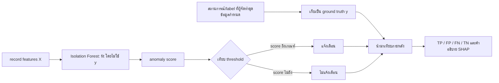

# NSL-KDD: ป้ายกำกับการโจมตีและเหตุผลที่ Isolation Forest แจ้งเตือน

เอกสารนี้อธิบายสองเรื่องที่มักสับสนกัน:

1. **เหตุใด record จึงมี `label` ว่าเป็นการโจมตี** — เป็นป้ายอ้างอิงที่มากับชุดข้อมูลจากเหตุการณ์โจมตีที่ผู้จัดทำจำลองและติดป้ายไว้
2. **เหตุใด Isolation Forest จึงแจ้งเตือน record** — โมเดลพบว่ารูปแบบของ feature แปลกเมื่อเทียบกับข้อมูลที่ใช้เรียนรู้ ไม่ได้อ่าน `label` แล้วทำนายชนิดการโจมตี

ดังนั้น SHAP อธิบายว่า feature เปลี่ยนคะแนนความผิดปกติของโมเดลอย่างไร แต่ไม่ได้พิสูจน์ว่า feature นั้นเป็นสาเหตุจริงของการโจมตี และไม่ได้ยืนยันเหตุผลทางนิติวิทยาศาสตร์ของ label เดิม

## ภาพแยก “label จริง” ออกจาก “การแจ้งเตือนของโมเดล”

### ตัวอย่างหนึ่ง record ที่เห็นเหตุและผลชัดเจน

| สิ่งที่ตรวจ | ค่าจากตัวอย่างในรายงาน | อ่านอย่างไร |
|---|---|---|
| Record/label จริง | `KDDTest#17093`, `warezmaster` | label นี้มาจาก annotation ของ dataset ไม่ได้เกิดจาก SHAP |
| คะแนน / threshold | `0.48808` / `0.44345` | คะแนนสูงกว่าเกณฑ์ `0.04463` จึงถูกแจ้งเตือนเป็น TP ตาม label อ้างอิง |
| SHAP ที่ดัน score ขึ้น | `service=ftp=1` `(+0.0344)`; `is_guest_login=1` `(+0.0304)` | ในคำอธิบายของโมเดล ฟีเจอร์เหล่านี้ผลัก anomaly score ขึ้นเมื่อเทียบกับ baseline ของ SHAP |
| เส้นทางในต้นไม้ | split สั้นสุด: `is_guest_login=1 > 0.846` | ตัวอย่างนี้ผ่านเงื่อนไขแยกเร็วในต้นไม้นี้; Isolation Forest ใช้ความสั้นของ path เป็นสัญญาณความโดดเดี่ยว |
| ข้อสรุปที่พูดได้ | “โมเดลมองรูปแบบนี้ว่าน่าสงสัยภายใต้ข้อมูล/threshold ที่ตั้งไว้” | **พูดไม่ได้** ว่า FTP หรือ guest login เป็นสาเหตุจริงของการโจมตี; เป็น contribution ต่อ score ไม่ใช่เหตุเชิงนิติวิทยาศาสตร์ |

ตัวอย่างนี้เป็นหลักฐานว่าเกิดอะไรในโมเดล ไม่ใช่หลักฐานทั่วไปว่า feature เดียวกันจะทำให้ทุก record ถูกแจ้งเตือน

## 1. ป้ายโจมตีเดิมมาจากไหน

NSL-KDD สืบเนื่องจาก KDD Cup 1999 ซึ่งสร้างข้อมูลจากเครือข่ายจำลองและใส่เหตุการณ์โจมตีหลายชนิด แต่ละแถวแทนการเชื่อมต่อหนึ่งรายการ และข้อมูลต้นฉบับกำหนดไว้ว่าเป็น `normal` หรือชื่อการโจมตีแบบเฉพาะ เช่น `neptune` หรือ `guess_passwd` [คำอธิบาย KDD Cup](https://www.kdd.org/kdd-cup/view/kdd-cup-1999/Tasks) และ [หน้า NSL-KDD ของ UNB](https://www.unb.ca/cic/datasets/nsl.html)

สิ่งที่ `label` บอกคือ **ผู้จัดทำชุดข้อมูลจัด record นี้ไว้ในเหตุการณ์/ชนิดใด** ไม่ได้บอกว่า feature ช่องใดเป็นสาเหตุโดยตรง และไม่มีคำบรรยายรายแถวว่า packet ใดหรือการกระทำใดทำให้ติดป้าย การตีความ feature ในเอกสารนี้จึงเป็นการอธิบายรูปแบบข้อมูลและการทำงานของโมเดล ไม่ใช่คำตัดสินว่า record จริงในเครือข่ายสมัยใหม่เป็นอันตรายแน่นอน

### จำนวน label ที่ตรวจจากไฟล์โปรเจกต์

| ชุดข้อมูล | แถว | label ไม่ซ้ำ | ความหมาย |
|---|---:|---:|---|
| `KDDTrain` | 125,973 | 23 | `normal` และการโจมตี 22 ชนิด |
| `KDDTest` | 22,544 | 38 | `normal` และการโจมตี 37 ชนิด |
| `KDDTest-21` | 11,850 | 38 | ชุดทดสอบย่อยของ `KDDTest`; ไม่ใช่ record เพิ่มเติมจากอีก dataset อิสระ |
| รวมชื่อ label ที่พบใน Train/Test | — | 40 | `normal` และชื่อการโจมตี 39 ชนิด; `spy` กับ `warezclient` มีใน Train แต่ไม่มีใน Test |

`KDDTest` มีการโจมตี 17 ชนิดที่ไม่อยู่ใน `KDDTrain`: `apache2`, `httptunnel`, `mailbomb`, `mscan`, `named`, `processtable`, `ps`, `saint`, `sendmail`, `snmpgetattack`, `snmpguess`, `sqlattack`, `udpstorm`, `worm`, `xlock`, `xsnoop` และ `xterm` การทดสอบจึงตรวจด้วยว่าโมเดลพบพฤติกรรมที่ไม่เคยเห็นระหว่าง fit ได้หรือไม่

## 2. การแบ่งตระกูลการโจมตี

ระดับตระกูลอธิบาย “เป้าหมายโดยกว้าง” ของการโจมตี ไม่ใช่ output ที่ Isolation Forest รุ่นนี้ทำนาย:

| ตระกูล | อธิบายแบบง่าย |
|---|---|
| **DoS** — Denial of Service | ทำให้เครื่องหรือบริการช้าลง ใช้งานไม่ได้ หรือให้ผู้ใช้ปกติเข้าถึงได้ยาก |
| **Probe** | สำรวจเครือข่าย หาเครื่อง พอร์ต หรือบริการที่เปิดอยู่ ก่อนเลือกเป้าหมาย |
| **R2L** — Remote to Local | พยายามเข้าถึงบัญชีหรือเครื่องภายในจากระยะไกลโดยไม่มีสิทธิ์ |
| **U2R** — User to Root | เริ่มจากสิทธิ์ผู้ใช้ทั่วไปแล้วพยายามยกระดับเป็นผู้ดูแลระบบ |

ตารางต่อไปนี้แสดงตระกูลที่ใช้กันในคำอธิบาย NSL-KDD และความหมายชื่อแบบย่อ การจัดกลุ่มอ้างอิง taxonomy ที่เผยแพร่สำหรับ NSL-KDD [บทความทบทวนและตาราง attack types](https://www.mdpi.com/2078-2489/12/9/375) ชื่อเป็นชื่อสถานการณ์/เทคนิคใน benchmark; รายละเอียดของ record จริงอาจสรุปจากชื่อเพียงอย่างเดียวไม่ได้

| ตระกูล | `label` | ความหมายชื่อโดยย่อ |
|---|---|---|
| DoS | `apache2` | สถานการณ์โจมตีเพื่อรบกวนบริการเว็บ Apache |
| DoS | `back` | DoS scenario ชื่อ back ในชุดข้อมูล |
| DoS | `land` | การเชื่อมต่อที่ต้นทางและปลายทางเป็น host/port เดียวกัน |
| DoS | `mailbomb` | ส่งอีเมลจำนวนมากเพื่อกดดันบริการอีเมล |
| DoS | `neptune` | การโจมตีการเชื่อมต่อ TCP แบบ SYN flood |
| DoS | `pod` | Ping of Death หรือแพ็กเก็ต ICMP ผิดปกติ/ใหญ่เกินไป |
| DoS | `processtable` | ทำให้ตาราง process หรือทรัพยากร process เต็ม |
| DoS | `smurf` | ICMP broadcast/amplification เพื่อเพิ่มปริมาณทราฟฟิกไปยังเป้าหมาย |
| DoS | `teardrop` | ใช้ IP fragments ที่ประกอบกลับผิดปกติ |
| DoS | `udpstorm` | ทราฟฟิก UDP จำนวนมากเพื่อรบกวนบริการ |
| DoS | `worm` | เหตุการณ์ที่เกี่ยวกับ worm; taxonomy ที่อ้างอิงจัดไว้ใน DoS |
| Probe | `ipsweep` | สำรวจหาเครื่องที่ตอบสนองในเครือข่าย |
| Probe | `mscan` | สแกนหลายเครื่องหรือหลายบริการเพื่อหาเป้าหมาย |
| Probe | `nmap` | สแกน host/port/service ด้วยรูปแบบที่รู้จักใน benchmark |
| Probe | `portsweep` | ไล่ตรวจพอร์ตบน host หลายเครื่อง |
| Probe | `saint` | การสแกน/สำรวจเครือข่ายตาม scenario ของชุดข้อมูล |
| Probe | `satan` | เครื่องมือสำรวจช่องโหว่และบริการเครือข่ายใน benchmark |
| R2L | `ftp_write` | พยายามเขียนไฟล์ผ่านบริการ FTP โดยไม่ได้รับอนุญาต |
| R2L | `guess_passwd` | เดาหรือคาดเดารหัสผ่านเพื่อเข้าบัญชีจากระยะไกล |
| R2L | `httptunnel` | ใช้ HTTP เป็นช่องทาง tunnel สำหรับการเข้าถึงจากระยะไกล |
| R2L | `imap` | scenario โจมตีบริการ IMAP เพื่อเข้าถึงจากระยะไกล |
| R2L | `multihop` | ใช้การเข้าถึงหลายทอดเพื่อไปยังเครื่องหรือบัญชีภายใน |
| R2L | `named` | scenario โจมตีบริการ DNS/BIND ที่ชื่อ `named` |
| R2L | `phf` | ใช้ช่องโหว่ CGI script ที่ชื่อ `phf` |
| R2L | `sendmail` | scenario โจมตีบริการอีเมล Sendmail |
| R2L | `snmpgetattack` | ใช้คำขอ SNMP ในรูปแบบโจมตี |
| R2L | `snmpguess` | คาดเดา SNMP community string เพื่อเข้าถึงข้อมูล/บริการ |
| R2L | `spy` | R2L scenario ชื่อ spy ในชุดข้อมูล |
| R2L | `warezclient` | scenario ฝั่ง client ที่เกี่ยวข้องกับการรับ/ดาวน์โหลดซอฟต์แวร์ |
| R2L | `warezmaster` | scenario ฝั่ง server ที่เกี่ยวข้องกับการให้/อัปโหลดซอฟต์แวร์ |
| R2L | `xlock` | scenario โจมตีที่เกี่ยวข้องกับ X11 lock/session |
| R2L | `xsnoop` | scenario สอดส่อง session ในระบบ X11 |
| U2R | `buffer_overflow` | ใช้ buffer overflow เพื่อพยายามยกระดับสิทธิ์ |
| U2R | `loadmodule` | โหลด module เพื่อพยายามได้สิทธิ์สูงขึ้น |
| U2R | `perl` | ใช้ scenario ที่เกี่ยวข้องกับโปรแกรม Perl เพื่อยกระดับสิทธิ์ |
| U2R | `ps` | scenario ยกระดับสิทธิ์ที่เกี่ยวข้องกับคำสั่ง/โปรแกรม `ps` |
| U2R | `rootkit` | ใช้ rootkit หรือพฤติกรรมที่เกี่ยวข้องกับสิทธิ์ root |
| U2R | `sqlattack` | SQL attack scenario ที่ถูกจัดไว้ในกลุ่มยกระดับสิทธิ์ของ benchmark |
| U2R | `xterm` | scenario ยกระดับสิทธิ์ที่เกี่ยวข้องกับ X terminal |

### `Unknown` ในโค้ดโปรเจกต์แปลว่าอะไร

ใน `cleansing.ipynb` มี family mapping ครบเฉพาะ 22 ชนิดที่ปรากฏใน `KDDTrain` ส่วน 17 ชนิดใหม่ใน `KDDTest` ยังไม่มีใน mapping จึงได้ `attack_family = Unknown` ตามการทำงานปัจจุบัน คำว่า `Unknown` **ไม่ได้แปลว่าเป็น normal หรือไม่รู้ว่าแถวนี้เป็น attack**: `label` เดิมยังอยู่ และ `is_attack` ยังคงเป็น 1 สำหรับทุก label ที่ไม่ใช่ `normal`

| ชุดทดสอบ | `Unknown` rows | ความหมาย |
|---|---:|---|
| `KDDTest` | 3,750 | แถวของ attack labels ที่ไม่มีใน family map ปัจจุบัน |
| `KDDTest-21` | 3,740 | แถวของ attack labels ที่ไม่มีใน family map ปัจจุบัน หลังเลือกเป็นชุดย่อย |

การจัดตระกูลในตารางข้างบนเป็น taxonomy สำหรับอธิบายและตรวจสอบข้อมูล ไม่ได้แก้ `attack_family` ในไฟล์ pipeline และไม่ได้ถูกส่งเข้า Isolation Forest

## 3. Isolation Forest ใช้อะไรตัดสินว่า record น่าสงสัย

### ข้อมูลที่ใช้ฝึก

โมเดลใน backup ที่นำมาอธิบายคือ `isolation-forest-iso-20261012-235646-997274` ซึ่ง fit กับ `KDDTrain` โดยไม่ส่ง `y`, `label`, `attack_family` หรือ `is_attack` เข้า `fit()`:

| รายการ | ค่าที่ใช้ |
|---|---|
| อัลกอริทึม | Isolation Forest จำนวน 300 ต้นไม้ |
| แถวที่ fit | 125,973 แถวจาก `KDDTrain` |
| feature ที่ fit | 121 คอลัมน์: numeric เดิม 37 + One-Hot 84 |
| สิ่งที่ไม่ใช้ fit | `label`, `attack_family`, `is_attack`, `difficulty` และ engineered alternatives 36 คอลัมน์ |
| random seed | 42 |
| threshold | anomaly score `0.4434531411615339` ซึ่งคำนวณจาก quantile ที่เลือกใน Train |

คะแนนในเอกสารนี้นิยามตามโค้ดโปรเจกต์เป็น `anomaly_score = -IsolationForest.score_samples(X)` ดังนั้น **คะแนนยิ่งสูง ยิ่งน่าสงสัย**; โมเดลแจ้งเตือนเมื่อ `score >= threshold` ค่า threshold นี้ไม่ได้แปลว่า attack rate เป็น 5% และไม่ใช่ระดับความมั่นใจว่า record เป็น attack

Isolation Forest สุ่มเลือก feature และจุดแบ่งในต้นไม้เพื่อแยก record; พฤติกรรมที่แยกออกได้ด้วยเส้นทางสั้นในต้นไม้หลายต้นมักได้ anomaly score สูง [คำอธิบาย Isolation Forest ของ scikit-learn](https://scikit-learn.org/stable/modules/generated/sklearn.ensemble.IsolationForest.html) การ fit ไม่ได้เรียนรู้ชื่อ attack หรือสร้าง classifier สำหรับ DoS/Probe/R2L/U2R ส่วน K-Means ที่ใช้จัดกลุ่ม alert เป็นขั้นแยกต่างหาก; cluster ID ไม่ใช่ชื่อ attack family

### Feature ที่ส่งผลกับคะแนนในตัวอย่าง

SHAP คำนวณกับฟังก์ชันคะแนนจริง `-model.score_samples(X)` โดยตรง ไม่ใช่ SHAP ของคะแนนภายในแบบอื่น ใช้ background 20 แถวสุ่มจาก KDDTrain (`random_state=42`) และ 3 permutations ต่อ record ในตัวอย่างที่เลือกทั้งหมด 88 รายการ การตรวจ `base value + ผลรวม SHAP` กลับเป็น anomaly score ได้ โดยค่าคลาดเคลื่อนสูงสุดประมาณ `2.8e-16`

| Feature ที่มีค่าเฉลี่ย absolute SHAP สูงในตัวอย่าง | ค่าเฉลี่ย |SHAP| | อ่านอย่างไร |
|---|---:|---|
| `service=telnet` | 0.008570 | One-Hot บอกว่า service เป็น Telnet |
| `dst_host_diff_srv_rate` | 0.004956 | อัตราความหลากหลายของ service ที่ปลายทาง host เดียวกัน |
| `service=private` | 0.003895 | One-Hot บอกว่า service อยู่ในหมวด private |
| `protocol_type=tcp` | 0.003638 | One-Hot บอกว่า protocol เป็น TCP |
| `dst_host_rerror_rate` | 0.003627 | อัตรา reject/error ของ connection ที่ destination host |
| `dst_host_same_src_port_rate` | 0.003313 | อัตราการใช้ source port เดิมกับ destination host |
| `srv_rerror_rate` | 0.003279 | อัตรา reject/error ในกลุ่ม service เดียวกัน |
| `service=ftp_data` | 0.003263 | One-Hot บอกว่า service เป็น ftp_data |
| `dst_host_srv_rerror_rate` | 0.003157 | อัตรา reject/error ของ host และ service เดียวกัน |
| `dst_host_serror_rate` | 0.002872 | อัตรา SYN error ของ connection ที่ destination host |
ค่าเฉลี่ยข้างบนคำนวณจาก 88 ตัวอย่างที่เลือกให้ครอบคลุมทุก label และทุกกลุ่มผลประเมิน จึงไม่ใช่ feature importance แบบถ่วงตามสัดส่วนจริงทั้ง dataset และไม่ได้บอกทิศทางตายตัว `SHAP +` ในตารางราย record หมายถึง feature นั้นดันคะแนนของ record นั้นให้สูงขึ้นเมื่อเทียบกับ background; `SHAP -` หมายถึงดึงคะแนนลง ค่าความสัมพันธ์ระหว่าง feature, การสุ่ม background และ One-Hot columns ทำให้ SHAP เป็นคำอธิบายของโมเดลภายใต้สมมติฐานการ mask ไม่ใช่เหตุและผลหรือหลักฐานว่าเป็นต้นเหตุจริง

ทดสอบ `TreeExplainer` แล้วพบว่าอธิบายค่าที่เกี่ยวกับ path length ของต้นไม้ ไม่ได้รวมกลับเป็น anomaly score ที่โปรเจกต์ใช้โดยตรง จึงใช้ `PermutationExplainer` กับ callable ที่คืน `-score_samples` แทน [เอกสาร SHAP PermutationExplainer](https://shap.readthedocs.io/en/stable/generated/shap.PermutationExplainer.html)

### ผลประเมินจาก backup เดียวกัน

Label ถูกนำมาเทียบ **หลัง scoring** เพื่อคำนวณผลประเมินเท่านั้น ตารางนี้ยังแสดงว่า anomaly flag ไม่ได้เท่ากับ “โมเดลรู้ชนิด attack”

| ชุดทดสอบ | rows | TP | FP | FN | TN | Precision | Recall | F1 | ROC-AUC |
|---|---:|---:|---:|---:|---:|---:|---:|---:|
| `KDDTest` | 22,544 | 2,152 | 70 | 10,681 | 9,641 | 96.85% | 16.77% | 0.2859 | 0.8796 |
| `KDDTest-21` | 11,850 | 2,141 | 69 | 7,557 | 2,083 | 96.88% | 22.08% | 0.3596 | 0.6450 |

ที่ threshold นี้โมเดลมี precision สูง แต่ recall ต่ำ: ใน `KDDTest` มี attack ที่ไม่ถูกแจ้งเตือน 10,681 แถว จึงไม่ควรสรุปว่า “ไม่แจ้งเตือน = ปลอดภัย” หรือ “แจ้งเตือน = โจมตีแน่นอน”

## 4. ตัวอย่างราย record: feature ส่งผลต่อคะแนนอย่างไร

เลือก **2 records ต่อ label** โดยหยิบคะแนน anomaly ต่ำสุดและสูงสุดจากชุด Test เพื่อให้เห็นตัวอย่างที่คะแนนต่างกัน; ถ้ามีใน Test ไม่ถึง 2 แถวจึงเติมจาก Train และระบุ split ไว้ในรหัสแถว ส่วน TP, FP, FN และ TN เลือกอย่างละ 2 records จาก Test โดยไม่ซ้ำกับตัวอย่างราย label

### วิธีอ่านคำอธิบายของแต่ละ record

- คอลัมน์ SHAP แสดง feature พร้อมค่าจริงของ record และ contribution ต่อ **anomaly score**: ค่าเป็นบวกดันคะแนนขึ้น ส่วนค่าลบดึงคะแนนลง เมื่อเทียบกับ background ที่ใช้คำนวณ SHAP ตัวเลขนี้เป็นคะแนน ไม่ใช่เปอร์เซ็นต์ความมั่นใจ และไม่ได้แปลว่า feature นั้นเป็นต้นเหตุของ attack
- แสดงเฉพาะ 2 feature ที่ดันคะแนนขึ้นมากที่สุดและ 2 feature ที่ดึงคะแนนลงมากที่สุด ผลรวม SHAP ของทุก feature รวมกับ base value จึงจะเท่าคะแนน anomaly score
- คอลัมน์สุดท้ายบอกว่าคะแนนอยู่เหนือหรือต่ำกว่า threshold `0.44345` เท่าไร จึงช่วยอธิบายว่าทำไมโมเดลแจ้งเตือนหรือไม่แจ้งเตือน; `TP/FP/FN/TN` เป็นผลที่คำนวณภายหลังจากนำผลแจ้งเตือนไปเทียบ label จริง
- Path แสดงเงื่อนไข 2 ขั้นแรกจากต้นไม้ต้นหนึ่งที่แยก record นี้ได้เร็วที่สุด ส่วนค่าเฉลี่ยเป็นจำนวน split โดยเฉลี่ยจาก 300 ต้นไม้ ไม่ใช่กฎเดียวที่ทุกต้นใช้
- `service=...`, `protocol_type=...` และ `flag=...` เป็นคอลัมน์ One-Hot: ค่า 1 หมายถึง record อยู่ในหมวดนั้น ค่า 0 หมายถึงไม่ใช่หมวดนั้น; `dst_host_...` เป็นสถิติที่สรุปตามปลายทาง และ `*_rate` เป็นอัตราส่วนของเหตุการณ์ในกลุ่มข้อมูล ไม่ใช่ความน่าจะเป็นว่าเป็น attack
- ความหมายของคอลัมน์อื่น เช่น bytes, login, root activity และ error rates ดูได้ที่ [คู่มือคอลัมน์ NSL-KDD](dataset_guide.md) และ [คำอธิบาย Feature Engineering](feature_engineering.md)

**ตัวอย่างอ่านผล:** `KDDTest#02880` มี label จริง `ipsweep`; `service=ecr_i=1` เพิ่มคะแนน `+0.0214` และ `protocol_type=icmp=1` เพิ่ม `+0.0211` แต่คะแนนสุดท้าย `0.39002` ยังต่ำกว่า threshold `0.44345` อยู่ `0.05344` จึงไม่ถูกแจ้งเตือน (FN) นี่คือเหตุผลของคะแนนโมเดล ไม่ใช่การบอกว่า ICMP เป็นสาเหตุของการโจมตี ส่วน `KDDTest#09658` มี label `normal`; `dst_host_diff_srv_rate=0.67` เพิ่ม `+0.0222` และ `protocol_type=icmp=1` เพิ่ม `+0.0221` คะแนน `0.47683` จึงสูงกว่า threshold `0.44345` อยู่ `0.03338` และเกิด FP — anomaly ไม่ได้แปลว่าเป็น attack แน่นอน

### คำช่วยแปลชื่อ feature ในตัวอย่าง

| รูปแบบ/ชื่อ | ความหมายแบบง่าย |
|---|---|
| `service=...` | บริการปลายทาง เช่น HTTP, FTP หรือ Telnet; เป็นตัวบอกหมวด ไม่ใช่ชื่อการโจมตี |
| `protocol_type=...` | โปรโตคอลที่ใช้ เช่น TCP, UDP หรือ ICMP |
| `flag=...` | สถานะ/ผลของการเชื่อมต่อ เช่น สำเร็จ ถูกปฏิเสธ หรือ reset |
| `duration` | ระยะเวลาของการเชื่อมต่อ |
| `src_bytes`, `dst_bytes` | จำนวน bytes จากต้นทางไปปลายทาง และ bytes ตอบกลับจากปลายทาง |
| `count`, `srv_count` | จำนวน connection ในกลุ่ม host เดียวกัน หรือ service เดียวกัน |
| `serror_rate`, `rerror_rate` | อัตรา SYN error และ reject/error ในกลุ่ม connection |
| ชื่อที่มี `srv_` | สถิติที่จำกัดมองเฉพาะ service เดียวกัน |
| ชื่อที่ขึ้นต้น `dst_host_` | สถิติที่มองกลุ่ม connection ของ destination host; ถ้ามี `_srv_` จะเจาะจง host และ service |
| `logged_in`, `is_guest_login` | ระบุว่า login สำเร็จหรือใช้ guest account หรือไม่ |
| `root_shell`, `num_root`, `num_compromised` | ตัวบ่งชี้/จำนวนกิจกรรมที่เกี่ยวกับสิทธิ์ root หรือการถูก compromise |
| `num_access_files`, `num_file_creations`, `num_failed_logins` | จำนวนการเข้าถึงไฟล์ การสร้างไฟล์ และการ login ล้มเหลว |
| `wrong_fragment` | จำนวน packet fragment ที่ผิดรูปแบบ |

ชื่อ feature เป็นค่าหลังแปลงข้อมูลที่โมเดลใช้จริง ไม่ใช่ชื่อการโจมตี; คู่มือคอลัมน์ที่ลิงก์ไว้มีนิยามครบทุกช่อง

### Normal — การเชื่อมต่อปกติ

| Label จริง | Record | คะแนน / ผล | ตัวดันคะแนนขึ้น (SHAP +) | ตัวดึงคะแนนลง (SHAP -) | เส้นทาง split ของต้นไม้ที่สั้น | เทียบ threshold |
|---|---|---|---|---|---|---|
| `normal` | `KDDTest#08765` | 0.33100 / TN | `service=http=1` (+0.0068) `dst_host_srv_count=255` (+0.0032) | `service=private=0` (-0.0033) `serror_rate=0` (-0.0031) | เฉลี่ย 8.00; เส้นทางสั้นสุด 8: is_guest_login=0<=0.846 -> srv_count=6<=153 | score ต่ำกว่า threshold 0.44345 อยู่ 0.11245 จึงไม่แจ้งเตือน |
| `normal` | `KDDTest#09658` | 0.47683 / FP | `dst_host_diff_srv_rate=0.67` (+0.0222) `protocol_type=icmp=1` (+0.0221) | `service=private=0` (-0.0030) `service=http=0` (-0.0023) | เฉลี่ย 7.10; เส้นทางสั้นสุด 2: wrong_fragment=1>0.406 -> service=ecr_i=1>0.594 | score สูงกว่า threshold 0.44345 อยู่ 0.03338 จึงแจ้งเตือน |
### DoS — การรบกวนบริการ

| Label จริง | Record | คะแนน / ผล | ตัวดันคะแนนขึ้น (SHAP +) | ตัวดึงคะแนนลง (SHAP -) | เส้นทาง split ของต้นไม้ที่สั้น | เทียบ threshold |
|---|---|---|---|---|---|---|
| `apache2` | `KDDTest#22087` | 0.34106 / FN | `service=http=1` (+0.0083) `dst_host_srv_count=227` (+0.0044) | `service=private=0` (-0.0032) `dst_host_serror_rate=0` (-0.0029) | เฉลี่ย 7.96; เส้นทางสั้นสุด 5: service=http=1>0.146 -> serror_rate=0<=0.819 | score ต่ำกว่า threshold 0.44345 อยู่ 0.10240 จึงไม่แจ้งเตือน |
| `apache2` | `KDDTest#14987` | 0.48513 / TP | `flag=rstr=1` (+0.0228) `src_bytes=5.57e+04` (+0.0153) | `service=private=0` (-0.0026) `service=ftp_data=0` (-0.0018) | เฉลี่ย 6.96; เส้นทางสั้นสุด 2: srv_serror_rate=0.38>0.375 -> srv_rerror_rate=0.59>0.313 | score สูงกว่า threshold 0.44345 อยู่ 0.04167 จึงแจ้งเตือน |
| `back` | `KDDTest#12152` | 0.36136 / FN | `src_bytes=5.45e+04` (+0.0164) `service=http=1` (+0.0061) | `service=private=0` (-0.0032) `dst_host_serror_rate=0` (-0.0030) | เฉลี่ย 7.85; เส้นทางสั้นสุด 4: flag=sf=1>0.25 -> src_bytes=5.45e+04>4.13e+04 | score ต่ำกว่า threshold 0.44345 อยู่ 0.08209 จึงไม่แจ้งเตือน |
| `back` | `KDDTest#05360` | 0.46733 / TP | `flag=rstr=1` (+0.0249) `src_bytes=5.45e+04` (+0.0159) | `dst_host_serror_rate=0` (-0.0026) `service=private=0` (-0.0026) | เฉลี่ย 7.06; เส้นทางสั้นสุด 2: dst_host_diff_srv_rate=0.01<=0.011 -> flag=rstr=1>0.554 | score สูงกว่า threshold 0.44345 อยู่ 0.02387 จึงแจ้งเตือน |
| `land` | `KDDTest#04892` | 0.40477 / FN | `service=finger=1` (+0.0245) `srv_diff_host_rate=1` (+0.0169) | `service=http=0` (-0.0034) `dst_host_same_src_port_rate=0` (-0.0026) | เฉลี่ย 7.48; เส้นทางสั้นสุด 2: service=finger=1>0.756 -> diff_srv_rate=0<=0.0757 | score ต่ำกว่า threshold 0.44345 อยู่ 0.03868 จึงไม่แจ้งเตือน |
| `land` | `KDDTest#20722` | 0.47771 / TP | `dst_host_srv_diff_host_rate=1` (+0.0264) `service=finger=1` (+0.0221) | `service=http=0` (-0.0033) `service=private=0` (-0.0023) | เฉลี่ย 6.96; เส้นทางสั้นสุด 2: srv_serror_rate=1>0.845 -> dst_host_srv_diff_host_rate=1>0.00527 | score สูงกว่า threshold 0.44345 อยู่ 0.03426 จึงแจ้งเตือน |
| `mailbomb` | `KDDTest#01213` | 0.35516 / FN | `service=smtp=1` (+0.0142) `dst_host_srv_count=247` (+0.0056) | `service=private=0` (-0.0032) `dst_host_srv_rerror_rate=0` (-0.0028) | เฉลี่ย 7.90; เส้นทางสั้นสุด 3: dst_host_same_srv_rate=0.97>0.898 -> service=smtp=1>0.0394 | score ต่ำกว่า threshold 0.44345 อยู่ 0.08829 จึงไม่แจ้งเตือน |
| `mailbomb` | `KDDTest#00531` | 0.40222 / FN | `dst_host_rerror_rate=0.88` (+0.0155) `diff_srv_rate=0.67` (+0.0146) | `service=private=0` (-0.0028) `srv_rerror_rate=0` (-0.0020) | เฉลี่ย 7.69; เส้นทางสั้นสุด 2: diff_srv_rate=0.67>0.636 -> src_bytes=2.6e+03>219 | score ต่ำกว่า threshold 0.44345 อยู่ 0.04123 จึงไม่แจ้งเตือน |
| `neptune` | `KDDTest#07294` | 0.34248 / FN | `serror_rate=1` (+0.0054) `dst_host_serror_rate=1` (+0.0054) | `dst_host_same_srv_rate=0.08` (-0.0042) `service=http=0` (-0.0041) | เฉลี่ย 7.97; เส้นทางสั้นสุด 2: service=http_443=0<=0.409 -> service=remote_job=1>0.275 | score ต่ำกว่า threshold 0.44345 อยู่ 0.10097 จึงไม่แจ้งเตือน |
| `neptune` | `KDDTest#02255` | 0.44724 / TP | `service=ftp=1` (+0.0350) `flag=rsto=1` (+0.0245) | `service=http=0` (-0.0023) `dst_host_same_srv_rate=0.07` (-0.0022) | เฉลี่ย 7.28; เส้นทางสั้นสุด 1: service=ftp=1>0.883 | score สูงกว่า threshold 0.44345 อยู่ 0.00378 จึงแจ้งเตือน |
| `pod` | `KDDTest#18992` | 0.36693 / FN | `protocol_type=icmp=1` (+0.0209) `protocol_type=tcp=0` (+0.0109) | `service=private=0` (-0.0032) `dst_host_serror_rate=0` (-0.0024) | เฉลี่ย 7.85; เส้นทางสั้นสุด 4: protocol_type=icmp=1>0.687 -> dst_host_same_srv_rate=0<=0.446 | score ต่ำกว่า threshold 0.44345 อยู่ 0.07652 จึงไม่แจ้งเตือน |
| `pod` | `KDDTest#21942` | 0.48753 / TP | `dst_host_diff_srv_rate=1` (+0.0305) `service=ecr_i=1` (+0.0211) | `service=private=0` (-0.0026) `dst_host_srv_rerror_rate=0` (-0.0022) | เฉลี่ย 6.98; เส้นทางสั้นสุด 2: wrong_fragment=1>0.406 -> service=ecr_i=1>0.594 | score สูงกว่า threshold 0.44345 อยู่ 0.04407 จึงแจ้งเตือน |
| `processtable` | `KDDTest#00112` | 0.38351 / FN | `service=telnet=1` (+0.0259) `duration=8.08e+03` (+0.0125) | `service=private=0` (-0.0028) `service=http=0` (-0.0024) | เฉลี่ย 7.62; เส้นทางสั้นสุด 2: dst_host_diff_srv_rate=0.03<=0.454 -> duration=8.08e+03>5.94e+03 | score ต่ำกว่า threshold 0.44345 อยู่ 0.05995 จึงไม่แจ้งเตือน |
| `processtable` | `KDDTest#19031` | 0.46582 / TP | `flag=rstr=1` (+0.0228) `service=telnet=1` (+0.0224) | `service=http=0` (-0.0025) `service=private=0` (-0.0022) | เฉลี่ย 7.15; เส้นทางสั้นสุด 2: flag=rstr=1>0.787 -> dst_host_diff_srv_rate=0.49>0.438 | score สูงกว่า threshold 0.44345 อยู่ 0.02237 จึงแจ้งเตือน |
| `smurf` | `KDDTest#16596` | 0.39996 / FN | `protocol_type=icmp=1` (+0.0210) `service=ecr_i=1` (+0.0210) | `service=private=0` (-0.0032) `dst_host_serror_rate=0` (-0.0028) | เฉลี่ย 7.73; เส้นทางสั้นสุด 2: service=ecr_i=1>0.439 -> count=6<=191 | score ต่ำกว่า threshold 0.44345 อยู่ 0.04349 จึงไม่แจ้งเตือน |
| `smurf` | `KDDTest#18925` | 0.47629 / TP | `srv_count=511` (+0.0326) `service=ecr_i=1` (+0.0203) | `service=private=0` (-0.0025) `dst_host_serror_rate=0` (-0.0024) | เฉลี่ย 7.24; เส้นทางสั้นสุด 1: srv_count=511>389 | score สูงกว่า threshold 0.44345 อยู่ 0.03284 จึงแจ้งเตือน |
| `teardrop` | `KDDTest#17280` | 0.38160 / FN | `service=private=1` (+0.0144) `protocol_type=tcp=0` (+0.0111) | `dst_host_srv_rerror_rate=0` (-0.0024) `service=http=0` (-0.0021) | เฉลี่ย 7.81; เส้นทางสั้นสุด 2: wrong_fragment=1>0.406 -> service=ecr_i=0<=0.594 | score ต่ำกว่า threshold 0.44345 อยู่ 0.06186 จึงไม่แจ้งเตือน |
| `teardrop` | `KDDTest#09813` | 0.41511 / FN | `wrong_fragment=3` (+0.0232) `service=private=1` (+0.0137) | `dst_host_srv_rerror_rate=0` (-0.0022) `service=http=0` (-0.0021) | เฉลี่ย 7.53; เส้นทางสั้นสุด 2: wrong_fragment=3>0.406 -> service=ecr_i=0<=0.594 | score ต่ำกว่า threshold 0.44345 อยู่ 0.02834 จึงไม่แจ้งเตือน |
| `udpstorm` | `KDDTest#20043` | 0.38843 / FN | `service=private=1` (+0.0136) `protocol_type=tcp=0` (+0.0127) | `service=http=0` (-0.0025) `dst_host_srv_rerror_rate=0` (-0.0025) | เฉลี่ย 7.79; เส้นทางสั้นสุด 2: protocol_type=tcp=0<=0.337 -> dst_host_serror_rate=0.77>0.0164 | score ต่ำกว่า threshold 0.44345 อยู่ 0.05503 จึงไม่แจ้งเตือน |
| `udpstorm` | `KDDTest#08700` | 0.39652 / FN | `dst_host_diff_srv_rate=0.5` (+0.0167) `service=private=1` (+0.0146) | `dst_host_serror_rate=0` (-0.0025) `service=http=0` (-0.0022) | เฉลี่ย 7.83; เส้นทางสั้นสุด 4: srv_serror_rate=0<=0.845 -> dst_host_diff_srv_rate=0.5<=0.586 | score ต่ำกว่า threshold 0.44345 อยู่ 0.04693 จึงไม่แจ้งเตือน |
| `worm` | `KDDTest#03111` | 0.37391 / FN | `service=telnet=1` (+0.0266) `dst_bytes=7.92e+03` (+0.0050) | `service=private=0` (-0.0029) `serror_rate=0` (-0.0022) | เฉลี่ย 7.70; เส้นทางสั้นสุด 2: dst_host_srv_rerror_rate=0<=0.223 -> service=telnet=1>0.292 | score ต่ำกว่า threshold 0.44345 อยู่ 0.06954 จึงไม่แจ้งเตือน |
| `worm` | `KDDTest#17625` | 0.37731 / FN | `service=telnet=1` (+0.0267) `dst_bytes=7.87e+03` (+0.0051) | `service=private=0` (-0.0028) `dst_host_srv_rerror_rate=0` (-0.0023) | เฉลี่ย 7.69; เส้นทางสั้นสุด 2: dst_host_srv_rerror_rate=0<=0.223 -> service=telnet=1>0.292 | score ต่ำกว่า threshold 0.44345 อยู่ 0.06614 จึงไม่แจ้งเตือน |
### Probe — การสำรวจเครือข่าย

| Label จริง | Record | คะแนน / ผล | ตัวดันคะแนนขึ้น (SHAP +) | ตัวดึงคะแนนลง (SHAP -) | เส้นทาง split ของต้นไม้ที่สั้น | เทียบ threshold |
|---|---|---|---|---|---|---|
| `ipsweep` | `KDDTest#02880` | 0.39002 / FN | `service=ecr_i=1` (+0.0214) `protocol_type=icmp=1` (+0.0211) | `service=private=0` (-0.0028) `dst_host_srv_rerror_rate=0` (-0.0023) | เฉลี่ย 7.67; เส้นทางสั้นสุด 2: service=ecr_i=1>0.439 -> count=2<=191 | score ต่ำกว่า threshold 0.44345 อยู่ 0.05344 จึงไม่แจ้งเตือน |
| `ipsweep` | `KDDTest#15525` | 0.43118 / FN | `dst_host_srv_diff_host_rate=1` (+0.0266) `protocol_type=icmp=1` (+0.0190) | `dst_host_serror_rate=0` (-0.0032) `service=private=0` (-0.0031) | เฉลี่ย 7.49; เส้นทางสั้นสุด 3: service=daytime=0<=0.1 -> protocol_type=icmp=1>0.493 | score ต่ำกว่า threshold 0.44345 อยู่ 0.01227 จึงไม่แจ้งเตือน |
| `mscan` | `KDDTest#04415` | 0.36067 / FN | `service=pop_3=1` (+0.0093) `dst_host_srv_rerror_rate=0.22` (+0.0054) | `service=private=0` (-0.0030) `service=http=0` (-0.0022) | เฉลี่ย 7.80; เส้นทางสั้นสุด 1: service=pop_3=1>0.402 | score ต่ำกว่า threshold 0.44345 อยู่ 0.08279 จึงไม่แจ้งเตือน |
| `mscan` | `KDDTest#16011` | 0.49169 / TP | `flag=rsto=1` (+0.0236) `dst_host_diff_srv_rate=0.8` (+0.0194) | `service=private=0` (-0.0025) `service=http=0` (-0.0024) | เฉลี่ย 6.99; เส้นทางสั้นสุด 1: service=pop_3=1>0.402 | score สูงกว่า threshold 0.44345 อยู่ 0.04824 จึงแจ้งเตือน |
| `nmap` | `KDDTest#03056` | 0.44359 / TP | `dst_host_diff_srv_rate=1` (+0.0287) `dst_host_same_src_port_rate=1` (+0.0163) | `service=http=0` (-0.0038) `dst_host_srv_count=1` (-0.0020) | เฉลี่ย 7.28; เส้นทางสั้นสุด 2: service=z39_50=0<=0.193 -> flag=sh=1>0.0458 | score สูงกว่า threshold 0.44345 อยู่ 0.00014 จึงแจ้งเตือน |
| `nmap` | `KDDTest#16859` | 0.46959 / TP | `dst_host_diff_srv_rate=1` (+0.0280) `dst_host_srv_diff_host_rate=0.67` (+0.0184) | `service=http=0` (-0.0038) `service=private=0` (-0.0023) | เฉลี่ย 6.91; เส้นทางสั้นสุด 1: service=domain=1>0.241 | score สูงกว่า threshold 0.44345 อยู่ 0.02613 จึงแจ้งเตือน |
| `portsweep` | `KDDTest#16575` | 0.37254 / FN | `dst_host_rerror_rate=0.9` (+0.0144) `service=private=1` (+0.0125) | `service=http=0` (-0.0027) `service=domain_u=0` (-0.0019) | เฉลี่ย 7.88; เส้นทางสั้นสุด 1: flag=oth=1>0.732 | score ต่ำกว่า threshold 0.44345 อยู่ 0.07091 จึงไม่แจ้งเตือน |
| `portsweep` | `KDDTest#22095` | 0.49309 / TP | `service=telnet=1` (+0.0238) `flag=rsto=1` (+0.0234) | `service=http=0` (-0.0031) `dst_host_same_srv_rate=0.02` (-0.0024) | เฉลี่ย 6.99; เส้นทางสั้นสุด 2: service=ldap=0<=0.995 -> flag=rsto=1>0.382 | score สูงกว่า threshold 0.44345 อยู่ 0.04964 จึงแจ้งเตือน |
| `saint` | `KDDTest#08533` | 0.36896 / FN | `service=other=1` (+0.0196) `protocol_type=tcp=0` (+0.0096) | `service=private=0` (-0.0031) `dst_host_srv_rerror_rate=0` (-0.0026) | เฉลี่ย 7.89; เส้นทางสั้นสุด 4: service=netbios_ns=0<=0.601 -> service=other=1>0.301 | score ต่ำกว่า threshold 0.44345 อยู่ 0.07449 จึงไม่แจ้งเตือน |
| `saint` | `KDDTest#13212` | 0.47511 / TP | `dst_host_diff_srv_rate=1` (+0.0264) `protocol_type=icmp=1` (+0.0216) | `service=http=0` (-0.0026) `dst_host_same_srv_rate=0` (-0.0024) | เฉลี่ย 7.09; เส้นทางสั้นสุด 2: protocol_type=tcp=0<=0.337 -> dst_host_serror_rate=0.05>0.0164 | score สูงกว่า threshold 0.44345 อยู่ 0.03166 จึงแจ้งเตือน |
| `satan` | `KDDTest#13737` | 0.38543 / FN | `diff_srv_rate=1` (+0.0194) `dst_host_rerror_rate=0.75` (+0.0133) | `service=private=0` (-0.0026) `service=http=0` (-0.0025) | เฉลี่ย 7.71; เส้นทางสั้นสุด 1: service=nntp=1>0.917 | score ต่ำกว่า threshold 0.44345 อยู่ 0.05803 จึงไม่แจ้งเตือน |
| `satan` | `KDDTest#13340` | 0.46901 / TP | `dst_host_diff_srv_rate=0.94` (+0.0229) `service=other=1` (+0.0203) | `dst_host_same_srv_rate=0` (-0.0038) `service=http=0` (-0.0025) | เฉลี่ย 7.34; เส้นทางสั้นสุด 2: srv_serror_rate=0<=0.153 -> serror_rate=0.16>0.131 | score สูงกว่า threshold 0.44345 อยู่ 0.02556 จึงแจ้งเตือน |
### R2L — การเข้าจากระยะไกล

| Label จริง | Record | คะแนน / ผล | ตัวดันคะแนนขึ้น (SHAP +) | ตัวดึงคะแนนลง (SHAP -) | เส้นทาง split ของต้นไม้ที่สั้น | เทียบ threshold |
|---|---|---|---|---|---|---|
| `ftp_write` | `KDDTest#11685` | 0.35553 / FN | `service=ftp_data=1` (+0.0183) `dst_host_count=100` (+0.0037) | `service=private=0` (-0.0028) `dst_host_srv_rerror_rate=0` (-0.0024) | เฉลี่ย 7.90; เส้นทางสั้นสุด 4: service=ftp_data=1>0.644 -> dst_host_count=100>76.8 | score ต่ำกว่า threshold 0.44345 อยู่ 0.08793 จึงไม่แจ้งเตือน |
| `ftp_write` | `KDDTest#06421` | 0.43852 / FN | `service=ftp=1` (+0.0353) `is_guest_login=1` (+0.0321) | `service=private=0` (-0.0028) `dst_host_srv_rerror_rate=0` (-0.0024) | เฉลี่ย 6.99; เส้นทางสั้นสุด 1: is_guest_login=1>0.846 | score ต่ำกว่า threshold 0.44345 อยู่ 0.00493 จึงไม่แจ้งเตือน |
| `guess_passwd` | `KDDTest#17880` | 0.34411 / FN | `service=pop_3=1` (+0.0094) `logged_in=1` (+0.0034) | `service=private=0` (-0.0029) `dst_host_srv_rerror_rate=0` (-0.0026) | เฉลี่ย 7.87; เส้นทางสั้นสุด 1: service=pop_3=1>0.402 | score ต่ำกว่า threshold 0.44345 อยู่ 0.09934 จึงไม่แจ้งเตือน |
| `guess_passwd` | `KDDTest#13830` | 0.44739 / TP | `flag=rsto=1` (+0.0248) `service=telnet=1` (+0.0243) | `service=private=0` (-0.0025) `service=http=0` (-0.0019) | เฉลี่ย 7.24; เส้นทางสั้นสุด 2: service=auth=0<=0.165 -> num_failed_logins=1>0.501 | score สูงกว่า threshold 0.44345 อยู่ 0.00394 จึงแจ้งเตือน |
| `httptunnel` | `KDDTest#10638` | 0.35892 / FN | `service=ftp_data=1` (+0.0176) `dst_host_same_src_port_rate=0.54` (+0.0070) | `service=private=0` (-0.0029) `dst_host_srv_rerror_rate=0` (-0.0025) | เฉลี่ย 7.92; เส้นทางสั้นสุด 3: service=ftp_data=1>0.644 -> dst_host_count=131>76.8 | score ต่ำกว่า threshold 0.44345 อยู่ 0.08453 จึงไม่แจ้งเตือน |
| `httptunnel` | `KDDTest#16961` | 0.46065 / TP | `service=telnet=1` (+0.0286) `num_compromised=9` (+0.0188) | `service=private=0` (-0.0029) `service=http=0` (-0.0021) | เฉลี่ย 6.94; เส้นทางสั้นสุด 1: num_root=7>3.87 | score สูงกว่า threshold 0.44345 อยู่ 0.01720 จึงแจ้งเตือน |
| `imap` | `KDDTest#07132` | 0.42584 / FN | `flag=rsto=1` (+0.0248) `service=imap4=1` (+0.0191) | `service=private=0` (-0.0026) `service=http=0` (-0.0025) | เฉลี่ย 7.36; เส้นทางสั้นสุด 1: service=imap4=1>0.947 | score ต่ำกว่า threshold 0.44345 อยู่ 0.01761 จึงไม่แจ้งเตือน |
| `imap` | `KDDTrain#17672` | 0.38402 / Train (ไม่แจ้งเตือน) | `service=imap4=1` (+0.0181) `dst_host_count=5` (+0.0091) | `service=private=0` (-0.0027) `dst_host_srv_rerror_rate=0` (-0.0024) | เฉลี่ย 7.60; เส้นทางสั้นสุด 1: service=imap4=1>0.947 | ข้อมูล Train แบบ in-sample; ไม่แจ้งเตือน |
| `multihop` | `KDDTest#13302` | 0.35817 / FN | `service=ftp_data=1` (+0.0175) `src_bytes=1.62e+04` (+0.0070) | `service=private=0` (-0.0029) `dst_host_srv_rerror_rate=0` (-0.0025) | เฉลี่ย 7.86; เส้นทางสั้นสุด 2: src_bytes=1.62e+04>5.48e+03 -> dst_host_same_srv_rate=0<=0.202 | score ต่ำกว่า threshold 0.44345 อยู่ 0.08528 จึงไม่แจ้งเตือน |
| `multihop` | `KDDTest#11765` | 0.52466 / TP | `dst_host_srv_diff_host_rate=1` (+0.0260) `service=telnet=1` (+0.0248) | `service=private=0` (-0.0025) `service=http=0` (-0.0024) | เฉลี่ย 6.39; เส้นทางสั้นสุด 1: num_root=26>3.87 | score สูงกว่า threshold 0.44345 อยู่ 0.08121 จึงแจ้งเตือน |
| `named` | `KDDTest#17555` | 0.35543 / FN | `service=domain=1` (+0.0166) `duration=707` (+0.0056) | `service=private=0` (-0.0030) `service=http=0` (-0.0026) | เฉลี่ย 7.83; เส้นทางสั้นสุด 1: service=domain=1>0.241 | score ต่ำกว่า threshold 0.44345 อยู่ 0.08803 จึงไม่แจ้งเตือน |
| `named` | `KDDTest#20895` | 0.45051 / TP | `flag=rsto=1` (+0.0234) `service=domain=1` (+0.0153) | `service=private=0` (-0.0028) `dst_host_serror_rate=0` (-0.0025) | เฉลี่ย 7.31; เส้นทางสั้นสุด 1: service=domain=1>0.241 | score สูงกว่า threshold 0.44345 อยู่ 0.00706 จึงแจ้งเตือน |
| `phf` | `KDDTest#18230` | 0.37812 / FN | `num_access_files=1` (+0.0128) `service=http=1` (+0.0091) | `service=private=0` (-0.0033) `serror_rate=0` (-0.0028) | เฉลี่ย 7.63; เส้นทางสั้นสุด 1: root_shell=1>0.306 | score ต่ำกว่า threshold 0.44345 อยู่ 0.06534 จึงไม่แจ้งเตือน |
| `phf` | `KDDTest#13059` | 0.39713 / FN | `srv_rerror_rate=1` (+0.0126) `rerror_rate=1` (+0.0110) | `service=private=0` (-0.0029) `dst_host_serror_rate=0` (-0.0027) | เฉลี่ย 7.79; เส้นทางสั้นสุด 3: rerror_rate=1>0.116 -> dst_host_rerror_rate=0.06<=0.641 | score ต่ำกว่า threshold 0.44345 อยู่ 0.04633 จึงไม่แจ้งเตือน |
| `sendmail` | `KDDTest#04833` | 0.36680 / FN | `service=auth=1` (+0.0266) `dst_host_count=50` (+0.0059) | `service=private=0` (-0.0028) `dst_host_srv_rerror_rate=0` (-0.0025) | เฉลี่ย 7.72; เส้นทางสั้นสุด 1: service=auth=1>0.914 | score ต่ำกว่า threshold 0.44345 อยู่ 0.07666 จึงไม่แจ้งเตือน |
| `sendmail` | `KDDTest#06834` | 0.40171 / FN | `service=telnet=1` (+0.0262) `dst_host_srv_rerror_rate=0.43` (+0.0080) | `service=private=0` (-0.0028) `service=ftp_data=0` (-0.0020) | เฉลี่ย 7.43; เส้นทางสั้นสุด 1: root_shell=1>0.306 | score ต่ำกว่า threshold 0.44345 อยู่ 0.04174 จึงไม่แจ้งเตือน |
| `snmpgetattack` | `KDDTest#18761` | 0.37389 / FN | `service=private=1` (+0.0149) `protocol_type=tcp=0` (+0.0112) | `dst_host_serror_rate=0` (-0.0028) `dst_host_srv_rerror_rate=0` (-0.0025) | เฉลี่ย 7.91; เส้นทางสั้นสุด 4: service=http_443=0<=0.303 -> service=supdup=0<=0.944 | score ต่ำกว่า threshold 0.44345 อยู่ 0.06957 จึงไม่แจ้งเตือน |
| `snmpgetattack` | `KDDTest#05430` | 0.41432 / FN | `service=other=1` (+0.0190) `dst_host_diff_srv_rate=0.6` (+0.0184) | `service=private=0` (-0.0032) `service=http=0` (-0.0028) | เฉลี่ย 7.73; เส้นทางสั้นสุด 4: srv_serror_rate=0<=0.845 -> dst_host_diff_srv_rate=0.6>0.586 | score ต่ำกว่า threshold 0.44345 อยู่ 0.02914 จึงไม่แจ้งเตือน |
| `snmpguess` | `KDDTest#10440` | 0.37317 / FN | `service=private=1` (+0.0149) `protocol_type=tcp=0` (+0.0101) | `dst_host_srv_rerror_rate=0` (-0.0026) `dst_host_serror_rate=0` (-0.0026) | เฉลี่ย 7.90; เส้นทางสั้นสุด 4: service=imap4=0<=0.91 -> service=private=1>0.481 | score ต่ำกว่า threshold 0.44345 อยู่ 0.07029 จึงไม่แจ้งเตือน |
| `snmpguess` | `KDDTest#03073` | 0.41592 / FN | `protocol_type=icmp=1` (+0.0199) `service=urp_i=1` (+0.0192) | `service=private=0` (-0.0033) `dst_host_serror_rate=0` (-0.0029) | เฉลี่ย 7.58; เส้นทางสั้นสุด 1: service=urp_i=1>0.369 | score ต่ำกว่า threshold 0.44345 อยู่ 0.02753 จึงไม่แจ้งเตือน |
| `spy` | `KDDTrain#21445` | 0.37704 / Train (ไม่แจ้งเตือน) | `service=telnet=1` (+0.0264) `dst_host_srv_serror_rate=0.31` (+0.0059) | `service=http=0` (-0.0027) `service=private=0` (-0.0027) | เฉลี่ย 7.66; เส้นทางสั้นสุด 2: dst_host_srv_rerror_rate=0<=0.223 -> service=telnet=1>0.292 | ข้อมูล Train แบบ in-sample; ไม่แจ้งเตือน |
| `spy` | `KDDTrain#64331` | 0.40498 / Train (ไม่แจ้งเตือน) | `service=telnet=1` (+0.0254) `num_access_files=1` (+0.0111) | `service=private=0` (-0.0027) `service=http=0` (-0.0027) | เฉลี่ย 7.37; เส้นทางสั้นสุด 1: num_file_creations=1>0.226 | ข้อมูล Train แบบ in-sample; ไม่แจ้งเตือน |
| `warezclient` | `KDDTrain#38158` | 0.35173 / Train (ไม่แจ้งเตือน) | `service=ftp_data=1` (+0.0170) `logged_in=1` (+0.0032) | `service=private=0` (-0.0029) `dst_host_srv_rerror_rate=0` (-0.0025) | เฉลี่ย 7.94; เส้นทางสั้นสุด 4: service=ftp_data=1>0.196 -> logged_in=1>0.667 | ข้อมูล Train แบบ in-sample; ไม่แจ้งเตือน |
| `warezclient` | `KDDTrain#36827` | 0.49276 / Train (แจ้งเตือน) | `service=ftp=1` (+0.0343) `is_guest_login=1` (+0.0287) | `service=private=0` (-0.0025) `service=http=0` (-0.0020) | เฉลี่ย 6.65; เส้นทางสั้นสุด 1: is_guest_login=1>0.846 | ข้อมูล Train แบบ in-sample; แจ้งเตือน |
| `warezmaster` | `KDDTest#21993` | 0.35102 / FN | `service=ftp_data=1` (+0.0175) `dst_host_same_src_port_rate=0.14` (+0.0013) | `service=private=0` (-0.0028) `dst_host_srv_rerror_rate=0` (-0.0026) | เฉลี่ย 7.92; เส้นทางสั้นสุด 4: service=ftp_data=1>0.569 -> dst_host_srv_count=35<=36.7 | score ต่ำกว่า threshold 0.44345 อยู่ 0.09243 จึงไม่แจ้งเตือน |
| `warezmaster` | `KDDTest#18123` | 0.49256 / TP | `service=ftp=1` (+0.0321) `is_guest_login=1` (+0.0291) | `service=http=0` (-0.0027) `service=private=0` (-0.0026) | เฉลี่ย 6.63; เส้นทางสั้นสุด 1: is_guest_login=1>0.846 | score สูงกว่า threshold 0.44345 อยู่ 0.04911 จึงแจ้งเตือน |
| `xlock` | `KDDTest#04028` | 0.36503 / FN | `src_bytes=5.61e+04` (+0.0149) `dst_bytes=1.76e+04` (+0.0077) | `service=private=0` (-0.0031) `dst_host_srv_rerror_rate=0` (-0.0025) | เฉลี่ย 7.77; เส้นทางสั้นสุด 1: service=x11=1>0.788 | score ต่ำกว่า threshold 0.44345 อยู่ 0.07842 จึงไม่แจ้งเตือน |
| `xlock` | `KDDTest#07502` | 0.43784 / FN | `service=telnet=1` (+0.0280) `dst_bytes=1.52e+05` (+0.0178) | `service=private=0` (-0.0028) `service=http=0` (-0.0023) | เฉลี่ย 7.10; เส้นทางสั้นสุด 1: num_root=8>3.87 | score ต่ำกว่า threshold 0.44345 อยู่ 0.00562 จึงไม่แจ้งเตือน |
| `xsnoop` | `KDDTest#21278` | 0.35124 / FN | `dst_bytes=1.8e+04` (+0.0079) `duration=469` (+0.0056) | `service=private=0` (-0.0031) `service=http=0` (-0.0025) | เฉลี่ย 7.89; เส้นทางสั้นสุด 1: service=x11=1>0.788 | score ต่ำกว่า threshold 0.44345 อยู่ 0.09222 จึงไม่แจ้งเตือน |
| `xsnoop` | `KDDTest#20894` | 0.41537 / FN | `service=telnet=1` (+0.0271) `num_access_files=1` (+0.0117) | `service=private=0` (-0.0028) `dst_host_srv_rerror_rate=0` (-0.0022) | เฉลี่ย 7.22; เส้นทางสั้นสุด 1: num_root=5>3.87 | score ต่ำกว่า threshold 0.44345 อยู่ 0.02808 จึงไม่แจ้งเตือน |
### U2R — การยกระดับสิทธิ์

| Label จริง | Record | คะแนน / ผล | ตัวดันคะแนนขึ้น (SHAP +) | ตัวดึงคะแนนลง (SHAP -) | เส้นทาง split ของต้นไม้ที่สั้น | เทียบ threshold |
|---|---|---|---|---|---|---|
| `buffer_overflow` | `KDDTest#02424` | 0.37281 / FN | `service=telnet=1` (+0.0261) `num_file_creations=1` (+0.0067) | `service=private=0` (-0.0029) `dst_host_srv_rerror_rate=0` (-0.0022) | เฉลี่ย 7.66; เส้นทางสั้นสุด 1: num_file_creations=1>0.226 | score ต่ำกว่า threshold 0.44345 อยู่ 0.07064 จึงไม่แจ้งเตือน |
| `buffer_overflow` | `KDDTest#00967` | 0.47676 / TP | `service=telnet=1` (+0.0245) `dst_host_diff_srv_rate=0.84` (+0.0211) | `service=private=0` (-0.0027) `service=http=0` (-0.0021) | เฉลี่ย 6.85; เส้นทางสั้นสุด 1: num_root=4>3.87 | score สูงกว่า threshold 0.44345 อยู่ 0.03331 จึงแจ้งเตือน |
| `loadmodule` | `KDDTest#02036` | 0.43444 / FN | `service=telnet=1` (+0.0245) `dst_host_rerror_rate=0.86` (+0.0147) | `service=private=0` (-0.0027) `service=http=0` (-0.0024) | เฉลี่ย 7.18; เส้นทางสั้นสุด 1: root_shell=1>0.306 | score ต่ำกว่า threshold 0.44345 อยู่ 0.00902 จึงไม่แจ้งเตือน |
| `loadmodule` | `KDDTest#04500` | 0.43920 / FN | `service=telnet=1` (+0.0251) `num_compromised=1` (+0.0122) | `service=private=0` (-0.0030) `service=http=0` (-0.0021) | เฉลี่ย 7.15; เส้นทางสั้นสุด 1: root_shell=1>0.306 | score ต่ำกว่า threshold 0.44345 อยู่ 0.00426 จึงไม่แจ้งเตือน |
| `perl` | `KDDTest#22085` | 0.40824 / FN | `service=telnet=1` (+0.0254) `dst_host_srv_rerror_rate=0.62` (+0.0100) | `service=private=0` (-0.0029) `service=ftp_data=0` (-0.0019) | เฉลี่ย 7.37; เส้นทางสั้นสุด 1: root_shell=1>0.306 | score ต่ำกว่า threshold 0.44345 อยู่ 0.03522 จึงไม่แจ้งเตือน |
| `perl` | `KDDTest#04167` | 0.42124 / FN | `dst_host_srv_diff_host_rate=1` (+0.0274) `service=telnet=1` (+0.0249) | `service=private=0` (-0.0028) `serror_rate=0` (-0.0024) | เฉลี่ย 7.31; เส้นทางสั้นสุด 1: num_file_creations=2>0.226 | score ต่ำกว่า threshold 0.44345 อยู่ 0.02221 จึงไม่แจ้งเตือน |
| `ps` | `KDDTest#04293` | 0.35825 / FN | `service=ftp_data=1` (+0.0173) `dst_host_srv_diff_host_rate=0.1` (+0.0043) | `service=private=0` (-0.0028) `dst_host_srv_rerror_rate=0` (-0.0025) | เฉลี่ย 7.86; เส้นทางสั้นสุด 3: num_compromised=0<=1.98 -> service=ftp_data=1>0.106 | score ต่ำกว่า threshold 0.44345 อยู่ 0.08520 จึงไม่แจ้งเตือน |
| `ps` | `KDDTest#04352` | 0.47195 / TP | `service=telnet=1` (+0.0263) `num_compromised=8` (+0.0174) | `service=private=0` (-0.0029) `service=http=0` (-0.0026) | เฉลี่ย 6.84; เส้นทางสั้นสุด 1: num_root=7>3.87 | score สูงกว่า threshold 0.44345 อยู่ 0.02849 จึงแจ้งเตือน |
| `rootkit` | `KDDTest#09128` | 0.35508 / FN | `service=ftp_data=1` (+0.0173) `dst_host_serror_rate=0.2` (+0.0030) | `service=private=0` (-0.0029) `dst_host_srv_rerror_rate=0` (-0.0026) | เฉลี่ย 7.91; เส้นทางสั้นสุด 5: service=pop_3=0<=0.00635 -> service=ftp_data=1>0.858 | score ต่ำกว่า threshold 0.44345 อยู่ 0.08838 จึงไม่แจ้งเตือน |
| `rootkit` | `KDDTest#20734` | 0.47590 / TP | `service=telnet=1` (+0.0259) `num_compromised=57` (+0.0185) | `service=private=0` (-0.0028) `service=http=0` (-0.0023) | เฉลี่ย 6.82; เส้นทางสั้นสุด 1: num_root=51>3.87 | score สูงกว่า threshold 0.44345 อยู่ 0.03245 จึงแจ้งเตือน |
| `sqlattack` | `KDDTest#08125` | 0.41508 / FN | `service=telnet=1` (+0.0274) `num_access_files=1` (+0.0115) | `service=private=0` (-0.0028) `dst_host_srv_rerror_rate=0` (-0.0024) | เฉลี่ย 7.23; เส้นทางสั้นสุด 1: num_root=4>3.87 | score ต่ำกว่า threshold 0.44345 อยู่ 0.02837 จึงไม่แจ้งเตือน |
| `sqlattack` | `KDDTest#05478` | 0.41830 / FN | `service=telnet=1` (+0.0270) `num_access_files=1` (+0.0116) | `service=private=0` (-0.0028) `serror_rate=0` (-0.0022) | เฉลี่ย 7.24; เส้นทางสั้นสุด 1: num_root=4>3.87 | score ต่ำกว่า threshold 0.44345 อยู่ 0.02516 จึงไม่แจ้งเตือน |
| `xterm` | `KDDTest#11573` | 0.37956 / FN | `service=ftp_data=1` (+0.0177) `dst_host_diff_srv_rate=0.5` (+0.0163) | `service=private=0` (-0.0030) `dst_host_serror_rate=0` (-0.0025) | เฉลี่ย 7.79; เส้นทางสั้นสุด 3: service=ftp_data=1>0.994 -> dst_host_count=4<=46.9 | score ต่ำกว่า threshold 0.44345 อยู่ 0.06389 จึงไม่แจ้งเตือน |
| `xterm` | `KDDTest#03621` | 0.48850 / TP | `dst_host_srv_diff_host_rate=1` (+0.0273) `service=telnet=1` (+0.0245) | `service=private=0` (-0.0030) `serror_rate=0` (-0.0028) | เฉลี่ย 6.75; เส้นทางสั้นสุด 1: num_root=17>3.87 | score สูงกว่า threshold 0.44345 อยู่ 0.04504 จึงแจ้งเตือน |

## 5. ตัวอย่างผลประเมินรายกรณี

ตัวอย่างต่อไปนี้มี 2 records ต่อกลุ่ม และไม่ซ้ำกับตารางราย label: **TP** = attack ที่ถูกแจ้งเตือน, **FP** = normal ที่ถูกแจ้งเตือน, **FN** = attack ที่ไม่ถูกแจ้งเตือน และ **TN** = normal ที่ไม่ถูกแจ้งเตือน Label ถูกใช้เพื่อประเมินผลหลัง scoring เท่านั้น; Isolation Forest ไม่ได้ฝึกเพื่อทำนาย label หรือประเภท attack

### TP — แจ้งเตือน record ที่เป็น attack

| Record | Label จริง | คะแนน / ผล | ตัวดันคะแนนขึ้น (SHAP +) | ตัวดึงคะแนนลง (SHAP -) | เส้นทาง split ของต้นไม้ที่สั้น | เทียบ threshold |
|---|---|---|---|---|---|---|
| `KDDTest#12170` | `mscan` | 0.44346 / TP | `flag=rsto=1` (+0.0245) `service=telnet=1` (+0.0229) | `service=private=0` (-0.0026) `service=http=0` (-0.0022) | เฉลี่ย 7.31; เส้นทางสั้นสุด 2: service=ldap=0<=0.995 -> flag=rsto=1>0.382 | score สูงกว่า threshold 0.44345 อยู่ 0.00001 จึงแจ้งเตือน |
| `KDDTest#17093` | `warezmaster` | 0.48808 / TP | `service=ftp=1` (+0.0344) `is_guest_login=1` (+0.0304) | `service=private=0` (-0.0026) `service=http=0` (-0.0025) | เฉลี่ย 6.78; เส้นทางสั้นสุด 1: is_guest_login=1>0.846 | score สูงกว่า threshold 0.44345 อยู่ 0.04463 จึงแจ้งเตือน |
### FP — แจ้งเตือน record ที่เป็น normal

| Record | Label จริง | คะแนน / ผล | ตัวดันคะแนนขึ้น (SHAP +) | ตัวดึงคะแนนลง (SHAP -) | เส้นทาง split ของต้นไม้ที่สั้น | เทียบ threshold |
|---|---|---|---|---|---|---|
| `KDDTest#05667` | `normal` | 0.44355 / FP | `dst_host_diff_srv_rate=0.88` (+0.0248) `diff_srv_rate=0.88` (+0.0196) | `service=http=0` (-0.0030) `srv_rerror_rate=0` (-0.0018) | เฉลี่ย 7.46; เส้นทางสั้นสุด 3: diff_srv_rate=0.88>0.275 -> dst_host_same_src_port_rate=1>0.882 | score สูงกว่า threshold 0.44345 อยู่ 0.00010 จึงแจ้งเตือน |
| `KDDTest#13293` | `normal` | 0.47566 / FP | `service=telnet=1` (+0.0265) `num_compromised=796` (+0.0196) | `service=private=0` (-0.0027) `service=http=0` (-0.0020) | เฉลี่ย 6.76; เส้นทางสั้นสุด 1: num_root=878>3.87 | score สูงกว่า threshold 0.44345 อยู่ 0.03220 จึงแจ้งเตือน |
### FN — ไม่แจ้งเตือน record ที่เป็น attack

| Record | Label จริง | คะแนน / ผล | ตัวดันคะแนนขึ้น (SHAP +) | ตัวดึงคะแนนลง (SHAP -) | เส้นทาง split ของต้นไม้ที่สั้น | เทียบ threshold |
|---|---|---|---|---|---|---|
| `KDDTest#22084` | `guess_passwd` | 0.34419 / FN | `service=pop_3=1` (+0.0094) `logged_in=1` (+0.0036) | `service=private=0` (-0.0029) `dst_host_srv_rerror_rate=0` (-0.0025) | เฉลี่ย 7.87; เส้นทางสั้นสุด 1: service=pop_3=1>0.402 | score ต่ำกว่า threshold 0.44345 อยู่ 0.09926 จึงไม่แจ้งเตือน |
| `KDDTest#01491` | `smurf` | 0.44345 / FN | `srv_count=511` (+0.0325) `service=ecr_i=1` (+0.0204) | `service=private=0` (-0.0024) `dst_host_srv_rerror_rate=0` (-0.0024) | เฉลี่ย 7.40; เส้นทางสั้นสุด 1: srv_count=511>389 | score ต่ำกว่า threshold 0.44345 อยู่ 0.00000 จึงไม่แจ้งเตือน |
### TN — ไม่แจ้งเตือน record ที่เป็น normal

| Record | Label จริง | คะแนน / ผล | ตัวดันคะแนนขึ้น (SHAP +) | ตัวดึงคะแนนลง (SHAP -) | เส้นทาง split ของต้นไม้ที่สั้น | เทียบ threshold |
|---|---|---|---|---|---|---|
| `KDDTest#17879` | `normal` | 0.33100 / TN | `service=http=1` (+0.0064) `dst_host_srv_count=255` (+0.0032) | `service=private=0` (-0.0032) `serror_rate=0` (-0.0032) | เฉลี่ย 8.00; เส้นทางสั้นสุด 8: is_guest_login=0<=0.846 -> srv_count=6<=153 | score ต่ำกว่า threshold 0.44345 อยู่ 0.11245 จึงไม่แจ้งเตือน |
| `KDDTest#10446` | `normal` | 0.44324 / TN | `flag=rstr=1` (+0.0257) `service=other=1` (+0.0213) | `service=private=0` (-0.0023) `service=http=0` (-0.0021) | เฉลี่ย 7.50; เส้นทางสั้นสุด 2: flag=rstr=1>0.787 -> dst_host_diff_srv_rate=0.33<=0.438 | score ต่ำกว่า threshold 0.44345 อยู่ 0.00021 จึงไม่แจ้งเตือน |

ผลตรวจ additivity ของ SHAP สำหรับตัวอย่างทั้ง 88 records: ค่าคลาดเคลื่อนสูงสุด = `2.776e-16` (น้อยกว่า 1e-12)
