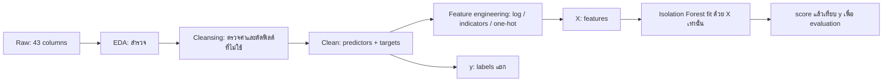

# คู่มือคอลัมน์และการเปลี่ยนแปลงข้อมูล NSL-KDD

เอกสารนี้อธิบายข้อมูลในโปรเจกต์ตั้งแต่ไฟล์ดิบจนถึงไฟล์สำหรับนำไปทดลองกับโมเดล ครอบคลุมความหมายของทุกคอลัมน์ดิบ การทำความสะอาด การสร้างคุณลักษณะ (feature engineering) การแยกคำตอบ (`y`) ออกจากข้อมูลนำเข้า (`X`) และความหมายของคอลัมน์ที่เกิดจาก One-Hot Encoding

> คำอธิบายฟิลด์ต้นฉบับอ้างอิงเอกสาร KDD Cup และเอกสารวิชาการที่แจกแจง schema ของ NSL-KDD ส่วนจำนวนคอลัมน์และกติกาการแปลงอ้างอิง notebook และ output ที่อยู่ใน repository นี้โดยตรง

## ดูภาพการเปลี่ยนจาก raw เป็นข้อมูลสำหรับโมเดล



ตัวอย่างหนึ่งแถวแบบสาธิต (ไม่ได้อ้างว่าเป็น record จริง):

| ขั้น | ค่าตัวอย่าง | เหตุและผล |
|---|---|---|
| Raw | `duration=2`, `protocol_type=TCP`, `src_bytes=120`, `dst_bytes=30`, `label=neptune`, `difficulty=21` | มีทั้งพฤติกรรม เฉลย และข้อมูลประกอบในแถวเดียว |
| Cleansing | protocol ถูก normalize เป็น `tcp`; `difficulty` ถูกตัด; เพิ่ม `attack_family=DoS`, `is_attack=1` ใน target | ทำรูปแบบข้อมูลให้สม่ำเสมอและแยกคำตอบออกจาก input |
| Feature engineering | `log1p_src_bytes=ln(121)≈4.796`; `protocol_type_tcp=1` | ลดช่วงค่าสูงและแปลงข้อความเป็นตัวเลขที่โมเดลรับได้ |
| ตอน fit | Isolation Forest เห็นค่าพฤติกรรมใน `X`; ไม่เห็น `neptune` หรือ `is_attack` | จึงเรียนรูปแบบโดยไม่รู้ label; label ใช้เทียบคะแนนหลังทำนายเท่านั้น |

ไฟล์ `features` และ `targets` ต้องคงแถวเรียงตรงกัน ถ้าจัดเรียง/กรองเพียงไฟล์เดียว คำตอบอาจไปจับคู่ผิด record ได้

## อ่านภาพรวมก่อน

หนึ่งแถวในชุดข้อมูลแทนบันทึกการเชื่อมต่อเครือข่าย (connection record) ไม่ใช่หนึ่งแพ็กเก็ต แต่ละแถวมีข้อมูลลักษณะการเชื่อมต่อ สถิติการใช้งาน และคำตอบอ้างอิงว่าเป็นการใช้งานปกติหรือการโจมตี

| ช่วงข้อมูล | มีอะไรอยู่ | จำนวนคอลัมน์/แถวใน output ปัจจุบัน |
|---|---|---:|
| Raw | 41 ตัวแปรของ connection + `label` + `difficulty` | 43 คอลัมน์ |
| หลัง cleansing | 40 ตัวแปรที่คงไว้ + `label` + target เพิ่ม 2 ตัว | 43 คอลัมน์ |
| Feature matrix เต็ม | numeric เดิม 37 + สร้างเพิ่ม 36 + One-Hot 84 | 157 คอลัมน์ใน `*_features.csv` |
| Target matrix | `label`, `attack_family`, `is_attack` | 3 คอลัมน์ใน `*_targets.csv` แยกจาก features |
| Isolation Forest baseline | numeric เดิม 37 + One-Hot 84 | **121 features**; ยังไม่ใช้ engineered เพิ่ม 36 ตัว |

การที่ไฟล์ cleaned มี 43 คอลัมน์ไม่ได้แปลว่ามี input 43 ตัว: มันมี input 40 ตัว (37 numeric + 3 categorical), `label` เดิม 1 ตัว และ target ที่เพิ่ม 2 ตัว รวมเป็น 43 คอลัมน์ ส่วนขั้น feature engineering แปลง categorical 3 ตัวเป็น 84 คอลัมน์ตัวเลข ทำให้ได้ 157 features และเก็บ target 3 ตัวไว้อีกไฟล์

## ชุดข้อมูลและไฟล์ที่ pipeline สร้าง

### ชุดข้อมูล

| Split | ไฟล์ raw | จำนวนแถวที่ตรวจพบ |
|---|---|---:|
| Train | `KDDTrain+.txt` | 125,973 |
| Test | `KDDTest+.txt` | 22,544 |
| Test-21 | `KDDTest-21.txt` | 11,850 |

`KDDTrain` ใช้ fit โมเดลและเรียนรู้ vocabulary ของหมวดหมู่ ส่วน `KDDTest` และ `KDDTest-21` ใช้ทดสอบหลังการฝึก ชุดทดสอบมี attack บางชื่อที่ไม่มีใน Train จึงช่วยตรวจว่าโมเดลรับมือกับรูปแบบที่ไม่เคยเห็นได้หรือไม่ [ข้อมูลอธิบายโจทย์ KDD Cup](https://kdd.org/kdd-cup/view/kdd-cup-1999/Tasks)

### ไฟล์ในแต่ละขั้น

| ที่อยู่/ไฟล์ | เนื้อหา | ใช้ทำอะไร |
|---|---|---|
| `data-pipeline/NSL-KDD/raw/*.txt` | ข้อมูลดิบ ไม่มี header; notebook กำหนดชื่อคอลัมน์ 43 ช่องให้ตามลำดับ | ต้นทางของ pipeline; ไม่ควรแก้ด้วยมือ |
| `data-pipeline/NSL-KDD/output/cleansing/*_clean.csv` | ข้อมูลหลัง normalize, ตรวจสอบ, ตัดคอลัมน์ที่กำหนด และเพิ่ม targets | input ให้ feature engineering เฉพาะ NSL |
| `cleaning_report.csv` | จำนวนแถว/คอลัมน์ที่ตรวจหรือถูกลบในแต่ละขั้น | ตรวจย้อนกลับคุณภาพ cleansing |
| `cleaned_schema.csv` | ชื่อคอลัมน์และชนิดข้อมูลหลัง cleansing | ตรวจ schema และ dtype |
| `cleaning_config.json` | กติกาที่ notebook ใช้ เช่น คอลัมน์ที่ลบ/เพิ่ม | ตรวจสอบการตั้งค่าและทำซ้ำ |
| `feature_engineering/*_features.csv` | ตัวเลขเดิม, engineered features และ One-Hot columns รวม 157 คอลัมน์ | `X` หรือข้อมูลนำเข้าให้โมเดลที่ใช้ full feature set |
| `feature_engineering/*_targets.csv` | `label`, `attack_family`, `is_attack` | `y` สำหรับ supervised learning หรือใช้อ้างอิงประเมินผลภายหลัง |
| `feature_schema.csv` | ชื่อ feature, กลุ่ม (`original_numeric`, `engineered`, `one_hot`) และคำอธิบาย | ตรวจชนิด/ลำดับ features; สำหรับสูตร engineered ให้ยึดตารางในเอกสารนี้และ notebook เพราะคำอธิบาย fallback ของบางชื่อในไฟล์ปัจจุบันระบุเป็น One-Hot ไม่ตรงกับชนิดจริง |
| `feature_engineering_config.json` | รายการคอลัมน์และนโยบายการแปลง | ตรวจสอบการสร้าง feature |
| `feature_validation_report.csv` | row count, missing/infinite, schema match | ยืนยันว่า X และ y จับคู่กันและพร้อมส่งต่อ |
| `unknown_category_report.csv` | หมวดหมู่ใน Test ที่ไม่เคยพบใน Train | ตรวจผลกระทบจาก vocabulary ที่ไม่รู้จัก |

ไฟล์ใน `output/` เป็นผลที่สร้างซ้ำได้จาก raw data กับ notebook จึงถูกละเว้นจาก Git ตาม `.gitignore`

## คอลัมน์ดิบทั้ง 43 ช่อง

ข้อมูลต้นฉบับมีตัวแปรอธิบาย connection 41 ตัว ตามด้วย `label` และ `difficulty` รวม 43 ช่อง ตารางด้านล่างบอกความหมายและบทบาทใน pipeline ของโปรเจกต์นี้

### A. ลักษณะพื้นฐานของ connection (ช่อง 1–9)

| # | คอลัมน์ | ชนิดก่อนแปลง | ความหมายแบบเข้าใจง่าย | บทบาท/สัญญาณที่อาจมีต่อโมเดล |
|---:|---|---|---|---|
| 1 | `duration` | ตัวเลข | ระยะเวลาของการเชื่อมต่อ หน่วยวินาที | เวลาสั้น/ยาวผิดจากรูปแบบปกติอาจช่วยแยกพฤติกรรมได้; คงเป็น numeric และมี `log1p_duration` เพิ่ม |
| 2 | `protocol_type` | หมวดหมู่ | ชนิดโปรโตคอล เช่น TCP, UDP หรือ ICMP | บอกวิธีสื่อสาร; แปลงเป็น 3 One-Hot columns แทนการป้อนข้อความให้โมเดล |
| 3 | `service` | หมวดหมู่ | บริการปลายทาง เช่น HTTP, FTP, Telnet | รูปแบบบริการที่ผิดจากปกติอาจเป็นสัญญาณ; แปลงเป็น 70 One-Hot columns |
| 4 | `flag` | หมวดหมู่ | สถานะ/ผลการเชื่อมต่อ เช่น `SF`, `S0`, `REJ` | สถานะสำเร็จหรือผิดพลาดอาจช่วยบอกลักษณะ traffic; แปลงเป็น 11 One-Hot columns |
| 5 | `src_bytes` | ตัวเลข | จำนวน bytes จากต้นทางไปปลายทาง | ปริมาณข้อมูลทิศทางขาออก; คงค่าเดิมและสร้าง `log1p_src_bytes` |
| 6 | `dst_bytes` | ตัวเลข | จำนวน bytes จากปลายทางกลับมาต้นทาง | ปริมาณข้อมูลตอบกลับ; คงค่าเดิมและสร้าง log/ผลต่าง/ยอดรวม |
| 7 | `land` | 0/1 | เป็น 1 เมื่อ source และ destination เป็น host/port เดียวกัน; นอกนั้นเป็น 0 | สถานะที่พบไม่บ่อยอาจมีประโยชน์; คงค่าเดิมและสร้าง `has_land` |
| 8 | `wrong_fragment` | จำนวน | จำนวน fragment ของ packet ที่ผิดรูปแบบ | ค่ามากกว่า 0 อาจเป็นสัญญาณผิดปกติ; คงค่าและสร้าง `has_wrong_fragment` |
| 9 | `urgent` | จำนวน | จำนวน packet ที่ตั้ง urgent bit | เหตุการณ์ที่พบไม่บ่อย; คงค่าและสร้าง `has_urgent` |

### B. เนื้อหาและกิจกรรมบัญชี/ระบบ (ช่อง 10–22)

| # | คอลัมน์ | ชนิดก่อนแปลง | ความหมายแบบเข้าใจง่าย | บทบาท/สัญญาณที่อาจมีต่อโมเดล |
|---:|---|---|---|---|
| 10 | `hot` | จำนวน | จำนวนตัวบ่งชี้กิจกรรมที่จัดว่า “hot” ใน connection | อาจสะท้อนกิจกรรมเนื้อหาที่น่าสงสัย; คงค่าและสร้าง log กับ indicator |
| 11 | `num_failed_logins` | จำนวน | จำนวนครั้งที่ login ไม่สำเร็จ | การลองรหัสผ่านซ้ำอาจเป็นสัญญาณโจมตี; คงค่าและสร้าง log กับ `has_num_failed_logins` |
| 12 | `logged_in` | 0/1 | 1 ถ้า login สำเร็จ, 0 ถ้าไม่สำเร็จ | บอกสถานะการ login; คงเป็นตัวเลขเดิม |
| 13 | `num_compromised` | จำนวน | จำนวนเงื่อนไข/กิจกรรมที่บ่งชี้ว่าถูก compromise | ค่าสูงหรือไม่เป็นศูนย์อาจเป็นสัญญาณ; คงค่าและสร้าง log กับ indicator |
| 14 | `root_shell` | 0/1 | 1 ถ้าได้ root shell, 0 ถ้าไม่ได้ | การได้สิทธิ์สูงอาจสำคัญต่อ U2R; คงค่าและสร้าง `has_root_shell` และตัวรวม root activity |
| 15 | `su_attempted` | 0/1 หรือสถานะจำนวนเต็มตามไฟล์ | ระบุว่ามีการพยายามใช้คำสั่ง `su root` หรือไม่ | อาจบ่งชี้การยกระดับสิทธิ์; คงค่าและสร้าง `has_su_attempted` กับตัวรวม root activity |
| 16 | `num_root` | จำนวน | จำนวนการเข้าถึง/กิจกรรมในฐานะ root | ค่ามากกว่า 0 อาจชี้การใช้สิทธิ์สูง; คงค่าและสร้าง log/indicator |
| 17 | `num_file_creations` | จำนวน | จำนวนการสร้างไฟล์ | การสร้างไฟล์ผิดปกติอาจมีความหมาย; คงค่าและสร้าง log/indicator กับตัวรวม file/shell |
| 18 | `num_shells` | จำนวน | จำนวน shell prompts ที่พบ | shell ที่เกิดในบริบทผิดปกติเป็นเบาะแส; คงค่าและสร้าง `has_num_shells` กับตัวรวม file/shell |
| 19 | `num_access_files` | จำนวน | จำนวนการทำงานกับ access-control files | การแตะไฟล์ควบคุมสิทธิ์อาจเป็นพฤติกรรมสำคัญ; คงค่าและสร้าง log/indicator กับตัวรวม file/shell |
| 20 | `num_outbound_cmds` | จำนวน | จำนวนคำสั่ง outbound ใน FTP session | ตั้งใจเป็นสถิติเนื้อหา แต่ข้อมูลที่ใช้รอบนี้มีค่า 0 ทุกแถว จึงไม่มีความสามารถแยก record และถูกลบใน cleansing |
| 21 | `is_host_login` | 0/1 | flag เกี่ยวกับชนิด login; เอกสารบางแหล่งเรียกแนวคิดนี้ว่า `is_hot_login` (login ที่อยู่ใน hot list) | เก็บชื่อตาม schema ของไฟล์ในโปรเจกต์และคงเป็น numeric; อย่าตีความจากคำว่า host เพียงอย่างเดียว |
| 22 | `is_guest_login` | 0/1 | 1 ถ้าเป็น guest login, 0 ถ้าไม่ใช่ | บอกชนิดบัญชี/การ login; คงเป็น numeric |

### C. สถิติ traffic ตาม host/service (ช่อง 23–41)

คอลัมน์กลุ่มนี้ไม่ได้บอกแค่แถวปัจจุบัน แต่สรุป connection รอบข้างเพื่อเห็นพฤติกรรมซ้ำ เช่น การเชื่อมต่อถี่ การเปลี่ยน service หรือ error ซ้ำ ๆ เอกสารต้นฉบับอธิบายแนวคิดของหน้าต่างเวลาและกลุ่ม same-host/same-service ไว้; NSL-KDD ใช้แนวคิด connection window กับ record ของ host ไม่ควรเข้าใจว่าเป็น feature ที่โมเดลคำนวณจากข้อมูลจริงแบบ real-time เอง

| # | คอลัมน์ | ชนิดก่อนแปลง | ความหมายแบบเข้าใจง่าย | บทบาท/สัญญาณที่อาจมีต่อโมเดล |
|---:|---|---|---|---|
| 23 | `count` | จำนวน | จำนวน connection ในกลุ่มที่มี destination host เดียวกัน | ค่าสูงอาจบ่งชี้การเชื่อมต่อถี่; คงค่าและสร้าง `log1p_count` |
| 24 | `srv_count` | จำนวน | จำนวน connection ที่ใช้ service เดียวกับแถวนี้ในกลุ่มสถิติ | ช่วยมองการใช้บริการซ้ำ; คงค่าและสร้าง `log1p_srv_count` |
| 25 | `serror_rate` | 0–1 | สัดส่วน connection ที่มี SYN error ในกลุ่ม same-host | ค่าใกล้ 1 หมายถึงพบ SYN error มากในกลุ่มนั้น; คงค่าเดิม |
| 26 | `srv_serror_rate` | 0–1 | สัดส่วน SYN error ในกลุ่ม same-service | ใช้ดูว่า error เกิดซ้ำกับ service เดียวหรือไม่ |
| 27 | `rerror_rate` | 0–1 | สัดส่วน connection ที่มี REJ/reject error ในกลุ่ม same-host | เป็นสัญญาณสถานะปฏิเสธที่เกิดซ้ำ |
| 28 | `srv_rerror_rate` | 0–1 | สัดส่วน REJ/reject error ในกลุ่ม same-service | ช่วยดู error เมื่อมองเฉพาะ service เดียว |
| 29 | `same_srv_rate` | 0–1 | สัดส่วน connection ในกลุ่ม same-host ที่ใช้ service เดียวกับแถวปัจจุบัน | ค่าสูงแปลว่ารูปแบบ service ค่อนข้างซ้ำ; ใช้สร้าง `host_service_rate_gap` ร่วมกับสถิติ host |
| 30 | `diff_srv_rate` | 0–1 | สัดส่วน connection ในกลุ่ม same-host ที่ใช้ service ต่างจากแถวปัจจุบัน | ค่าสูงอาจสะท้อนการไล่หลาย service เช่น probing แต่ไม่ใช่หลักฐานโจมตีโดยตัวมันเอง |
| 31 | `srv_diff_host_rate` | 0–1 | สัดส่วน connection ในกลุ่ม same-service ที่ไปยัง host ต่างกัน | ช่วยเห็นการใช้ service เดียวกับหลาย host |
| 32 | `dst_host_count` | จำนวน | จำนวน connection ที่สัมพันธ์กับ destination host เดียวกัน | ปริมาณ activity รอบ host; คงค่าและสร้าง `log1p_dst_host_count` |
| 33 | `dst_host_srv_count` | จำนวน | จำนวน connection ไป host เดียวกันและใช้ service เดียวกัน | สรุปการใช้ service ที่ host; คงค่าและสร้าง log และใช้คำนวณ ratio |
| 34 | `dst_host_same_srv_rate` | 0–1 | สัดส่วน connection ที่ host ปัจจุบันซึ่งใช้ service เดียวกัน | บอกความสม่ำเสมอของ service ที่ host; ใช้สร้าง `host_service_rate_gap` |
| 35 | `dst_host_diff_srv_rate` | 0–1 | สัดส่วน/อัตราการใช้ service ที่แตกต่างกันในกลุ่ม destination host | ค่าสูงอาจสะท้อนการกระจายไปหลายบริการ |
| 36 | `dst_host_same_src_port_rate` | 0–1 | สัดส่วน connection ไป host ปัจจุบันที่ใช้ source port เดียวกัน | ช่วยบอกความซ้ำของรูปแบบพอร์ตต้นทาง |
| 37 | `dst_host_srv_diff_host_rate` | 0–1 | สัดส่วน connection ของ service เดียวกันที่มาจาก host ต่างกัน | ช่วยดูว่าบริการเดียวถูกเรียกจากหลาย host หรือไม่ |
| 38 | `dst_host_serror_rate` | 0–1 | สัดส่วน connection ไป destination host ที่มี S0/SYN error | สัญญาณ error ในภาพรวมระดับ host |
| 39 | `dst_host_srv_serror_rate` | 0–1 | สัดส่วน connection ของ host และ service เดียวกันที่มี S0/SYN error | เจาะจง error ต่อ host-service pair |
| 40 | `dst_host_rerror_rate` | 0–1 | สัดส่วน connection ไป destination host ที่มี RST/reject error | สัญญาณ reject/error ระดับ host |
| 41 | `dst_host_srv_rerror_rate` | 0–1 | สัดส่วน connection ของ host และ service เดียวกันที่มี RST/reject error | เจาะจง reject/error ต่อ host-service pair |

อัตราส่วน (`*_rate`) ถูกตรวจให้อยู่ในช่วง 0 ถึง 1 รวมปลายช่วง หากนอกช่วง cleansing จะหยุดและแจ้ง ไม่ปรับ/clip ค่าเงียบ ๆ

### D. คำตอบและ metadata (ช่อง 42–43)

| # | คอลัมน์ | ความหมาย | การใช้ |
|---:|---|---|---|
| 42 | `label` | คำตอบละเอียดของแถว เช่น `normal`, `neptune`, `satan` | เก็บไว้เป็น target อ้างอิง; ห้ามรวมใน X ของ Isolation Forest เพราะเป็นการบอกคำตอบล่วงหน้า |
| 43 | `difficulty` | คะแนน/ระดับความยากที่ผูกกับ benchmark record ไม่ใช่พฤติกรรมของ network connection | ถูกลบในการ cleansing เพื่อไม่ให้ metadata กลายเป็นเบาะแสของโมเดล และไม่ส่งต่อไป feature engineering |

## สิ่งที่ cleansing ทำและผลที่ได้จริง

ลำดับงานอยู่ใน `data-pipeline/NSL-KDD/cleansing.ipynb` และกติกาสรุปใน `output/cleansing/cleaning_config.json`

1. อ่าน raw ตามลำดับ schema 43 ช่อง เพราะไฟล์ไม่มี header
2. ตัดช่องว่างและเปลี่ยน `protocol_type`, `service`, `flag`, `label` เป็นตัวพิมพ์เล็ก เพื่อให้ค่าที่สะกดเหมือนกันถูกนับเป็นหมวดเดียวกัน
3. แปลงคอลัมน์ตัวเลขเป็นชนิดตัวเลข ตรวจ invalid numeric และ `+/-inf`
4. แทน infinity เป็น missing แล้วลบแถวที่มี missing หากมี
5. ลบเฉพาะแถวซ้ำทุกคอลัมน์ภายในแต่ละ split ไม่ลบแถวที่แค่มีรูปแบบคล้ายกัน
6. ตรวจว่า rate อยู่ใน [0,1] และค่าตัวเลขที่ควรไม่ติดลบต้องไม่ติดลบ; ถ้าผิดจะหยุด ไม่แก้ค่าด้วยการ clip
7. ลบ `difficulty` และลบ feature ที่คงที่; ในข้อมูลรอบนี้คือ `num_outbound_cmds` ซึ่งเป็นศูนย์ทุกแถว
8. สร้าง `attack_family` และ `is_attack` จาก `label`

### ผลตรวจ cleansing ในไฟล์ปัจจุบัน

| Split | แถวเริ่มต้น | แถวสุดท้าย | missing/invalid/infinite | แถวซ้ำ | คอลัมน์ที่ลบ |
|---|---:|---:|---:|---:|---|
| KDDTrain | 125,973 | 125,973 | 0 | 0 | `difficulty`, `num_outbound_cmds` |
| KDDTest | 22,544 | 22,544 | 0 | 0 | `difficulty`, `num_outbound_cmds` |
| KDDTest-21 | 11,850 | 11,850 | 0 | 0 | `difficulty`, `num_outbound_cmds` |

ดังนั้นรอบนี้ cleansing ไม่ได้ทิ้ง record เลย คอลัมน์ก่อนเพิ่ม target ลดจาก 43 เป็น 41; จากนั้น `attack_family` และ `is_attack` เพิ่มอีก 2 จึงได้ cleaned output 43 คอลัมน์เหมือนจำนวน raw แต่ความหมายของคอลัมน์เปลี่ยนไป

## Targets ที่เพิ่มจาก `label`

### `attack_family`

ยุบชื่อการโจมตีรายตัวให้เป็นกลุ่มกว้างเพื่อวิเคราะห์หรือใช้เป็น target ในงานจำแนกแบบ supervised

| Family | ชื่อ `label` ที่ map ใน notebook |
|---|---|
| Normal | `normal` |
| DoS | `back`, `land`, `neptune`, `pod`, `smurf`, `teardrop` |
| Probe | `ipsweep`, `nmap`, `portsweep`, `satan` |
| R2L | `ftp_write`, `guess_passwd`, `imap`, `multihop`, `phf`, `spy`, `warezclient`, `warezmaster` |
| U2R | `buffer_overflow`, `loadmodule`, `perl`, `rootkit` |
| Unknown | label ที่ไม่อยู่ใน mapping ข้างบนและไม่ใช่ `normal` |

`Unknown` ไม่ได้แปลว่าไม่มีคำตอบหรือเป็นข้อมูลปกติ แต่แปลว่า label เป็น attack ที่ mapping ปัจจุบันยังไม่จัดเข้ากลุ่มย่อย `label` เดิมยังอยู่ และ `is_attack` จะเป็น 1

### `is_attack`

- `0` เมื่อ `label == "normal"`
- `1` เมื่อ label เป็นชื่ออื่นทั้งหมด รวมถึง attack ที่ `attack_family` เป็น `Unknown`

ทั้งสองคอลัมน์นี้และ `label` ถูกส่งออกใน `*_targets.csv` แยกจาก `*_features.csv` เพื่อป้องกัน target leakage

## Feature engineering: อะไรเพิ่มขึ้นและมาจากไหน

Feature engineering ไม่ได้ลบตัวเลขเดิมใน 37 numeric inputs แต่เพิ่มคอลัมน์ทางเลือกอีก 36 ตัว เพื่อให้ทดลอง representation หรือสัญญาณสรุปอื่นได้ โดย **การเพิ่มคอลัมน์ไม่ได้รับประกันว่าจะทำให้โมเดลดีขึ้น**

### 1. Log transform: เพิ่ม 13 คอลัมน์

สูตรคือ `log1p_x = ln(1 + max(x, 0))` สำหรับค่าที่ไม่ติดลบ ค่าต้นฉบับยังคงอยู่ จุดประสงค์คือบีบช่วงค่าที่ห่างกันมาก เช่น bytes หรือจำนวน connection เพื่อให้โมเดลบางประเภทไม่ถูกค่าขนาดใหญ่มากครอบงำ

| คอลัมน์ใหม่ | มาจากคอลัมน์ |
|---|---|
| `log1p_duration` | `duration` |
| `log1p_src_bytes` | `src_bytes` |
| `log1p_dst_bytes` | `dst_bytes` |
| `log1p_count` | `count` |
| `log1p_srv_count` | `srv_count` |
| `log1p_dst_host_count` | `dst_host_count` |
| `log1p_dst_host_srv_count` | `dst_host_srv_count` |
| `log1p_hot` | `hot` |
| `log1p_num_failed_logins` | `num_failed_logins` |
| `log1p_num_compromised` | `num_compromised` |
| `log1p_num_root` | `num_root` |
| `log1p_num_file_creations` | `num_file_creations` |
| `log1p_num_access_files` | `num_access_files` |

ตัวอย่าง: `log1p(0)=0`, `log1p(10)≈2.40`, `log1p(1,000,000)≈13.82` จึงลดช่องว่างระหว่างค่าปานกลางกับค่ามหาศาล แต่ยังรักษาลำดับเดิมไว้

### 2. Indicator: เพิ่ม 14 คอลัมน์

สำหรับตัวแปรเดี่ยว กติกาคือ `has_x = 1` ถ้าค่าเดิมมากกว่า 0 มิฉะนั้นเป็น 0; จึงเน้นว่าเหตุการณ์เกิดหรือไม่ มากกว่าจำนวนครั้ง

| คอลัมน์ใหม่ | ตรวจจาก |
|---|---|
| `has_land` | `land > 0` |
| `has_wrong_fragment` | `wrong_fragment > 0` |
| `has_urgent` | `urgent > 0` |
| `has_hot` | `hot > 0` |
| `has_num_failed_logins` | `num_failed_logins > 0` |
| `has_num_compromised` | `num_compromised > 0` |
| `has_root_shell` | `root_shell > 0` |
| `has_su_attempted` | `su_attempted > 0` |
| `has_num_root` | `num_root > 0` |
| `has_num_file_creations` | `num_file_creations > 0` |
| `has_num_shells` | `num_shells > 0` |
| `has_num_access_files` | `num_access_files > 0` |
| `has_root_activity` | 1 เมื่อ `root_shell`, `su_attempted` หรือ `num_root` ตัวใดตัวหนึ่งมากกว่า 0 |
| `has_file_or_shell_activity` | 1 เมื่อ `num_file_creations`, `num_shells` หรือ `num_access_files` ตัวใดตัวหนึ่งมากกว่า 0 |

ตัวอย่าง: ทั้ง `num_failed_logins=0` และ `num_failed_logins=1` เป็นค่าต่างกันในตัวเลขเดิม แต่ indicator เพิ่มช่องที่แยก “ไม่มีเหตุการณ์” (0) กับ “มีอย่างน้อยหนึ่งครั้ง” (1) ชัดเจน

### 3. Aggregate/interaction features: เพิ่ม 9 คอลัมน์

| คอลัมน์ใหม่ | สูตรจากคอลัมน์เดิม | ช่วยสรุปอะไร |
|---|---|---|
| `total_bytes` | `src_bytes + dst_bytes` | bytes รวมทั้งสองทิศทาง |
| `log1p_total_bytes` | `ln(1 + max(total_bytes, 0))` | bytes รวมในสเกลที่บีบช่วงแล้ว |
| `signed_log_byte_difference` | `sign(src_bytes-dst_bytes) * ln(1+abs(src_bytes-dst_bytes))` | ทิศทางและขนาดความต่างของ bytes; บวกเมื่อ source ส่งมากกว่า |
| `syn_error_mean` | `(serror_rate + srv_serror_rate) / 2` | ค่าเฉลี่ย SYN error สองระดับ |
| `reject_error_mean` | `(rerror_rate + srv_rerror_rate) / 2` | ค่าเฉลี่ย reject error สองระดับ |
| `overall_error_rate` | ค่าเฉลี่ย `serror_rate`, `srv_serror_rate`, `rerror_rate`, `srv_rerror_rate` | สรุป error rates ระดับ connection/service |
| `host_service_count_ratio` | `dst_host_srv_count / (dst_host_count + 1)` | สัดส่วนเชิงประมาณของ connection ที่ host ใช้ service เดียว; บวก 1 เพื่อกันหารศูนย์ |
| `host_service_rate_gap` | `dst_host_same_srv_rate - same_srv_rate` | ความต่างของอัตรา same-service ระดับ host กับกลุ่ม same-host |
| `host_error_mean` | ค่าเฉลี่ย `dst_host_serror_rate`, `dst_host_srv_serror_rate`, `dst_host_rerror_rate`, `dst_host_srv_rerror_rate` | สรุป error rates สี่ตัวระดับ destination host |

ตัวแปรรวมช่วยให้โมเดลเห็นรูปแบบที่ต้องพิจารณาหลายช่องพร้อมกัน แต่บางสูตรเป็นค่าเฉลี่ย/ผลรวมของข้อมูลเดิม จึงมีข้อมูลซ้ำกันอยู่ในเชิงสารสนเทศ ควรทดลองเพิ่มเป็นกลุ่มและเปรียบเทียบผล ไม่ควรสมมติว่ามีคอลัมน์มากแล้วแม่นขึ้น

### 4. One-Hot Encoding: แปลง 3 หมวดหมู่เป็น 84 ตัวเลข

โมเดลทั่วไปไม่ควรมองข้อความอย่าง `tcp` เป็นตัวเลขลำดับ จึงสร้างคอลัมน์ 0/1 หนึ่งคอลัมน์ต่อหนึ่งหมวด ตัวอย่างเช่น `protocol_type=tcp` จะเป็น 1 เมื่อ protocol เป็น TCP และหมวดอื่นในกลุ่มเดียวกันเป็น 0

หมวดหมู่และลำดับคอลัมน์เรียนรู้จาก `KDDTrain` เท่านั้น ไม่ fit แยกบน test:

| กลุ่มต้นทาง | จำนวนคอลัมน์ | ตัวอย่างชื่อที่สร้าง |
|---|---:|---|
| `protocol_type` | 3 | `protocol_type=icmp`, `protocol_type=tcp`, `protocol_type=udp` |
| `service` | 70 | เช่น `service=http`, `service=ftp`, `service=private` (รายชื่อครบด้านล่าง) |
| `flag` | 11 | เช่น `flag=sf`, `flag=s0`, `flag=rej` (รายชื่อครบด้านล่าง) |

รายชื่อหมวดหมู่ทั้งหมดที่ได้จาก vocabulary ของ Train:

```text
protocol_type: icmp, tcp, udp
service: aol, auth, bgp, courier, csnet_ns, ctf, daytime, discard, domain, domain_u,
         echo, eco_i, ecr_i, efs, exec, finger, ftp, ftp_data, gopher, harvest,
         hostnames, http, http_2784, http_443, http_8001, imap4, irc, iso_tsap,
         klogin, kshell, ldap, link, login, mtp, name, netbios_dgm, netbios_ns,
         netbios_ssn, netstat, nnsp, nntp, ntp_u, other, pm_dump, pop_2, pop_3,
         printer, private, red_i, remote_job, rje, shell, smtp, sql_net, ssh,
         sunrpc, supdup, systat, telnet, tftp_u, tim_i, time, urh_i, urp_i,
         uucp, uucp_path, vmnet, whois, x11, z39_50
flag: oth, rej, rsto, rstos0, rstr, s0, s1, s2, s3, sf, sh
```

รวม 3 + 70 + 11 = 84 features; หลังแปลงแล้วคอลัมน์ข้อความเดิม 3 ช่องไม่อยู่ใน `*_features.csv` โดยมีข้อมูลเข้ารหัสแทน หาก Test มีหมวดที่ไม่อยู่ใน Train เวกเตอร์ในกลุ่มนั้นจะเป็นศูนย์และมีรายงานไว้ใน `unknown_category_report.csv` รอบปัจจุบันรายงาน unseen category เป็น 0 ทุก split

## สุดท้ายแล้วโมเดลได้รับ X และ y อย่างไร

### Isolation Forest ที่โปรเจกต์ใช้ปัจจุบัน

สคริปต์ทดลองแบบไฟล์เดียว `model/isolation-forest/train_single.py` ใช้ `feature_schema.csv` เลือกเฉพาะชนิด `original_numeric` และ `one_hot` จากนั้น fit Isolation Forest ด้วย `KDDTrain` เท่านั้น

- **X ที่ใช้ fit:** 37 numeric เดิม + 84 One-Hot = 121 columns
- **ไม่ใช้เป็น X:** `label`, `attack_family`, `is_attack`, `difficulty`, `num_outbound_cmds` และ engineered alternatives ทั้ง 36 คอลัมน์
- **y/label ตอน fit:** ไม่มีการส่ง `y` เข้า `IsolationForest.fit()`; นี่คือ unsupervised learning
- **หลัง scoring:** ใช้ `is_attack`/`label` จาก KDDTest และ KDDTest-21 เทียบผลเพื่อคำนวณ evaluation เท่านั้น
- **การแบ่ง cluster:** ใช้ K-Means แยกต่างหากกับ records ที่ IF flag ใน train; cluster ID ไม่ใช่ attack family และ `-1` หมายถึงไม่ได้ถูก flag

เหตุผลที่ยังไม่ใส่ engineered 36 ตัวใน baseline คือหลายตัวเป็นการแปลงหรือสรุปจากตัวเลขเดิม ทำให้ข้อมูลบางมิติถูกแทนซ้ำ และอาจเพิ่มโอกาสที่มิตินั้นจะมีอิทธิพลต่อการสุ่มแบ่งของ Isolation Forest การเปรียบเทียบ baseline 121 กับชุดที่เพิ่ม engineered features ควรใช้ split และเงื่อนไข threshold เดียวกัน

### ถ้าใช้ supervised model

- Binary classification: ใช้ `is_attack` เป็น y
- Multi-class family: ใช้ `attack_family` เป็น y
- จำแนกชื่อโจมตีรายตัว: ใช้ `label` เป็น y

ในทุกกรณี target ที่เลือกต้องถูกเอาออกจาก X ก่อน fit ไม่เช่นนั้นโมเดลจะเห็นคำตอบอยู่ใน input และผลประเมินจะไม่น่าเชื่อถือ

### ข้อควรเข้าใจเกี่ยวกับ “ผลต่อโมเดล”

คำอธิบายผลต่อโมเดลในตารางเป็นเหตุผลเชิงโดเมนว่าค่าชนิดนั้นอาจช่วยบอกพฤติกรรมใด ไม่ใช่การยืนยันว่า feature นั้นทำให้คะแนนดีขึ้นหรือเป็นสาเหตุของ attack โดยตรง Isolation Forest ไม่ได้ให้ความสำคัญของ feature แบบเส้นตรงเหมือน coefficient ของ regression; การเพิ่ม feature ซ้ำหรือมีสเกล/จำนวนหมวดมากอาจเปลี่ยนโอกาสที่ feature จะถูกใช้ในการแยกต้นไม้ จึงควรตรวจผลด้วยการทดลองและ validation

## การเปลี่ยนรูปโดยย่อ

```text
Raw: 41 predictors + label + difficulty = 43 columns
  └─ Cleansing: normalize/check; drop difficulty and constant num_outbound_cmds
     └─ add attack_family and is_attack
        Clean: 40 predictors + label + 2 targets = 43 columns
          └─ Feature engineering
             Features: 37 numeric + 36 engineered + 84 one-hot = 157 columns
             Targets:  label + attack_family + is_attack = 3 columns (separate file)
                └─ Isolation Forest baseline selects 37 numeric + 84 one-hot = 121 columns
```

## แหล่งอ้างอิง

- [SIGKDD, KDD Cup 1999: Computer Network Intrusion Detection](https://kdd.org/kdd-cup/view/kdd-cup-1999/Tasks) — เป้าหมายของชุดข้อมูลและนิยามกลุ่ม basic/content/traffic features
- [NIST-hosted paper: NSL-KDD feature list and preprocessing](https://tsapps.nist.gov/publication/get_pdf.cfm?pub_id=926377) — ตารางคุณลักษณะ 41 ตัว, กลุ่ม feature, One-Hot Encoding และรายละเอียด NSL-KDD
- ไฟล์ที่ใช้เทียบกับเอกสารใน repository: `data-pipeline/NSL-KDD/cleansing.ipynb`, `data-pipeline/NSL-KDD/feature_engineering.ipynb`, `data-pipeline/NSL-KDD/output/cleansing/cleaning_report.csv`, `cleaned_schema.csv`, `data-pipeline/NSL-KDD/output/feature_engineering/feature_schema.csv`, `feature_engineering_config.json` และ `model/isolation-forest/src/data.py`
