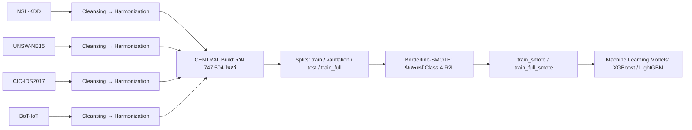
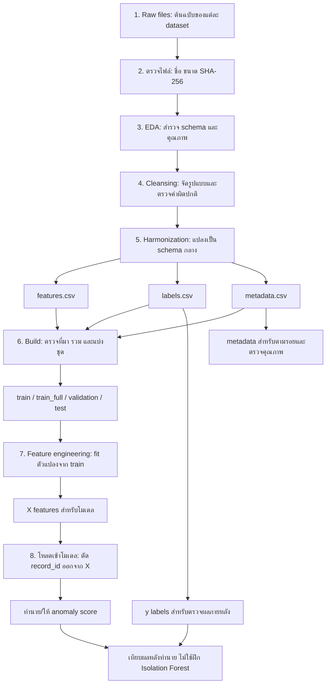

# Data Pipeline: Quad-Dataset (NSL-KDD + UNSW-NB15 + CIC-IDS2017 + BoT-IoT)

> **สถานะโครงสร้างไฟล์:** CIC/BoT cleansing และ harmonization รวมถึง Borderline-SMOTE มี implementation ใน notebook โดยตรงตามรูปแบบ NSL/UNSW; master runner execute code cells เหล่านั้น ดู [PIPELINE_FILE_GUIDE.md](PIPELINE_FILE_GUIDE.md). CIC/BoT `download.py` สร้างข้อมูลตัวอย่าง ไม่ใช่ official raw benchmark.


คู่มือ: [NSL-KDD](sub-dataset/NSL-KDD/docs/dataset_guide.md) · [UNSW-NB15](sub-dataset/UNSW-NB15/docs/dataset_guide.md) · [CIC-IDS2017](sub-dataset/CIC-IDS2017/docs/dataset_guide.md) · [BoT-IoT](sub-dataset/BoT-IoT/docs/dataset_guide.md) · [Dataset กลาง (/CENTRAL)](CENTRAL/docs/central_dataset_guide.md)

ขอบเขตของ pipeline รองรับ **4 Benchmark Datasets ครบวงจร**:
1. **NSL-KDD**: ชุดข้อมูลคลาสสิกสำหรับตรวจจับทราฟฟิกเครือข่ายระดับ Host/OS
2. **UNSW-NB15**: ชุดข้อมูลเครือข่ายสมัยใหม่ ครอบคลุมการโจมตีระดับแอปพลิเคชันและมัลแวร์
3. **CIC-IDS2017**: ชุดข้อมูลทราฟฟิกขนาดใหญ่ บันทึกพฤติกรรมการโจมตี DoS, Recon, Exploits และ Brute-force
4. **BoT-IoT**: ชุดข้อมูลเครือข่ายอินเทอร์เน็ตของสรรพสิ่ง (IoT) จากเซ็นเซอร์อัจฉริยะ

## มองภาพการทำงานใน 10 วินาที



ตัวอย่างหนึ่งแถวก่อนและหลังจัดมาตรฐาน (ตัวเลขเป็น **ตัวอย่างประกอบ** ไม่ใช่สถิติที่คำนวณจากไฟล์จริง):

| ต้นทาง | ก่อนแปลง | หลังแปลง | เหตุ → ผล |
|---|---|---|---|
| NSL-KDD | `src_bytes=120`, `dst_bytes=30`, `label=neptune` | `bytes_forward=120`, `bytes_backward=30`; label แยกเป็น `DoS/DDoS` | ชื่อกลางทำให้โค้ด downstream ใช้ schema เดียวกันได้; label แยกไว้จึงไม่ปนเข้า `X` |
| UNSW-NB15 | `sbytes=120`, `dbytes=30`, `label=1`, `attack_cat=DoS` | `bytes_forward=120`, `bytes_backward=30`; label แยกเป็น `DoS/DDoS` | ค่า bytes ใช้คำนวณ feature ได้ด้วยสูตรเดียวกัน; label ใช้ประเมินภายหลัง ไม่ใช้แบ่ง split |

เครื่องที่ใช้ตรวจรอบนี้มี raw ของ UNSW-NB15 แล้ว และรายงานล่าสุดยืนยันว่า NSL-KDD กับ UNSW-NB15 ผ่าน readiness พร้อมรวม 406,190 records อย่างไรก็ตาม raw data และ output ถูกละเว้นจาก Git; หลัง clone สมาชิกต้องเตรียม raw ตามสิทธิ์การใช้งานและรัน pipeline เอง จากนั้นตรวจหัวข้อ [ความพร้อมของข้อมูล](common/docs/central_dataset_guide.md#8-พร้อมรวม-ในรายงานหมายถึงอะไร) ก่อนนำผลไปใช้

## ขั้นตอนทั้งหมด: จากไฟล์ดิบจนถึงข้อมูลที่โมเดลอ่านได้

แผนภาพต่อไปนี้แสดงว่างานแต่ละช่วงรับอะไร ส่งอะไรต่อ และจุดที่แยกคำตอบออกจากข้อมูลฝึก:



### 1. เตรียมไฟล์ต้นฉบับ (Raw)

Raw คือไฟล์ที่ได้จากผู้จัดทำ dataset และเป็นหลักฐานอ้างอิงหลักของทุกขั้น ห้ามแก้ทับไฟล์นี้ เพราะถ้าภายหลังพบว่าการแปลงผิด จะได้กลับมาเริ่มใหม่จากต้นฉบับได้

| Dataset | ไฟล์ที่ใช้ | ข้อสำคัญ |
|---|---|---|
| NSL-KDD | `sub-dataset/NSL-KDD/raw/` มีไฟล์ Train, Test และ `KDDTest-21` | `KDDTrain+_20Percent` เป็นชุดย่อย ไม่เอามาต่อซ้ำกับ Train เต็ม |
| UNSW-NB15 | `sub-dataset/UNSW-NB15/raw/UNSW_NB15_training-set.csv` และ `UNSW_NB15_testing-set.csv` | ดาวน์โหลดจากแหล่งที่ได้รับอนุญาตและวางไฟล์ไว้เอง; ขั้น Cleansing บันทึก manifest สำหรับตรวจความเปลี่ยนแปลง |

**เหตุ → ผล:** แยก raw ออกจาก output ทำให้การทดลองทำซ้ำได้ และป้องกันไม่ให้การแก้ค่าว่าง/ชื่อคอลัมน์ไปเปลี่ยนต้นฉบับโดยไม่รู้ตัว

### 2. ตรวจไฟล์และบันทึกที่มา

ตัวตรวจไฟล์บันทึกชื่อไฟล์ ขนาด และ SHA-256 (ลายนิ้วมือดิจิทัลของไฟล์) ไว้ใน manifest การมีชื่อไฟล์เหมือนกันอย่างเดียวไม่พอ เพราะไฟล์อาจมีเนื้อหาคนละรุ่น

ก่อนใช้ผลเดิม ขั้น harmonization/build จะเทียบ checksum กับ manifest และตรวจรุ่นของ `dataset_registry.json` กับ `feature_contract.json` หาก raw หรือกติกาเปลี่ยน ระบบจะหยุดและขอให้สร้างผลขั้นที่เกี่ยวข้องใหม่

**ตัวอย่าง:** ถ้าเปลี่ยน CSV ต้นทางเพียงหนึ่งค่า SHA-256 จะเปลี่ยน → ผล harmonized ที่สร้างจากไฟล์เก่าจะไม่ถูกยอมรับ → ลดโอกาสนำผลเก่ามาปนกับข้อมูลรุ่นใหม่

### 3. EDA — สำรวจข้อมูลก่อนแก้

EDA (Exploratory Data Analysis) ใช้ตอบว่าไฟล์มีหน้าตาอย่างไร ก่อนตัดสินใจว่าจะทำความสะอาดหรือแปลงแบบไหน โดยตรวจชื่อคอลัมน์ ชนิดข้อมูล missing จำนวนค่าที่ไม่ซ้ำ การกระจายตัว และ label

| รับเข้า | ตรวจอะไร | สิ่งที่ได้ / สิ่งที่ยังไม่เกิด |
|---|---|---|
| Raw files | header, dtype, ค่าว่าง, ค่าซ้ำ, label และ distribution | ตาราง/กราฟช่วยเลือกวิธีเตรียมข้อมูล; EDA ไม่แก้ raw และยังไม่ฝึกโมเดล |
| UNSW-NB15 | ตัวอย่างไม่เกิน 20,000 แถวต่อไฟล์ในรายงาน schema | ใช้ตรวจ schema เบื้องต้น ไม่ควรเข้าใจว่าเป็นสถิติจากทุกแถว |
| NSL-KDD | notebook แสดงสรุปและกราฟของข้อมูล Train | ใช้ตั้งสมมติฐาน; ค่าหางยาวหรือพบไม่บ่อยไม่ได้แปลว่าข้อมูลผิดเสมอ |

**เหตุ → ผล:** ถ้า EDA พบว่าเวลาถูกอ่านเป็นข้อความ หรือคอลัมน์ที่คาดว่าจะมีหายไป เราจะตรวจ mapping ก่อนแปลง แทนการจับคู่คอลัมน์ตามตำแหน่งซึ่งอาจทำให้ค่าผิดช่อง

### 4. Cleansing — ทำข้อมูลให้รูปแบบพร้อมตรวจสอบ

การ cleansing เป็นกติกาของแต่ละ dataset เพราะแต่ละชุดเขียนข้อมูลไม่เหมือนกัน และไม่ใช่การลบทุกแถวที่ดูแปลก

| งาน | NSL-KDD | UNSW-NB15 | ผลที่คาดหวัง |
|---|---|---|---|
| ทำข้อความให้สม่ำเสมอ | normalize รูปแบบหมวดหมู่/label ตาม notebook | ตัด BOM/ช่องว่างหัวท้ายของชื่อคอลัมน์และข้อความ | `TCP`, ` tcp ` และ `tcp` ไม่ถูกนับเป็นคนละหมวดเพราะช่องว่าง/ตัวพิมพ์ |
| จัดการ missing/ตัวเลข | ตรวจ schema, ชนิดข้อมูลและช่วงค่าตามกฎของ NSL | แปลงข้อความว่าง/sentinel เช่น `null` เป็น missing; ค่าที่เป็น infinity ไม่คงไว้ | missing ยังคงแยกจากเลขศูนย์; ป้องกันสูตรคำนวณผิด |
| ตรวจแถวซ้ำ | ตรวจตามกติกาใน notebook; รอบข้อมูลที่บันทึกไว้ไม่มีแถวที่ถูกลบ | เพิ่ม `_duplicate_flag` แต่เก็บแถวไว้ | มี audit trail และยังย้อนตรวจต้นทางได้ |
| รักษารหัสแถว | คงลำดับแถวที่ใช้เชื่อม raw กับ cleaned | เพิ่ม `orig_row_id` จากชื่อไฟล์และลำดับแถว | ตามกลับไปหา record เดิมได้ |

UNSW เขียนผลเป็น CSV ทีละ chunk เพื่อไม่ต้องโหลดไฟล์ใหญ่ทั้งหมดไว้ในหน่วยความจำ รายงาน `cleansing_audit.csv` สรุปจำนวนแถวเข้า/ออก missing และ duplicate flags ส่วน NSL notebook สร้างผล cleaned ที่ downstream ใช้; common adapter จะตรวจจำนวนแถวกับ raw ก่อนให้รหัสอ้างอิง

**ตัวอย่างเหตุ → ผล:** ข้อความ `" n/a "` กลายเป็น missing และถูกนับในรายงาน → โมเดลจะไม่เข้าใจผิดว่าคำว่า `n/a` เป็นค่าหมวดหมู่จริง แต่ข้อมูลไม่ได้ถูกแทนเป็น 0 โดยพลการ

### 5. Harmonization — ทำความหมายและชื่อฟิลด์ให้เป็นมาตรฐานร่วม

Harmonization ไม่ใช่แค่เปลี่ยนชื่อคอลัมน์ แต่เป็นการค้นชื่อจริงจาก header, ตรวจค่าที่จำเป็น, แปลงหน่วย/หมวดหมู่ที่มีกฎรองรับ, สร้างรหัส record และแยกข้อมูลออกเป็นสามตาราง

| ข้อมูลต้นทาง | ชื่อกลาง | ผลต่อขั้นต่อไป |
|---|---|---|
| NSL `duration`; UNSW `dur` | `duration` (วินาที) | ใช้สูตรเวลาเดียวกันได้เมื่อยืนยันหน่วยแล้ว |
| NSL `protocol_type`; UNSW `proto` | `protocol` (`tcp`, `udp`, `icmp`, `other`) | encoder ใช้ schema กลางเดียวกันได้ |
| NSL `src_bytes` / `dst_bytes`; UNSW `sbytes` / `dbytes` | `bytes_forward` / `bytes_backward` | เก็บทิศทางแยกกันเพื่อคำนวณปริมาณและสัดส่วน |
| Label ต้นทาง | `label_raw`, `attack_category`, `label_binary` ในตาราง labels | เก็บคำตอบไว้ประเมิน แต่ไม่ปนเป็น feature |

ตำแหน่งทิศทางและนิยามของ bytes ต้องตรวจจากเอกสารของ dataset ก่อนถือว่าเทียบกันได้ การใช้ชื่อกลางยังไม่ใช่หลักฐานว่าการกระจายหรือความหมายทั้งหมดเหมือนกัน

ผลลัพธ์ของ harmonization ในแต่ละโฟลเดอร์ `output/harmonized/` คือ:

| ไฟล์ | ตัวอย่างข้อมูลข้างใน | ทำไมแยก |
|---|---|---|
| `features.csv` | `record_id`, `duration`, `protocol`, `bytes_forward`, extensions | เป็นตารางพฤติกรรมที่คัดเลือกไปสร้าง `X` ได้; ต้องตัด `record_id` ก่อนป้อนโมเดล |
| `labels.csv` | `record_id`, `label_raw`, `attack_category`, `label_binary` | เป็นเฉลยอ้างอิง; กัน label รั่วเข้า training โดยไม่ตั้งใจ |
| `metadata.csv` | `record_id`, dataset ต้นทาง, `orig_row_id`, official split, เวลา, flags | ใช้แบ่งชุด ตรวจคุณภาพ และย้อนกลับไปต้นทาง ไม่ใช่ input ของโมเดล |

ทั้งสามตารางใช้ `record_id` เดียวกันและเรียงแถวตรงกัน ตัวอย่าง ID เช่น `UNSW-NB15:UNSW_NB15_training-set.csv:000000123` ใช้ระบุแถว ไม่ใช่ feature ที่บอกว่าเป็น attack

ไฟล์ใช้ **CSV** ซึ่งเปิดดูได้ด้วย text editor, Excel หรือ VS Code โดยไม่ต้องติดตั้งตัวอ่านเฉพาะ แต่ขนาดไฟล์อาจใหญ่กว่าและการอ่านอาจช้ากว่า Parquet การแยกเป็นสามไฟล์ยังช่วยเลือกเฉพาะ `features` ไปสร้าง `X` โดยไม่เผลอรวม `labels` หรือ `metadata` และใช้ `record_id` join กลับเมื่อจำเป็น

**กรณี KDDTest-21:** ตรวจ record จาก `KDDTest-21` ว่าตรงกับ record ใน `KDDTest+` ก่อน จากนั้นทำเป็น view สำหรับประเมินย่อย ไม่ต่อซ้ำเป็น record ใหม่

### 6. Build Dataset กลาง — ตรวจ รวม และแบ่งข้อมูล

`common/build_dataset.ipynb` มีโค้ดตรวจ checksum/version และตรวจว่า `features`, `labels`, `metadata` เชื่อมกันได้ ก่อนรวมเฉพาะชุดที่พร้อมเป็นตารางกลาง

การแบ่งข้อมูลมีความหมายดังนี้:

| ชื่อ split | ที่มา/หน้าที่ | label ใช้แบ่งไหม |
|---|---|---|
| `train_full` | ส่วน official Train ที่เหลือหลังกัน validation ออก เก็บแถวทั้งหมดของส่วนนี้ไว้ | ไม่ใช้ |
| `train` | สุ่มจาก `train_full`; ถ้ามีหลาย dataset จะสุ่มจำนวนแถวเท่ากันต่อแหล่ง หากมี NSL แหล่งเดียวจะได้จำนวนเท่ากับ `train_full` | ไม่ใช้ทั้งเลือก Normal หรือปรับสมดุลประเภท attack |
| `validation` | 20% ของ official Train แยกด้วย seed `42` ใช้ประเมิน/เลือกการตั้งค่า | ไม่ใช้ |
| `test` | official Test ของแต่ละชุด คงไว้เพื่อประเมินหลังพัฒนา | ไม่ใช้แบ่งหรือ fit |

ดังนั้น “จำนวนเท่ากันต่อแหล่งข้อมูล” ไม่ได้แปลว่า Normal และ Attack มีจำนวนเท่ากัน และไม่ได้ทำให้ pattern ของสอง dataset เหมือนกัน ส่วน `sample_weight` เก็บใน metadata เท่านั้น

โฟลเดอร์ `common/output/splits/<split>/` จะมี CSV สามไฟล์แบบเดียวกัน (`features`, `labels`, `metadata`) สำหรับแต่ละ split; `common/output/reports/` มีรายงาน readiness, feature compatibility, split counts, build summary และรายการ KDDTest-21 view

**เหตุ → ผล:** คง official Test ไว้ → ข้อมูลที่ใช้เลือก/fit preprocessing จะไม่ดูคำตอบจาก Test → ผลทดสอบสะท้อนข้อมูลที่กันไว้ได้ดีขึ้นกว่าการสุ่มทุกแถวปะปนกัน

### 7. Feature Engineering กลาง — สร้างและปรับสเกล feature

`common/feature_engineering.ipynb` อ่านรายงานความเข้ากันได้ก่อนเลือกฟิลด์ เมื่อมีเพียง dataset เดียวพร้อม ผลจะติดสถานะ `source_local_diagnostic`; จะไม่อ้างว่า feature ผ่านการยืนยันข้าม NSL-KDD และ UNSW-NB15 แล้ว

โปรไฟล์ `joint_v1` สร้าง model features 19 คอลัมน์:

| กลุ่ม | คอลัมน์ | ทำไปเพื่ออะไร |
|---|---|---|
| ปริมาณตัวเลข | `log_duration`, `log_bytes_forward`, `log_bytes_backward` | ลดช่วงหางยาวของ duration และ bytes |
| ทิศทาง bytes | `signed_log_bytes_ratio` | `log1p(forward) - log1p(backward)`; ค่าบวก/ลบแสดงว่าทิศทางใดมี bytes มากกว่า |
| Protocol | 4 คอลัมน์ `protocol_*` | เข้ารหัส tcp/udp/icmp/other แบบ one-hot |
| Service | 7 คอลัมน์ `service_*` | เพิ่มบริบทบริการ เช่น HTTP, DNS, SSH และ other |
| Connection state | 4 คอลัมน์ `conn_state_*` | เพิ่มบริบท established/no-reply/reset/other |

ตัวอย่างจำลอง: ถ้า `bytes_forward=120` และ `bytes_backward=30`, signed ratio จะได้ `ln(121)-ln(31)≈1.36`; เมื่อสลับ bytes สองทิศทางจะได้ค่าประมาณ `-1.36` จึงแสดงความไม่สมดุลได้สองด้าน

โปรไฟล์หลักพัก `log_total_bytes` ไว้เพราะซ้ำกับ bytes สองทิศทาง และพัก `log_bytes_per_second` เพราะ duration ศูนย์ที่แทนด้วย epsilon อาจทำให้ความหมายของอัตราคลาดเคลื่อน ปัจจุบัน Notebook สร้างเฉพาะ 19 model features ของ `joint_v1`; ดูสูตรและขั้นตอนใน [คู่มือ Dataset กลาง](common/docs/central_dataset_guide.md#7-feature-engineering-กลาง--สร้างและปรับสเกล-feature).

`StandardScaler` และ `OneHotEncoder` เรียนรู้จาก `train` เท่านั้น แล้วใช้ transformer ชุดเดิมแปลง `train_full`, `validation` และ `test` เพื่อไม่ให้ชุดประเมินมีอิทธิพลต่อค่าที่เรียนรู้ หาก feature ที่เลือกมี missing/infinite ระบบหยุดพร้อมรายงาน ไม่เติมศูนย์หรือลบแถวเงียบ ๆ

ผลลัพธ์อยู่ใน `common/output/feature_engineering/<split>/` เป็น `features.csv`, `labels.csv`, `metadata.csv` พร้อม `preprocessor.joblib`, `feature_schema.json` และ `feature_engineering_report.csv` ที่อธิบายชื่อคอลัมน์และวิธี fit

### 8. ส่งต่อให้โมเดลและประเมินผล

Data pipeline เตรียมและจัดเก็บข้อมูล แต่การฝึกโมเดลทำในโฟลเดอร์ `model/` ไม่ได้เกิดขึ้นโดยอัตโนมัติเมื่อรัน `build_dataset.ipynb` หรือ `feature_engineering.ipynb`

ก่อนสร้าง `X` ให้อ่าน `features.csv` เลือกเฉพาะคอลัมน์ตัวเลข/หมวดหมู่และตัด `record_id` ออก ส่วน `labels.csv` เชื่อมกลับด้วย `record_id` หลังโมเดลให้ prediction/score แล้วเท่านั้น ส่วน Isolation Forest ฝึกแบบ unsupervised จึงไม่ส่ง `y` เข้า `fit()`; labels ยังมีประโยชน์ต่อการวัด precision/recall และตรวจ FP/FN หลังจากนั้น

> Feature engineering เฉพาะ NSL ใน `sub-dataset/NSL-KDD/feature_engineering.ipynb` เป็นอีก pipeline สำหรับทดลองกับ Isolation Forest/MLP เดิม ผล 157 features และ baseline 121 features ในเอกสาร NSL จึงไม่ใช่ output เดียวกับ feature engineering กลาง

## โครงสร้าง

```text
data-pipeline/
├── sub-dataset/
│   ├── NSL-KDD/       # raw, notebooks, docs และ output ของชุดข้อมูล
│   ├── UNSW-NB15/     # raw, downloader, notebooks และ output
│   ├── CIC-IDS2017/   # raw, notebooks และ output
│   └── BoT-IoT/       # raw, notebooks และ output
├── CENTRAL/           # รวมข้อมูล แบ่ง split และทำ Borderline-SMOTE
├── build_quad_dataset.py
├── audit_all_pipelines.py
└── PIPELINE_FILE_GUIDE.md
```

แผนภาพนี้ละ `model_runs/` และ `reports/` ไว้ก่อนเพื่อให้เห็นเส้นทางหลักชัดขึ้นเท่านั้น ไฟล์ผลลัพธ์เดิมและการสร้างรายงานของ pipeline ยังอยู่เหมือนเดิม ไม่ได้ลบหรือย้ายข้อมูล

ในโฟลเดอร์ของแต่ละชุดทำ `EDA → Cleansing → Harmonization` ตามลำดับ โดยคำอธิบายและโค้ดของแต่ละขั้นอยู่ใน notebook ของ dataset นั้นโดยตรง จากนั้น `common/` อ่านเฉพาะผล harmonization ที่ได้มาตรฐานแล้ว เพื่อตรวจและรวมชุดข้อมูล แบ่ง Train/Validation/Test และทำ Feature Engineering กลาง จึงไม่มีการทำ EDA, Cleansing หรือ Harmonization ซ้ำใน `common/`

### โค้ดแต่ละส่วนทำหน้าที่อะไร

| ไฟล์ | หน้าที่ | ฟังก์ชัน/ผลลัพธ์สำคัญ |
|---|---|---|
| `sub-dataset/NSL-KDD/eda.ipynb`, `cleansing.ipynb`, `harmonization.ipynb` | สำรวจ ทำความสะอาด และแปลง NSL-KDD ให้ตรงกับ schema กลาง โดยแสดงโค้ดไว้ใน notebook | รันทีละ cell และตรวจผลแต่ละขั้นได้โดยไม่ต้องเปิด helper เฉพาะชุดจาก `common/` |
| `sub-dataset/UNSW-NB15/eda.ipynb`, `cleansing.ipynb`, `harmonization.ipynb` | ทำสามขั้นของ UNSW-NB15 ในโฟลเดอร์ของชุดข้อมูลเอง | แสดงโค้ดของแต่ละขั้นใน notebook เช่นเดียวกัน |
| `common/build_dataset.ipynb` | แสดงโค้ดทั้งหมดสำหรับตรวจผล harmonization, รวมชุดข้อมูล, แบ่ง split และสุ่ม Train ให้จำนวนต่อ dataset เท่ากัน | รันตามลำดับ cell; ผลหลักคือ `build_summary` |
| `common/feature_engineering.ipynb` | แสดงโค้ดทั้งหมดสำหรับคำนวณ feature กลางและ fit scaler/encoder จาก Train ก่อนแปลง split อื่น | รันหลัง Build; ผลหลักคือ `feature_engineering_summary` |

โค้ดช่วยหา project root, คำนวณ checksum และตรวจการจัดแนวของตารางถูกรวมไว้ใน notebook ที่ใช้โค้ดนั้นโดยตรง จึงเปิด notebook แล้วอ่านขั้นตอนการทำงานได้ครบ ไม่ต้องตามไปเปิดไฟล์ `.py` แยก ส่วน EDA/Cleansing/Harmonization ยังคงอยู่ใน notebook ของแต่ละ dataset; `common/` ทำงานกับผลที่ผ่าน Harmonization แล้วเท่านั้น.

เริ่มอ่านโค้ดตามลำดับนี้ได้: notebook ของ NSL-KDD หรือ UNSW-NB15 เพื่อดูงานราย dataset ทีละ cell → `common/build_dataset.ipynb` เพื่อดูการรวมและแบ่งข้อมูล → `common/feature_engineering.ipynb` เพื่อดูการเตรียมข้อมูลก่อนเข้าโมเดล แต่ละช่วงยังคงแยก labels และ metadata ออกจาก features.

## ติดตั้งและเริ่มทำงาน

จากโฟลเดอร์รากของโปรเจกต์:

```powershell
python -m pip install -r data-pipeline/requirements.txt
```

1. **ติดตั้งแพ็กเกจ** จาก project root: `python -m pip install -r data-pipeline/requirements.txt` (รวม Jupyter, pandas และ scikit-learn; CSV อ่าน/เขียนได้ผ่าน pandas)
2. **เตรียม Raw:** NSL-KDD ใช้ `data-pipeline/sub-dataset/NSL-KDD/download.py` ดาวน์โหลดไฟล์ที่กำหนดและสร้าง checksum manifest; UNSW-NB15 ให้ดาวน์โหลดไฟล์ official จากแหล่งที่ได้รับอนุญาตแล้ววางไว้ใน `sub-dataset/UNSW-NB15/raw/` จากนั้นเริ่มที่ `eda.ipynb` และ `cleansing.ipynb` ซึ่งบันทึก manifest ของไฟล์ต้นทางไว้ให้ขั้นถัดไปตรวจสอบ
3. **เปิดและรัน notebook รายชุดตามลำดับ** `eda.ipynb` → `cleansing.ipynb` → `harmonization.ipynb` ทั้งใน `sub-dataset/NSL-KDD/` และ `sub-dataset/UNSW-NB15/` (ถ้า UNSW ยังไม่มี raw ให้ข้ามชุดนั้นได้ แต่ build จะเป็นผลเฉพาะแหล่งที่พร้อม)
4. **สร้างตารางรวมและ split:** รัน `data-pipeline/common/build_dataset.ipynb` หลัง harmonization; ตรวจ `common/output/reports/dataset_readiness.csv` และ `build_report.json` ก่อนตีความว่าได้รวมกี่ dataset
5. **สร้าง model features กลาง:** รัน `data-pipeline/common/feature_engineering.ipynb`; ตรวจ `common/output/feature_engineering/feature_engineering_report.csv` และ `feature_schema.json`
6. **ฝึกโมเดลแยกต่างหาก:** อ่าน CSV ของ split ที่ต้องการ แยก `X` จาก features โดย drop `record_id`; ไม่เอา labels/metadata เข้าฝึก Isolation Forest แล้ว join labels กลับมาเพื่อ evaluation ภายหลัง

ตัวอย่างตรวจความสำเร็จหลัง build: ถ้า `dataset_readiness.csv` แสดง NSL `ready=True` และ UNSW `ready=False` หมายความว่า pipeline ทำงานได้กับ NSL แต่ **ยังไม่ได้** ทดสอบความเข้ากันได้ข้ามสองชุด อย่าตีความคำว่า `common` หรือการมีไฟล์ CSV ว่าเป็นหลักฐานว่ามีข้อมูลจากสองแหล่งแล้ว

raw data และ generated pipeline outputs ถูกละเว้นจาก Git ยกเว้นรายงาน/กราฟ MLP เดิมที่ย้ายมาไว้ใต้ `sub-dataset/NSL-KDD/output/model_runs/mlp/` เพื่อคงผลที่เคยติดตามใน repository ก่อนหน้านี้

แต่ละขั้นบันทึก SHA-256 ของ raw inputs และเวอร์ชัน registry/contract กำกับผล harmonization; หาก raw file, registry หรือ feature contract เปลี่ยน ระบบจะปฏิเสธการใช้ผล harmonization เก่า ต้องรันขั้นที่เกี่ยวข้องใหม่

## ข้อตกลงของข้อมูลกลาง

แต่ละชุดสร้าง `output/harmonized/{features,labels,metadata}.csv` โดยตารางทั้งสามเชื่อมด้วย `record_id` และต้องเรียงแถวตรงกัน:

- `features`: core fields ได้แก่ duration (วินาที), protocol และ bytes สองทิศทาง พร้อม extensions ที่มีหลักฐานใน source นั้น
- `labels`: เก็บ label ต้นทางและ taxonomy กลางไว้ประเมินภายหลัง ไม่ป้อนเป็น `X`
- `metadata`: เก็บชื่อ dataset, รหัสแถวเดิม, official split, เวลา, duplicate flag, availability masks และคุณภาพข้อมูล

ฟีเจอร์ core ที่นำเข้าร่วมได้ต้องมีนิยาม/หน่วยที่ยืนยันแล้วในทั้งสองชุด Extensions ที่ไม่มีในอีกชุดเก็บเป็น null พร้อม availability mask ใน metadata และไม่ส่งเข้าโมเดลกลางโดยอัตโนมัติ ดู [feature contract](common/feature_contract.json)

NSL-KDD และ UNSW-NB15 คง official Test แยกจาก Train; validation ถูกสุ่มจาก official Train ด้วย seed คงที่ โดยไม่ใช้ label ในการแบ่ง Train จัดเก็บ split `train_full` ก่อนสุ่มจำนวนต่อ dataset ให้เท่ากันใน `train`; labels ไม่ถูกใช้กรอง Normal หรือปรับสมดุล class ส่วน `KDDTest-21` เป็น evaluation view ที่ชี้กลับไปยังแถวใน KDDTest เท่านั้น

## สถานะข้อมูล

ทะเบียนมีเฉพาะ NSL-KDD และ UNSW-NB15 ดู `common/dataset_registry.json` และรายงาน `common/output/reports/dataset_readiness.csv` เพื่อทราบว่าชุดใดพร้อมจริงในเครื่องนี้ จากการรันล่าสุดทั้งสองชุดผ่าน readiness check และ build รวมได้ 406,190 records; ให้ตรวจรายงานซ้ำหลังเปลี่ยน raw file หรือ contract

รายงาน `feature_compatibility.json` แยก `usable_in_current_build` (ทดลองกับ source ที่มีข้อมูลแล้ว) จาก `eligible_for_joint_profile` (ยืนยันครบทั้ง NSL-KDD และ UNSW-NB15) ถ้า UNSW-NB15 ยังไม่พร้อม feature engineering จะระบุ scope เป็น `source_local_diagnostic` ไม่ใช่ผลทดสอบร่วม
