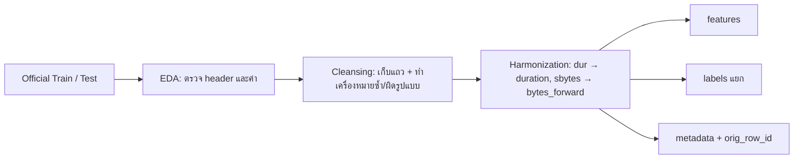

# UNSW-NB15

## จากไฟล์ที่ดาวน์โหลดสู่ข้อมูลกลาง

ตัวอย่างเพื่อให้เห็นผลของการแปลง (ตัวเลขสมมติสำหรับอธิบาย): `dur=2`, `sbytes=120`, `dbytes=30`, `label=1`, `attack_cat=DoS` จะกลายเป็น `duration=2`, `bytes_forward=120`, `bytes_backward=30`; label ยังอยู่แยกต่างหาก ส่วน `orig_row_id` ชี้กลับไปยังแถวเดิม ผลคือคำนวณสูตรกลางได้โดยไม่ทำข้อมูลต้นฉบับหาย และไม่เผลอส่ง label ให้โมเดล

วางไฟล์ official `UNSW_NB15_training-set.csv` และ `UNSW_NB15_testing-set.csv` ใน `raw/` โดยรักษาชื่อคอลัมน์/ค่าต้นฉบับไว้ก่อน ห้ามรวม official test เข้ากับ training จากนั้นรัน `python download.py` เพื่อตรวจชื่อไฟล์ header และจำนวนแถว (Train 175,341 / Test 82,332) สคริปต์จะข้ามไฟล์ที่มีอยู่แล้วและไม่เขียนทับ เว้นแต่ระบุ `--force` พร้อม URL ดาวน์โหลดโดยตรง

ผลจาก Cleansing และ Harmonization ใช้ CSV เช่นกัน: Cleansing บันทึกไฟล์ cleaned CSV ทีละ chunk เพื่อจำกัดการใช้หน่วยความจำ ส่วน Harmonization สร้าง `features.csv`, `labels.csv` และ `metadata.csv` ใน `output/harmonized/` ให้ `common/build_dataset.ipynb` นำไปใช้ต่อได้โดยตรง

อ่าน [คู่มือ UNSW-NB15 แบบละเอียด](docs/dataset_guide.md) สำหรับที่มาของข้อมูล คำอธิบายฟิลด์ labels, ขั้น cleansing/harmonization และข้อควรระวังในการใช้เทรนโมเดล

ดาวน์โหลดจาก [หน้าโครงการ UNSW-NB15](https://research.unsw.edu.au/projects/unsw-nb15-dataset) หากลิงก์ไฟล์ต้องใช้บัญชีมหาวิทยาลัยหรือ SharePoint ให้ดาวน์โหลดด้วยบัญชีที่ได้รับอนุญาต แล้ววาง CSV ลง `raw/`; pipeline ไม่ข้ามหน้า login และไม่อัปโหลดข้อมูลต้นฉบับ หากไฟล์ยังไม่ครบ สามารถรัน `python download.py --open-page` เพื่อเปิดหน้าโครงการและดูคำแนะนำได้

หลังวางไฟล์แล้ว รัน `eda.ipynb`, `cleansing.ipynb`, `harmonization.ipynb` ตามลำดับ โดยขั้น Cleansing จะบันทึกขนาด/SHA-256 ของไฟล์ต้นทาง และ Harmonization จะตรวจว่าต้นฉบับยังตรงกับ manifest ก่อนสร้างผลลัพธ์ Adapter ตรวจชื่อ `dur`, `proto`, `sbytes`, `dbytes`, `label`, `attack_cat` และ `stime` (ถ้ามี) จาก header จริง ไม่ใช้ตำแหน่งคอลัมน์ หากมี `stime` จะ parse เป็น Unix seconds; หากไม่มี `capture_time` จะเป็นค่าว่าง ไม่สร้างเวลาขึ้นเอง

โค้ดสำรวจ ทำความสะอาด และ Harmonization เขียนแสดงใน notebook ของ UNSW-NB15 โดยตรง จึงอ่านและรันทีละขั้นได้โดยไม่ต้องตามไปเปิดฟังก์ชันเฉพาะชุดจาก `common/` เมื่อเปลี่ยน schema กลาง ให้ตรวจ mapping ใน notebook นี้ให้ตรงกับ `common/feature_contract.json`; `common/` จะรับช่วงต่อหลัง Harmonization แล้วเท่านั้น

IP, ports และ Flow ID (ถ้ามี) เก็บได้เฉพาะ metadata/แหล่งอ้างอิง ห้ามเข้า feature กลางโดยอัตโนมัติ; ชุดทดสอบ official คงเดิม และแยก validation จาก training โดยไม่ใช้ label
