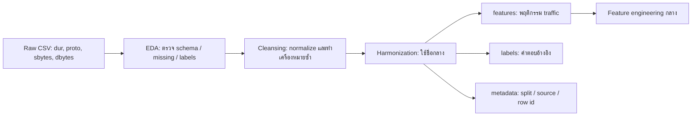

# คู่มือชุดข้อมูล UNSW-NB15

คู่มือนี้อธิบายว่า UNSW-NB15 มาจากไหน แต่ละฟิลด์ที่ pipeline สนใจหมายถึงอะไร ผ่านการเตรียมข้อมูลอย่างไร และข้อมูลใดถูกส่งต่อไปยัง dataset กลาง เนื้อหาแยก **คำตอบจริงของชุดข้อมูล** ออกจาก **feature ที่โมเดลใช้** เพื่อไม่ให้ label รั่วเข้าโมเดล

> **สถานะข้อมูลในโปรเจกต์:** ณ วันที่จัดทำเอกสาร โฟลเดอร์ `data-pipeline/UNSW-NB15/raw/` ยังไม่มีไฟล์ต้นทาง และรายงาน readiness ระบุว่า UNSW-NB15 ยังไม่พร้อม ดังนั้นตัวเลขสถิติของ UNSW ด้านล่างเป็นข้อมูลอ้างอิงจากหน้าโครงการ ไม่ใช่ผลคำนวณจากไฟล์ในเครื่อง รายงาน EDA จริงจะมีได้หลังวางไฟล์และรัน notebook

## มองเห็นเส้นทางข้อมูลและผลของการแปลง



ตัวอย่างเลขด้านล่างเป็น **ข้อมูลจำลองเพื่ออธิบายสูตร** ไม่ใช่ค่าที่วัดจาก raw ของเครื่องนี้ (ชุด UNSW ใน repository ยังไม่มีไฟล์ raw):

| ขั้น | ตัวอย่าง | เหตุ → ผลที่เกิด |
|---|---|---|
| Raw | `dur=2s`, `sbytes=120`, `dbytes=30`, `proto=tcp`, `label=1`, `attack_cat=DoS` | ต้นฉบับแยกข้อมูลพฤติกรรมออกจากคำตอบ |
| Harmonized | `duration=2`, `protocol=tcp`, `bytes_forward=120`, `bytes_backward=30` | ใช้ชื่อ field กลาง เพื่อให้สูตรเขียนครั้งเดียวได้; ค่าดิบที่แปลงไม่ได้จะเป็น missing + quality flag ไม่ถูกแทนเป็น 0 |
| Engineered | `log_duration=ln(3)≈1.099`; `log_total_bytes=ln(151)≈5.017`; `log_bytes_per_second=ln(76)≈4.331` | บีบช่วงตัวเลขหางยาว; จะเปลี่ยนระยะ/สเกลที่โมเดลเห็น จึงต้องเปรียบเทียบผลก่อนนำเข้าโมเดล |
| Labels/Metadata | `label_binary=1`, `attack_category=DoS/DDoS`; `orig_row_id` แยกอีกตาราง | ประเมินย้อนหลังและตามรอยต้นทางได้ โดยไม่ส่ง label หรือรหัส record เข้า `X` |

ถ้าตัวอย่างนี้มี `spkts=3`, `dpkts=2` จะได้ `mean_packet_size=(120+30)/(3+2)=30` bytes/packet; ถ้า packet count ไม่มี จะเป็น missing ไม่ใช่ 0 เพราะ “ไม่มีการวัด” ไม่เท่ากับ “วัดแล้วพบศูนย์”

## 1. UNSW-NB15 คืออะไร

UNSW-NB15 เป็นชุดข้อมูลสำหรับศึกษาการตรวจจับการบุกรุกเครือข่าย สร้างใน Cyber Range ของ UNSW Canberra โดยใช้ IXIA PerfectStorm จำลองกิจกรรมปกติและพฤติกรรมการโจมตีร่วมกัน แล้วใช้เครื่องมือวิเคราะห์ traffic สร้าง feature และ label ให้แต่ละ record หน้าโครงการระบุข้อมูลต้นฉบับรวมประมาณ 2.54 ล้าน records และชุดแบ่งมาตรฐาน `UNSW_NB15_training-set.csv` กับ `UNSW_NB15_testing-set.csv` มี 175,341 และ 82,332 records ตามลำดับ [หน้าโครงการ UNSW-NB15](https://research.unsw.edu.au/projects/unsw-nb15-dataset)

หนึ่งแถวเป็น **record ของ traffic/การสื่อสารเครือข่ายตามนิยามชุดข้อมูล** ไม่ควรตีความว่าเป็นแพ็กเก็ตเดี่ยวหนึ่งแพ็กเก็ต หรือเป็นเหตุการณ์โจมตีทั้งหมดในโลกจริง ชุดข้อมูลมีทั้งข้อมูลปกติที่สังเกตได้และพฤติกรรมโจมตีที่สร้างในการทดลอง จึงเหมาะกับการทดลองและเปรียบเทียบวิธี แต่ผลที่ได้ไม่รับประกันว่าจะเหมือน traffic ของเครือข่ายจริงทุกแห่ง

ผู้จัดทำระบุ attack category 9 กลุ่ม ได้แก่ `Fuzzers`, `Analysis`, `Backdoors`, `DoS`, `Exploits`, `Generic`, `Reconnaissance`, `Shellcode` และ `Worms` โดยมีคำอธิบายฟีเจอร์ประกอบในไฟล์ `UNSW-NB15_features.csv` จากหน้าโครงการเดียวกัน สำหรับการใช้งานทางวิชาการ ให้ตรวจเงื่อนไขการใช้งานและใส่การอ้างอิงตามที่ผู้จัดทำกำหนด

## 2. ไฟล์ที่โปรเจกต์คาดหวัง

วางไฟล์ที่ดาวน์โหลดจากแหล่งที่ได้รับอนุญาตไว้ที่:

```text
data-pipeline/UNSW-NB15/raw/
├── UNSW_NB15_training-set.csv
└── UNSW_NB15_testing-set.csv
```

แยก Train และ Test ตามต้นฉบับ อย่านำแถวจาก official Test ไปปนใน Train หรือใช้เลือก/ปรับแต่งโมเดล เมื่อรันขั้นสร้างชุดข้อมูล ระบบแบ่ง validation จาก official Train โดย seed คงที่ และเก็บ official Test ไว้เป็น Test

`download.py` ในโปรเจกต์ **ไม่ได้ดาวน์โหลดไฟล์จากเว็บ** แต่ตรวจว่ามีไฟล์ที่คาดหวังอยู่ใน `raw/` และบันทึกข้อมูลตรวจสอบไฟล์ เช่น ขนาดและ SHA-256 การดาวน์โหลดที่ต้อง login/ผ่าน SharePoint ต้องทำด้วยบัญชีที่ได้รับอนุญาต แล้วจึงนำไฟล์ CSV มาใส่ในโฟลเดอร์ดังกล่าว

## 3. Label: คำตอบที่ใช้ตรวจผล ไม่ใช่ข้อมูลป้อนเข้า

| คอลัมน์ | ความหมาย | การใช้งานใน pipeline |
|---|---|---|
| `label` | ป้ายกำกับไบนารีของแถว: `0` คือ normal และ `1` คือ attack | คงไว้ในตาราง labels เป็น `label_raw`; ใช้ตรวจความสอดคล้องและประเมินหลังโมเดลทำงาน ไม่ใช่ feature |
| `attack_cat` | ชื่อประเภทการโจมตีของแถว; แถวปกติควรระบุ normal/benign ตามไฟล์ต้นทาง | คงค่าเดิมเป็น `label_source_category` แล้ว map เป็น `attack_category` กลาง |

โค้ดตรวจว่า `label` มีเพียง 0/1 และตรวจว่า `label == 0` สอดคล้องกับหมวด normal/benign หรือไม่ ถ้าขัดกันจะหยุดพร้อมแจ้งจำนวนแถวที่ผิด แทนการแก้คำตอบให้เอง

### Taxonomy กลางที่โค้ดปัจจุบันใช้

| ค่าใน `attack_cat` โดยทั่วไป | หมวดกลาง |
|---|---|
| Normal / Benign | `Normal` |
| DoS | `DoS/DDoS` |
| Reconnaissance | `Probe/Recon` |
| Exploits, Shellcode | `Exploit/U2R` |
| Backdoors, Worms | `Botnet/Backdoor` |
| Fuzzers, Generic, Analysis | `Generic/Fuzzer` |
| Attack ที่ไม่ตรงกลุ่มข้างบน | `Other attack` |

นี่เป็นการจัดกลุ่มเพื่อให้เปรียบเทียบข้ามแหล่งข้อมูลได้ง่าย ไม่ใช่ taxonomy มาตรฐานสากลที่ละเอียดครบทุกชนิด การ map ใช้ `attack_cat` เป็นหลัก และเก็บค่าต้นฉบับไว้เสมอเพื่อย้อนตรวจได้ ส่วน `label_binary` จะคงค่าจาก `label` หลังผ่านการตรวจ

**ข้อสำคัญสำหรับ Isolation Forest:** ตอน fit โมเดลแบบ unsupervised ต้องส่งเฉพาะ `X` ที่เป็น features เข้าโมเดล ไม่ส่ง `label`, `attack_cat`, `label_binary` หรือ `attack_category` เข้าไป Label มีไว้เปรียบเทียบคะแนน anomaly กับคำตอบจริงภายหลังเท่านั้น

## 4. ฟิลด์ที่เชื่อมเข้า schema กลาง

ชื่อด้านซ้ายคือชื่อที่ adapter ค้นจาก header จริง โดยไม่อาศัยลำดับคอลัมน์ ชื่อฟิลด์ของไฟล์แต่ละ release อาจต่างกันได้ จึงต้องตรวจ `output/reports/eda_schema_report.csv` หลังนำไฟล์จริงเข้ามา

| ฟิลด์ UNSW | ความหมายโดยย่อ | คอลัมน์กลาง / การจัดการ | เหตุผลและข้อควรระวัง |
|---|---|---|---|
| `dur` | ระยะเวลาของ record/flow | `duration` หน่วยวินาที; ค่าต้องไม่ติดลบ | ใช้บอกความยาวการสื่อสาร; ศูนย์อาจเป็นค่าจริง ไม่ได้แทน missing |
| `proto` | โปรโตคอล เช่น TCP/UDP/ICMP | `protocol`: แปลงตัวพิมพ์เล็กและค่ารหัสที่รู้จัก; ที่เหลือเป็น `other` | ใช้ One-Hot ในขั้น feature engineering; หมวด unseen ไม่ทำให้ schema เปลี่ยน |
| `sbytes` | จำนวนไบต์จาก source ไป destination | `bytes_forward` หน่วย byte | รักษาทิศทาง source→destination ตามชื่อ/นิยามต้นทาง |
| `dbytes` | จำนวนไบต์จาก destination กลับ source | `bytes_backward` หน่วย byte | อย่าสลับกับ `sbytes`; นิยามทิศทางต้องตรงกับแหล่งอื่นก่อนใช้ร่วม |
| `service` | ชนิดบริการที่ตรวจพบ | `service_group` เมื่อมีค่า | map ชื่อที่รู้จัก เช่น HTTP, HTTPS/SSL, DNS, FTP, SSH, SMTP; ค่าอื่นเป็น `other` |
| `state` | สถานะ/ธงของการเชื่อมต่อ | `conn_state_group` เมื่อมีค่า | map แบบหยาบเป็น `established`, `reset`, `no-reply`, `other`; เก็บต้นฉบับในตาราง cleansed |
| `spkts`, `dpkts` | จำนวน packet สองทิศทาง | `packets_forward`, `packets_backward` | extension ของ UNSW; NSL-KDD ไม่มีค่าที่เทียบกันตรง ๆ จึงไม่เข้า core ร่วมโดยอัตโนมัติ |
| `sttl`, `dttl` | ค่า TTL ของ packet แยกสองทิศทาง | `ttl_forward`, `ttl_backward` | เก็บเป็น extension; อาจสะท้อนสภาพแวดล้อม/เส้นทางเครือข่าย ไม่ใช่หลักฐานการโจมตีโดยตัวมันเอง |
| `swin`, `dwin` | ค่า TCP window แยกสองทิศทาง | `tcp_window_forward`, `tcp_window_backward` | เก็บเป็น extension เฉพาะแหล่ง; ต้องตรวจค่าและความหมายก่อนเลือกใช้ |
| `stime` (ถ้ามี) | เวลาเริ่มต้นตามข้อมูลต้นทาง | `capture_time` ใน metadata เท่านั้น | adapter จะ parse เป็น Unix seconds เมื่อคอลัมน์มีอยู่; ถ้าไม่มีให้เป็น null ไม่สร้างเวลาขึ้นเอง |
| `id` หรือ identifier ต้นทาง | หมายเลข record ในไฟล์ (ถ้ามี) | ใช้ตรวจอ้างอิง ไม่ใช่ feature; pipeline สร้าง `orig_row_id` จากชื่อไฟล์และลำดับแถวระหว่าง cleansing | ป้องกันโมเดลจำเลขแถวหรือ artifact ของการ export |

### ฟีเจอร์เพิ่มที่คำนวณได้

`mean_packet_size` คำนวณจาก `(bytes_forward + bytes_backward) / (packets_forward + packets_backward)` เฉพาะเมื่อจำนวน packet รวมมากกว่า 0 ถ้าคำนวณไม่ได้จะเป็น missing ไม่แทนด้วยศูนย์ ฟีเจอร์นี้เป็น UNSW-only ในสัญญาปัจจุบัน

ฟีเจอร์กลางคำนวณต่อจาก core ที่ผ่านการตรวจแล้ว:

| ฟีเจอร์ | สูตร | สิ่งที่ช่วยสรุป |
|---|---|---|
| `log_duration` | `log1p(duration)` | ลดความต่างของ duration ที่มีหางยาว |
| `log_bytes_forward` / `log_bytes_backward` | `log1p(bytes)` | บีบช่วงจำนวน bytes โดยยังเก็บค่าศูนย์ได้ |
| `log_total_bytes` | `log1p(bytes_forward + bytes_backward)` | ปริมาณรับส่งรวม |
| `log_bytes_ratio` | `log1p(bytes_forward / (bytes_backward + 1))` | ความไม่สมดุลของ bytes สองทิศทาง |
| `log_bytes_per_second` | `log1p(total_bytes / max(duration, 1e-6))` | ความหนาแน่นของ bytes ต่อเวลา; epsilon ป้องกันหารศูนย์ |

สูตรเหล่านี้เป็นตัวแทนอีกแบบของข้อมูลต้นทาง ไม่ใช่ข้อมูลใหม่จาก sensor และไม่ยืนยันว่า record เป็น attack

## 5. ฟิลด์อื่นในไฟล์ต้นทาง

UNSW-NB15 มีฟิลด์อีกหลายกลุ่ม เช่น `rate`, `sload`/`dload`, `sloss`/`dloss`, interval/jitter, TCP timing และ sequence/window details, สถิติขนาด packet, ฟิลด์ HTTP/FTP, และตัวนับบริบทชื่อ `ct_*` หน้าโครงการมีไฟล์ `UNSW-NB15_features.csv` สำหรับนิยามฟิลด์ตาม release

pipeline รุ่นนี้เก็บคอลัมน์ต้นฉบับเหล่านั้นไว้ในผล cleansing เพื่อ audit แต่ **ยังไม่ส่งเข้าชุด feature กลางโดยอัตโนมัติ** จนกว่าจะเพิ่ม mapping พร้อมนิยาม หน่วย ความหมาย และการตรวจความเข้ากันได้ใน `common/feature_contract.json` ฟิลด์ `srcip`, `dstip`, port, Flow ID หรือ timestamp ดิบ (หากมีใน release ที่นำเข้า) เป็นตัวระบุ/metadata ไม่ใช้เป็น feature กลางโดยตรง เพราะเสี่ยงทำให้โมเดลจำเครื่องหรือชุด capture แทนพฤติกรรม

## 6. การเตรียมข้อมูลในโปรเจกต์

### ขั้นที่ 1 — EDA

รัน `eda.ipynb` เพื่อตรวจชื่อคอลัมน์ ชนิดข้อมูล จำนวนค่าว่าง และจำนวนค่าที่ไม่ซ้ำจากไฟล์จริง รายงานเป็นตัวอย่างตามขนาดที่ notebook ตั้งไว้ จึงต้องแยกให้ชัดว่าเป็นผลจาก sample หรือทั้งไฟล์ อย่าถือว่าคอลัมน์มีอยู่เพียงเพราะเห็นในคู่มือ

### ขั้นที่ 2 — Cleansing

`cleansing.ipynb` เรียก pipeline แบบแบ่งอ่านเป็น chunks แล้ว:

1. ตัด BOM/ช่องว่างหัวท้ายของชื่อคอลัมน์และข้อความ; หยุดถ้าตัดแล้วชื่อคอลัมน์ชนกัน
2. แปลงข้อความว่างและ sentinel เช่น `nan`, `null`, `n/a`, `inf` เป็น missing; ไม่เติมศูนย์แทน missing
3. เพิ่ม `orig_row_id` จาก path ของไฟล์และลำดับแถวเดิม และติด `duplicate_flag` เมื่อพบ record เนื้อหาซ้ำในไฟล์เดียวกัน
4. **ไม่ลบแถวซ้ำ** และไม่ตัด outlier อัตโนมัติ เพื่อเก็บ audit trail; ตรวจจำนวนแถวก่อน/หลังใน `cleansing_audit.csv`
5. บันทึกไฟล์ cleansed แบบ CSV ทีละ chunk พร้อม checksum manifest ของ raw input และรายงาน audit ไว้ใน `UNSW-NB15/output/cleansing/`

การทำซ้ำถูกทำเครื่องหมาย ไม่ได้แปลว่าต้องลบทิ้งเสมอ การตัดแถวซ้ำควรเป็นการทดลองที่ระบุกฎชัดและประเมินผลแยก

### ขั้นที่ 3 — Harmonization

`harmonization.ipynb` ตรวจ checksum ว่า raw ไม่เปลี่ยนหลัง cleansing แล้วอ่านชื่อคอลัมน์จริงเพื่อสร้างตารางสามชุด:

- `features.csv`: ฟิลด์ที่ map แล้วและ extensions ที่มีหลักฐานในต้นทาง
- `labels.csv`: `label_raw`, `label_source_category`, `attack_category`, `label_binary`
- `metadata.csv`: `source_dataset`, `orig_row_id`, official split, เวลา (ถ้ามี), duplicate flag, availability masks และ quality flags

ค่าของ `dur`, `sbytes`, `dbytes` ที่แปลงตัวเลขไม่ได้ ไม่ finite หรือติดลบ จะเป็น missing และมี quality flag ตามชนิดค่า; แถวไม่ถูกลบเงียบ ๆ ส่วนฟิลด์ optional ที่หายทั้งคอลัมน์จะเป็น null พร้อม mask ว่าไม่มีข้อมูล

## 7. ผลลัพธ์และการรัน

จาก project root ให้ติดตั้ง dependencies และรันตามลำดับ:

```powershell
python -m pip install -r data-pipeline/requirements.txt
python data-pipeline/UNSW-NB15/download.py
```

จากนั้นเปิดและรัน notebook ตามลำดับ:

1. `data-pipeline/UNSW-NB15/eda.ipynb`
2. `data-pipeline/UNSW-NB15/cleansing.ipynb`
3. `data-pipeline/UNSW-NB15/harmonization.ipynb`
4. `data-pipeline/common/build_dataset.ipynb`
5. `data-pipeline/common/feature_engineering.ipynb`

ผลหลักของ UNSW อยู่ใต้ `UNSW-NB15/output/cleansing/` และ `UNSW-NB15/output/harmonized/`; ผลรวมและ feature สำหรับโมเดลอยู่ใต้ `common/output/` ดูจำนวนแถวและความพร้อมจาก `common/output/reports/dataset_readiness.csv`, `feature_compatibility.json` และ `build_report.json`

## 8. ข้อจำกัดที่ควรจำ

- การจับคู่ชื่อคอลัมน์และการตรวจว่าคอลัมน์ไม่เป็น null ทั้งหมด **ยังไม่พิสูจน์ว่าความหมายทางสถิติเหมือนกันทุก dataset** ต้องทบทวนหน่วย ทิศทาง และนิยามจากเอกสารต้นทางด้วย
- Train/Validation/Test ของ UNSW ใน pipeline รักษา official train/test แต่ validation ถูกสุ่มจาก train แบบไม่ใช้ label ไม่ใช่ time-based split
- จำนวนตัวอย่าง Train ที่เท่ากันต่อ dataset ช่วยไม่ให้ dataset ที่มีแถวมากกว่าครอบงำจำนวนตัวอย่าง แต่ไม่ได้ทำให้ distribution หรือสัดส่วน attack/normal เท่ากัน
- Isolation Forest เรียนรู้ความผิดปกติจากรูปแบบใน `X`; ไม่ได้รับประกันว่าจะจัด attack ทุกแถวเป็น anomaly โดยเฉพาะเมื่อรูปแบบโจมตีพบบ่อยในข้อมูลฝึก
- รายงาน `eligible_for_joint_profile` ในรุ่นนี้เป็นผลตรวจความพร้อมและความครบของข้อมูลตามโค้ด ไม่ใช่ผลพิสูจน์เชิงวิทยาศาสตร์ว่า feature เทียบกันได้สมบูรณ์

## แหล่งอ้างอิง

- [UNSW Canberra — The UNSW-NB15 Dataset และไฟล์ feature definitions](https://research.unsw.edu.au/projects/unsw-nb15-dataset)
- [Moustafa & Slay, UNSW-NB15: A comprehensive data set for network intrusion detection systems (2015)](https://doi.org/10.1109/MILCIS.2015.7348942)
