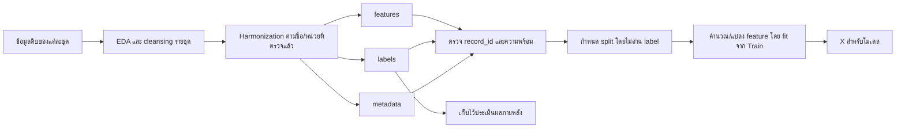
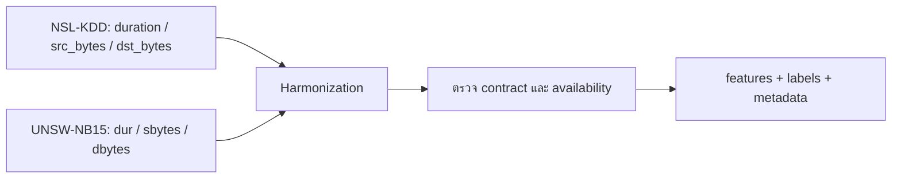

# คู่มือ Dataset กลาง: รวม NSL-KDD และ UNSW-NB15

เอกสารนี้อธิบายว่า “dataset กลาง” ในโปรเจกต์หมายถึงอะไร ข้อมูลเดินทางจากแต่ละชุดเข้ามารวมกันอย่างไร คอลัมน์ใดเป็นข้อมูลให้โมเดล (`X`), คอลัมน์ใดเป็นคำตอบ (`y`) และจุดใดที่ต้องระวังเมื่อใช้ Isolation Forest แบบ unsupervised

> **สถานะจากการรันล่าสุด:** ทั้ง NSL-KDD และ UNSW-NB15 ผ่าน readiness check และรวมได้ 406,190 records ดูค่าปัจจุบันได้จาก `common/output/reports/dataset_readiness.csv` และ `build_report.json` ทุกครั้ง เพราะสถานะอาจเปลี่ยนเมื่อไฟล์ต้นทางหรือ contract เปลี่ยน

ข้อมูลดิบและผลลัพธ์ pipeline ไม่ถูกอัปโหลดเข้า Git; สมาชิกที่ clone repository ใหม่ต้องเตรียมไฟล์ raw และรัน notebook ก่อน รายงานตัวเลขข้างต้นเป็นผลจากเครื่องที่ตรวจล่าสุด ไม่ใช่ไฟล์ output ที่รับประกันว่าจะอยู่ในทุก clone

## ภาพรวม: หนึ่ง record เดินทางอย่างไร



ตัวอย่างตัวเลขสาธิตหนึ่งแถว (ไม่ใช่สถิติจากไฟล์จริง):

| จุดที่ดู             | ค่า                                                                                                | ทำไมจึงมีขั้นนี้ / ผลที่เห็น                                                                                                                            |
| ---------------------------- | ----------------------------------------------------------------------------------------------------- | -------------------------------------------------------------------------------------------------------------------------------------------------------------------------------- |
| ต้นทาง UNSW            | `dur=2`, `sbytes=120`, `dbytes=30`, `label=1`, `attack_cat=DoS`                             | แต่ละชุดตั้งชื่อคอลัมน์ต่างกัน; label เป็นคำตอบอ้างอิง                                                                             |
| หลัง harmonization       | `duration=2`, `bytes_forward=120`, `bytes_backward=30`; label ย้ายไปตาราง `labels` | สูตรกลางอ่านชื่อเดียวกันได้; ค่า`label=1` ไม่กลายเป็น feature                                                                         |
| หลัง feature engineering | `log_duration=ln(3)≈1.099`; `log_total_bytes=ln(151)≈5.017`                                     | log บีบค่าขนาดใหญ่ให้ช่วงแคบลง; ไม่ได้เพิ่มข้อมูลจาก sensor และต้องทดสอบว่าช่วยโมเดลจริงหรือไม่ |
| ตอนประเมิน         | โมเดลให้ score ก่อน แล้วค่อย join`label_binary` ด้วย `record_id`          | วัดผลได้โดยไม่ให้คำตอบรั่วเข้า`fit()`                                                                                                            |

ตัวอย่างนี้สมมติว่าทิศทาง bytes ผ่านการตรวจสอบตาม contract แล้ว ค่า `record_id`/metadata จะช่วยระบุแถวและแหล่งที่มา แต่ต้องไม่ป้อนเข้า `X`

## 1. Dataset กลางคืออะไร

แต่ละ dataset มีรูปแบบและฟิลด์ของตัวเอง ตัวอย่างเช่น NSL-KDD ใช้ `duration`, `protocol_type`, `src_bytes`, `dst_bytes`; UNSW-NB15 ใช้ `dur`, `proto`, `sbytes`, `dbytes` ขั้น harmonization จึงแปลงเฉพาะฟิลด์ที่นิยามพอจะเทียบกันได้ให้ใช้ชื่อกลางเดียวกัน



การรวมไม่ได้หมายถึงเอาทุกคอลัมน์มาต่อกันแล้วเติมศูนย์ ช่องที่ไม่มีในบางแหล่งคงเป็น null ในตาราง harmonized พร้อม availability mask และต้องผ่านการพิจารณาก่อนเลือกเป็น feature ที่ใช้ฝึกร่วม

## 2. เส้นทางข้อมูลและหน้าที่ของแต่ละขั้น

| ขั้น                        | ทำอะไร                                                                                                    | ได้อะไร / ข้อควรระวัง                                                                                                             |
| ------------------------------- | --------------------------------------------------------------------------------------------------------------- | --------------------------------------------------------------------------------------------------------------------------------------------------- |
| 1. Raw                          | เก็บต้นฉบับจากแหล่งข้อมูล                                                              | ห้ามเขียนทับไฟล์ต้นฉบับ; checksum ใช้ตรวจว่าข้อมูลที่ผ่าน cleansing ตรงกับ raw รุ่นเดิม |
| 2. EDA                          | ตรวจ header, ชนิดข้อมูล, missing, ค่าที่ไม่ซ้ำ และ label                           | ช่วยรู้ schema จริงก่อน mapping; อย่าสรุปจากชื่อคอลัมน์อย่างเดียว                                    |
| 3. Cleansing รายชุด       | normalize ช่องว่าง/sentinel, ทำเครื่องหมายแถวซ้ำ, เก็บลำดับแถว           | ไม่ลบ record โดยอัตโนมัติ; เก็บผลไว้ใต้`Dataset/output/cleansing/`                                                   |
| 4. Harmonization รายชุด   | แปลงฟิลด์ตาม adapter ของ NSL หรือ UNSW                                                       | เขียน`features`, `labels`, `metadata` แยกกันและใช้ `record_id` ร่วมกัน                                              |
| 5. Build กลาง               | โหลดเฉพาะผล harmonized ที่ตรวจผ่าน, สร้าง split และรายงานความพร้อม | รักษา official Train/Test; ไม่ใช้ label เพื่อแบ่ง/สุ่ม Train                                                                |
| 6. Feature engineering กลาง | คำนวณ log features, fit scaler/encoder จาก Train                                                        | ใช้ transformer เดิมแปลง validation/test; label และ metadata ยังคงแยกไฟล์                                                 |

ในโครงสร้างปัจจุบัน Notebook มีโค้ดของขั้นตอนนั้นอยู่ในตัวโดยตรง ไม่ต้อง import ฟังก์ชันจากไฟล์ Python แยก: `build_dataset.ipynb` รวมตาราง harmonized และสร้าง split ส่วน `feature_engineering.ipynb` สร้าง feature กลาง กฎ schema และรายชื่อชุดข้อมูลอยู่ใน `feature_contract.json` และ `dataset_registry.json` ตามลำดับ

## 3. ตารางกลางสามชุด: อย่าสับสน X, y และ metadata

ทุกตารางเชื่อมกันด้วย `record_id` และต้องมีแถวเรียงตรงกัน ไฟล์จัดเก็บเป็น CSV เพื่อเปิดตรวจด้วยเครื่องมือทั่วไปได้

| ตาราง   | ข้อมูลสำคัญ                                                                                                      | ใช้ทำอะไร                                                                                | ป้อนเข้าโมเดลไหม                                                                         |
| ------------ | --------------------------------------------------------------------------------------------------------------------------- | ------------------------------------------------------------------------------------------------- | -------------------------------------------------------------------------------------------------------- |
| `features` | `duration`, `protocol`, `bytes_forward`, `bytes_backward`, extensions และ `record_id`                          | ตัวแปรพฤติกรรมของ traffic                                                        | ใช้เฉพาะคอลัมน์ feature; ต้อง drop`record_id` ก่อน fit/predict                  |
| `labels`   | `label_raw`, `label_source_category`, `attack_category`, `label_binary`                                             | คำตอบอ้างอิงสำหรับสรุป/ประเมินผล                                   | **ไม่ใช้ตอน fit Isolation Forest**; ใช้คำนวณ metrics หลังโมเดลทำนาย |
| `metadata` | dataset ต้นทาง,`orig_row_id`, split, capture time, split group, sample weight, duplicate flag, masks, quality flags | ตรวจสอบย้อนกลับ, แบ่งชุด, วิเคราะห์คุณภาพ/ความพร้อม | ไม่ใช่ feature model                                                                               |

`record_id` เป็นกุญแจ join ไม่ใช่สัญญาณโจมตี ตัวอย่าง `UNSW-NB15:UNSW_NB15_training-set.csv:000000123` มีไว้ชี้กลับไปยังแถวต้นทางเท่านั้น

### ตอบสั้น ๆ เรื่อง unsupervised

- **Train Isolation Forest:** ใช้ `X` เท่านั้น ไม่ส่ง `y` หรือคอลัมน์ label เข้า `fit()`
- **ประเมินหลัง train:** นำ score/prediction ไปเทียบกับ `label_binary` หรือ label รายประเภทที่เก็บแยกอยู่ได้
- **ข้อควรระวัง:** unsupervised ไม่ได้แปลว่าทุก attack จะถูกตรวจพบแน่นอน โมเดลหา record ที่ “ไม่เหมือนรูปแบบที่เรียนรู้” หาก traffic โจมตีมีอยู่บ่อยในข้อมูลฝึก โมเดลอาจมองเป็นรูปแบบปกติได้

ตัวอย่างแยกตาราง:

```text
features.csv:  record_id, duration, bytes_forward, bytes_backward, ...
labels.csv:    record_id, label_binary, attack_category, ...
metadata.csv:  record_id, source_dataset, data_split, ...

X = features.drop(columns=["record_id"])
y = labels["label_binary"]        # เก็บไว้ประเมินทีหลัง ไม่ส่งให้ IsolationForest.fit
```

## 4. ฟีเจอร์กลางและที่มา

### Core candidates

| ชื่อกลาง   | NSL-KDD           | UNSW-NB15  | หน่วย/การเตรียม                                                                    |
| ------------------ | ----------------- | ---------- | ------------------------------------------------------------------------------------------------ |
| `duration`       | `duration`      | `dur`    | วินาที; ต้องไม่ติดลบ; สร้าง`log_duration`                               |
| `protocol`       | `protocol_type` | `proto`  | จัดเป็น tcp/udp/icmp/other; One-Hot Encoder เรียนรู้จาก Train เท่านั้น |
| `bytes_forward`  | `src_bytes`     | `sbytes` | byte ในทิศทาง source → destination; สร้าง log feature                              |
| `bytes_backward` | `dst_bytes`     | `dbytes` | byte ในทิศทาง destination → source; สร้าง log feature                              |

ทั้งสี่เป็น **ผู้สมัคร** สำหรับ profile ร่วม ไม่ใช่คำยืนยันว่าความหมายตรงกันแล้วโดยอัตโนมัติ ต้องตรวจหน่วย ทิศทาง และนิยามจากเอกสารจริงทั้งสองชุด และตรวจว่าไม่มี missing ในแหล่งที่เข้าร่วม

### Derived features ที่สร้างในรอบกลาง

| ชื่อ                 | สูตร                                              | ตัวอย่างความหมาย                                                                          |
| ------------------------ | ----------------------------------------------------- | --------------------------------------------------------------------------------------------------------- |
| `log_duration`         | `log1p(duration)`                                   | ถ้า duration = 9 วินาที จะได้`ln(10)`; ลดอิทธิพลของค่าที่ใหญ่มาก |
| `log_bytes_forward`    | `log1p(bytes_forward)`                              | ลดช่วงค่าจำนวน bytes ขาออก                                                             |
| `log_bytes_backward`   | `log1p(bytes_backward)`                             | ลดช่วงค่าจำนวน bytes ขากลับ                                                           |
| `log_total_bytes`      | `log1p(forward + backward)`                         | สรุปปริมาณข้อมูลทั้งสองทิศทาง                                                |
| `log_bytes_ratio`      | `log1p(forward / (backward + 1))`                   | ค่าใหญ่ขึ้นเมื่อ traffic ขาออกมากกว่าขากลับอย่างชัดเจน       |
| `log_bytes_per_second` | `log1p((forward + backward) / max(duration, 1e-6))` | สรุปความหนาแน่นของ byte ต่อเวลาและป้องกันหารด้วยศูนย์      |

หลังได้ numeric features แล้ว `StandardScaler` จะ fit จาก `train` เท่านั้น และ `OneHotEncoder` สำหรับ protocol ก็ fit จาก Train เช่นกัน ตัวแปลงชุดเดิมถูกนำไปใช้กับ `validation`, `test` และ `train_full` เพื่อป้องกันข้อมูลจากชุดประเมินมีอิทธิพลต่อการเรียนรู้ preprocessing

## 5. Extensions ที่ไม่ควรยัดเข้าฟีเจอร์ร่วมทันที

| กลุ่ม             | คอลัมน์กลาง                                                                   | มีในชุดใดตาม contract                                                           | วิธีจัดการ                                                                                                                         |
| ---------------------- | ---------------------------------------------------------------------------------------- | ------------------------------------------------------------------------------------------- | -------------------------------------------------------------------------------------------------------------------------------------------- |
| Service / state        | `service_group`, `conn_state_group`                                                  | ทั้งสองชุดมีแหล่งตั้งต้น แต่ schema/หมวดแตกต่างกัน | map แบบระมัดระวัง; unknown เป็น other; ตรวจ mapping ก่อนใช้งาน                                                |
| Packet counts          | `packets_forward`, `packets_backward`                                                | UNSW มี`spkts`/`dpkts`; NSL ไม่มีค่าที่เทียบตรง                    | เก็บค่า UNSW และ null ใน NSL พร้อม`has_packet_stats`; ไม่เข้า core profile โดยอัตโนมัติ                |
| Packet size            | `mean_packet_size`                                                                     | คำนวณจาก UNSW bytes และ packet counts                                            | หารเฉพาะเมื่อ packet count > 0; UNSW-only extension                                                                             |
| TTL / TCP window       | `ttl_forward/backward`, `tcp_window_forward/backward`                                | UNSW-only (`sttl/dttl`, `swin/dwin`)                                                    | คงไว้ตรวจวิเคราะห์; ต้องมีโปรไฟล์เฉพาะหรือข้อมูลเทียบเคียงก่อนรวม model input |
| NSL content            | `nsl_hot`, `nsl_logged_in`, `nsl_failed_logins`, `nsl_root_shell`                | NSL-KDD เท่านั้น                                                                    | เก็บได้เป็น source-specific features แต่ไม่ใส่ร่วมกับ UNSW โดยอัตโนมัติ                               |
| NSL connection windows | `nsl_count_2s`, `nsl_srv_count_2s`, `nsl_same_srv_rate_2s`, `nsl_serror_rate_2s` | NSL-KDD เท่านั้น                                                                    | ไม่ถือว่าเทียบกับตัวนับ UNSW ได้ หากนิยาม window ไม่ตรงกัน                                        |

ค่าที่ไม่มีในแหล่งหนึ่งไม่ได้แปลว่าเป็นศูนย์ ตัวอย่างเช่น NSL ไม่มี packet count จึงต้องเป็น null ไม่ใช่ `packets_forward = 0` เพราะศูนย์จะสื่อว่า “วัดแล้วพบว่าไม่มี packet” ซึ่งต่างจาก “แหล่งนี้ไม่มีคอลัมน์นี้”

Availability masks เช่น `has_packet_stats` อยู่ใน metadata เพื่อบอกความพร้อม ไม่ถูกป้อนเข้าโมเดลโดยอัตโนมัติ เพราะโมเดลอาจเรียนรู้ว่า “มาจาก dataset ไหน” แทนที่จะเรียนรู้พฤติกรรม traffic

## 6. ฟิลด์ที่ห้ามเป็น model features

| คอลัมน์/กลุ่ม                                                       | ทำไมไม่ป้อนเข้าโมเดล                                                                          |
| ------------------------------------------------------------------------------- | ----------------------------------------------------------------------------------------------------------------- |
| `label_raw`, `label_source_category`, `attack_category`, `label_binary` | เป็นเฉลย ถ้าป้อนเข้าไปจะเกิด target leakage                                            |
| `source_dataset`                                                              | โมเดลอาจแยกแหล่งข้อมูลแทนการแยกพฤติกรรมโจมตี                          |
| `record_id`, `orig_row_id`                                                  | เป็นรหัสอ้างอิง ไม่ได้อธิบายพฤติกรรม network                                   |
| `capture_time`, timestamp ดิบ, `split_group`                             | ใช้จัดกลุ่ม/ตรวจสอบเวลา; อาจเผย split หรือช่วงเก็บข้อมูล            |
| `sample_weight`                                                               | metadata สำหรับการวิเคราะห์/ถ่วงน้ำหนัก ไม่ใช่สัญญาณใน record          |
| `dedup_flag`, availability masks, invalid-value flags                         | ใช้ audit คุณภาพ/ความพร้อม ไม่ใช่ network behavior                                        |
| `difficulty_level` (NSL), raw IP, Flow ID                                     | benchmark/source identifier หรือข้อมูลเฉพาะ environment เสี่ยงให้โมเดลจำที่มา |

ก่อนส่ง `X` เข้าโมเดล ให้เลือกเฉพาะชื่อที่อยู่ใน `feature_schema.json`; ถ้าอ่านไฟล์ต้นทางเอง ต้องตัด label และ identifier ที่กล่าวมาด้วย

## 7. การแบ่ง Train / Validation / Test

- NSL-KDD และ UNSW-NB15 รักษา official Train และ official Test ไว้
- สุ่ม 20% ของ official Train ไปเป็น Validation ด้วย seed คงที่ โดย **ไม่ดู label**; ส่วนที่เหลือเป็น Train
- `train_full` เก็บ Train เต็มหลังแยก Validation; `train` เป็นตัวอย่าง Train ที่สุ่มให้จำนวนแถวเท่ากันต่อแหล่ง เมื่อมีทั้งสองแหล่ง
- การสุ่มให้เท่ากันทำตาม source ไม่ได้ปรับสมดุลจำนวน Normal/Attack และไม่ได้ใช้ label กรองเฉพาะ Normal
- `sample_weight` ถูกเก็บใน metadata เท่านั้น ไม่ได้เข้า feature matrix ปัจจุบัน
- `KDDTest-21` เป็น view ที่อ้างถึงบาง record ใน official KDD Test ไม่ใช่ dataset เพิ่มหรือแถวที่นำมาต่อซ้ำ

รายงาน `common/output/reports/split_counts.csv` แสดงจำนวนจริงของไฟล์ที่เขียนออกมา โดยแยก `train` (หลังสุ่ม), `train_full` (ก่อนสุ่ม), `validation` และ `test` ออกจากกัน จึงใช้เทียบกับจำนวนแถวในโฟลเดอร์ `common/output/splits/` ได้โดยตรง

**ข้อจำกัดของ split ปัจจุบัน:** Validation ถูกสุ่มตามแถวจาก Train ไม่ใช่ time-based หรือ group-based split ส่วน official train/test ถูกคงตามชุดต้นทาง ดังนั้นควรตรวจ duplicate/group leakage และรายงานผลแยกตาม `source_dataset` เสมอ โดยเฉพาะเมื่อทดสอบการ generalize ข้าม dataset

## 8. “พร้อมรวม” ในรายงานหมายถึงอะไร

`common/build_dataset.ipynb` สร้าง `dataset_readiness.csv`, `feature_compatibility.json`, `build_report.json` และ split counts ไว้ใน `common/output/reports/`

- `usable_in_current_build`: feature มีและครบใน source ที่พร้อมอยู่ใน build ครั้งนี้ จึงใช้สร้าง diagnostic profile ได้
- `eligible_for_joint_profile`: ทั้ง NSL-KDD และ UNSW-NB15 พร้อม และคอลัมน์นั้นมีค่าไม่ missing ครบตามที่โค้ดตรวจ
- `source_local_diagnostic`: มีเพียงบาง source เช่น NSL-KDD อย่างเดียว ไม่ควรอธิบายว่าเป็นผลฝึกร่วมข้าม dataset

การตรวจครบ/ไม่ครบเป็นเพียง **ประตูเชิงเทคนิค** ไม่ได้พิสูจน์เชิงวิทยาศาสตร์ว่า units, ทิศทาง, วิธีเก็บ หรือ distribution เท่ากัน การอนุมัติ feature สำหรับงานร่วมยังต้องตรวจ source documentation และทดลองผลแยก source

## 9. ไฟล์ output อยู่ตรงไหน

```text
data-pipeline/
├── NSL-KDD/output/harmonized/        # harmonized triplet ของ NSL-KDD
├── UNSW-NB15/output/harmonized/      # harmonized triplet ของ UNSW-NB15 เมื่อรันผ่าน
└── common/output/
    ├── harmonized/                   # ข้อมูลจาก source ที่พร้อมใน build
    ├── splits/{train,train_full,validation,test}/
    │   ├── features.csv
    │   ├── labels.csv
    │   └── metadata.csv
    ├── feature_engineering/{split}/  # ตารางพร้อมแปลงแล้ว และ label/metadata แยก
    └── reports/                       # readiness, compatibility, split และ build reports
```

ผล feature engineering มี `record_id` เพื่อ join กลับ; ต้อง drop ก่อน fit/predict สัญญารายละเอียดของชื่อฟีเจอร์อยู่ใน `common/output/feature_engineering/feature_schema.json` หลังรันสำเร็จ ส่วนกฎที่คาดหวังอยู่ใน `common/feature_contract.json`

## 10. ขั้นตอนรันตั้งแต่ต้นจนได้ชุดกลาง

จาก project root:

```powershell
python -m pip install -r data-pipeline/requirements.txt
python data-pipeline/UNSW-NB15/download.py
```

จากนั้นรัน notebook ตามลำดับ: EDA → Cleansing → Harmonization ของแต่ละ dataset, แล้ว `common/build_dataset.ipynb`, และสุดท้าย `common/feature_engineering.ipynb` ตรวจไฟล์รายงานก่อนนำไปเทรนทุกครั้ง ถ้า UNSW ยังไม่มีไฟล์ ระบบควรแจ้ง incomplete/partial build ไม่ควรเรียกว่า combined dataset

## 11. ข้อเสนอแนะสำหรับทดลอง Isolation Forest

1. เริ่มจาก baseline ที่ฝึก NSL-only และประเมิน NSL Test เพื่อให้มีจุดเปรียบเทียบที่ตรวจซ้ำได้
2. เมื่อ UNSW พร้อม ให้ฝึก joint profile แล้วรายงานผลแยก UNSW Test และ NSL Test ไม่รายงานแต่ค่าเฉลี่ยรวมอย่างเดียว
3. ทดลอง train/test ข้ามแหล่ง (เช่น train NSL, test UNSW และกลับด้าน) เพื่อดู domain shift
4. แสดงทั้ง anomaly rate, confusion matrix/precision/recall และผลแยก attack category; เลือก threshold จาก validation ไม่เลือกจาก test
5. แยกผลของการเปลี่ยน feature, sampling และ contamination/threshold ทีละอย่าง เพื่อรู้ว่าอะไรทำให้ผลเปลี่ยน
6. ถ้าต้องการฝึกเฉพาะ traffic ปกติ ต้องกำหนดวิธีคัด normal อย่างชัดเจนใน **การทดลองแยก**; pipeline กลางปัจจุบันไม่ใช้ label เพื่อคัด normal ให้ Train

ข้อมูลกลางเป็นจุดเริ่มต้นที่ช่วยให้ฟิลด์มีรูปแบบร่วมกัน ไม่ใช่หลักประกันว่าโมเดลที่ฝึกกับสอง dataset จะทำงานดีในทุกเครือข่าย
