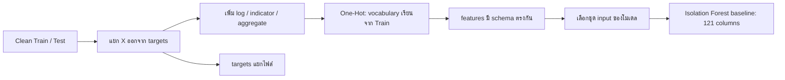

# คู่มือ Feature Engineering สำหรับ NSL-KDD

เอกสารนี้อธิบายว่า notebook `feature_engineering.ipynb` รับข้อมูลอะไร สร้างคอลัมน์ใหม่อย่างไร และควรส่งคอลัมน์ชุดใดให้โมเดล เนื้อหาจัดตามลำดับการทำงาน พร้อมสูตร ตัวอย่าง และข้อควรระวัง

> Feature ใหม่เป็นสมมติฐานที่ควรทดลอง ไม่ได้รับประกันว่าจะทำให้โมเดลแม่นขึ้น

## ภาพขั้นตอน พร้อมตัวอย่างก่อน–หลัง



ตัวอย่างค่าจำลองเพื่ออธิบายสิ่งที่โมเดลจะเห็น:

| ขั้น | ค่า | เหตุ → ผล |
|---|---|---|
| Clean input | `src_bytes=120`, `dst_bytes=30`, `protocol_type=tcp`, `label=neptune` | มีทั้งตัวเลข หมวดหมู่ และคำตอบ |
| สร้าง feature | `log1p_src_bytes=ln(121)≈4.796`; `log1p_dst_bytes=ln(31)≈3.434` | ค่าที่โตเร็วถูกบีบช่วง; ความแตกต่างของค่าสูงยังอยู่แต่ไม่ห่างมากเท่าเดิม |
| เข้ารหัสหมวดหมู่ | `protocol_type_tcp=1`, หมวด protocol อื่นเป็น 0 | เปลี่ยนข้อความเป็นตัวเลข โดยใช้ vocabulary จาก Train เพื่อให้ Test มีลำดับคอลัมน์เหมือนกัน |
| แยกคำตอบ | `label=neptune` อยู่ใน targets ไม่อยู่ใน features | ป้องกัน target leakage; IF baseline fit ด้วย 121 features ไม่ใช้ engineered alternatives ทั้ง 36 ตัว |

การเพิ่มคอลัมน์ไม่ได้ทำให้โมเดลดีขึ้นโดยอัตโนมัติ: features ใหม่อาจช่วยแสดงพฤติกรรมบางอย่างชัดขึ้น แต่ก็อาจซ้ำกับข้อมูลเดิมและเปลี่ยนการแบ่งของต้นไม้ จึงควรเทียบ baseline กับชุดทดลองบน split และเกณฑ์เดียวกัน

## 1. สรุปภาพรวม

| ช่วง | มีอะไรบ้าง | จำนวนคอลัมน์ |
|---|---|---:|
| หลัง cleansing: ตัวแปรอธิบาย | ตัวเลขเดิม 37 + หมวดหมู่ 3 (`protocol_type`, `service`, `flag`) | 40 |
| หลัง cleansing: คำตอบอ้างอิง | `label`, `attack_family`, `is_attack` | 3 |
| `*_features.csv` หลัง feature engineering | ตัวเลขเดิม 37 + feature สร้างเพิ่ม 36 + One-Hot 84 | **157** |
| `*_targets.csv` | คำตอบอ้างอิง 3 คอลัมน์ แยกไฟล์จาก features | **3** |
| ชุด input ของ Isolation Forest baseline ปัจจุบัน | ตัวเลขเดิม 37 + One-Hot 84; ไม่รวม engineered 36 ตัว | **121** |

```text
Clean CSVs
   ├── X/features: 37 ตัวเลขเดิม + 36 engineered + 84 one-hot = 157 features
   │      └── Isolation Forest baseline เลือก 37 ตัวเลขเดิม + 84 one-hot = 121
   └── y/reference: label + attack_family + is_attack = 3 targets (แยกไฟล์)
```

## 2. ไฟล์ที่อ่านและไฟล์ที่สร้าง

### Input

Notebook อ่านไฟล์ที่ได้จาก cleansing:

- `data-pipeline/sub-dataset/NSL-KDD/output/cleansing/KDDTrain_clean.csv`
- `data-pipeline/sub-dataset/NSL-KDD/output/cleansing/KDDTest_clean.csv`
- `data-pipeline/sub-dataset/NSL-KDD/output/cleansing/KDDTest-21_clean.csv`

โฟลเดอร์ input และ output ถูกค้นจากตำแหน่งโปรเจกต์ จึงไม่จำเป็นต้องเขียน path ของเครื่องใครลงใน notebook ต้องรัน cleansing ก่อน หากไฟล์เหล่านี้ไม่มี notebook จะแจ้งให้ทำขั้นนั้นก่อน

### Output

บันทึกไว้ที่ `data-pipeline/sub-dataset/NSL-KDD/output/feature_engineering/`

| ไฟล์ | ใช้ทำอะไร |
|---|---|
| `KDDTrain_features.csv`, `KDDTest_features.csv`, `KDDTest-21_features.csv` | ข้อมูล `X` สำหรับโมเดล มี 157 คอลัมน์ |
| `KDDTrain_targets.csv`, `KDDTest_targets.csv`, `KDDTest-21_targets.csv` | คำตอบ `y`/ข้อมูลอ้างอิง 3 คอลัมน์ |
| `feature_schema.csv` | ชื่อคอลัมน์ ชนิดของ feature และคำอธิบาย ใช้ตรวจ schema |
| `feature_engineering_config.json` | บันทึกคอลัมน์และนโยบายที่ใช้แปลงข้อมูล |
| `unknown_category_report.csv` | รายงานหมวดหมู่ในแต่ละ split ที่ไม่พบใน Train |
| `feature_validation_report.csv` | ตรวจจำนวนแถว/คอลัมน์ missing, infinite และ schema |

### จำนวนแถวที่ได้จากข้อมูลรอบนี้

| Split | แถวใน features | แถวใน targets | คอลัมน์ features | Missing/Infinite | Schema ตรงกับ Train |
|---|---:|---:|---:|---:|---|
| KDDTrain | 125,973 | 125,973 | 157 | 0 / 0 | ใช่ |
| KDDTest | 22,544 | 22,544 | 157 | 0 / 0 | ใช่ |
| KDDTest-21 | 11,850 | 11,850 | 157 | 0 / 0 | ใช่ |

แถวใน features และ targets จับคู่กันตามลำดับแถวเดิม ห้าม sort หรือกรองไฟล์ใดไฟล์หนึ่งโดยไม่ทำแบบเดียวกันกับอีกไฟล์

## 3. แยก X ออกจาก y ก่อนเทรน

`X` คือข้อมูลเบาะแสที่โมเดลใช้เรียนรู้ ส่วน `y` คือคำตอบอ้างอิงที่เราต้องการให้โมเดลทำนาย หรือเก็บไว้ตรวจผลภายหลัง

| Target | ความหมาย | ใช้เมื่อ |
|---|---|---|
| `label` | ชื่อแบบละเอียด เช่น `normal`, `neptune` | จำแนกชื่อ traffic/attack รายตัว |
| `attack_family` | กลุ่มกว้าง เช่น Normal, DoS, Probe, R2L, U2R | จำแนกกลุ่มการโจมตี |
| `is_attack` | 0 = normal, 1 = attack | จำแนกแบบปกติ/โจมตี (binary) |

ตัวอย่างเมื่อทำ supervised classification:

```python
import pandas as pd

X_train = pd.read_csv("data-pipeline/sub-dataset/NSL-KDD/output/feature_engineering/KDDTrain_features.csv")
train_targets = pd.read_csv("data-pipeline/sub-dataset/NSL-KDD/output/feature_engineering/KDDTrain_targets.csv")
y_train = train_targets["attack_family"]  # หรือเลือก is_attack / label
```

คอลัมน์ target ที่เลือกเป็น `y` ต้องไม่อยู่ใน `X` ด้วย มิฉะนั้นโมเดลจะเห็นคำตอบล่วงหน้า (target leakage)

### กรณี Isolation Forest (unsupervised)

Isolation Forest ฝึกด้วย `X` เท่านั้น ไม่รับ `y` ตอน `fit()`. หลังจากให้คะแนน KDDTest แล้ว จึงนำ `is_attack` หรือ `label` จาก targets มาเทียบเพื่อคำนวณผลประเมิน

ในโปรเจกต์นี้สคริปต์ไฟล์เดียว `model/isolation-forest/train_single.py` เลือก baseline 121 คอลัมน์ (`original_numeric` + `one_hot`) และยังไม่ใช้ engineered alternatives 36 คอลัมน์ เพื่อให้มี baseline ที่แยกจากการทดลอง feature engineering ได้ชัด

> mapping ของ `attack_family` ครอบคลุม attack บางชื่อเท่านั้น ชื่อที่ไม่อยู่ใน mapping จะเป็น `Unknown` แต่ `is_attack` ยังคงเป็น 1 หาก label ไม่ใช่ `normal` ดังนั้นควรตรวจ mapping ก่อนใช้ `attack_family` เป็น y สำหรับ supervised model

## 4. Feature ที่ notebook สร้าง

ค่าตัวเลขต้นฉบับ 37 คอลัมน์ยังคงอยู่ใน full feature set การแปลงด้านล่างเป็นคอลัมน์เพิ่ม ไม่ได้เขียนทับค่าต้นฉบับ

### 4.1 Log transform — เพิ่ม 13 คอลัมน์

ตัวแปรบางตัว เช่น bytes และจำนวน connection มีค่าต่ำจำนวนมาก แต่มีบางแถวที่ใหญ่มาก ทำให้ช่วงตัวเลขกว้างและเบ้ การแปลง log ช่วยบีบช่วงค่าสูง

สูตร:

```text
log1p_x = ln(1 + max(x, 0))
```

การบวก 1 ทำให้ค่า 0 แปลงได้ และการใช้ `max(x, 0)` ป้องกัน log ของค่าติดลบ (ข้อมูลควรผ่าน range validation มาก่อน)

| Feature ใหม่ | สร้างจาก |
|---|---|
| `log1p_duration` | `duration` |
| `log1p_src_bytes` | `src_bytes` |
| `log1p_dst_bytes` | `dst_bytes` |
| `log1p_count` | `count` |
| `log1p_srv_count` | `srv_count` |
| `log1p_dst_host_count` | `dst_host_count` |
| `log1p_dst_host_srv_count` | `dst_host_srv_count` |
| `log1p_hot` | `hot` |
| `log1p_num_failed_logins` | `num_failed_logins` |
| `log1p_num_compromised` | `num_compromised` |
| `log1p_num_root` | `num_root` |
| `log1p_num_file_creations` | `num_file_creations` |
| `log1p_num_access_files` | `num_access_files` |

ตัวอย่าง:

| ค่าเดิม `x` | `ln(1+x)` โดยประมาณ |
|---:|---:|
| 0 | 0.00 |
| 10 | 2.40 |
| 1,000 | 6.91 |
| 1,000,000 | 13.82 |

เช่น `src_bytes=1,000,000` จะได้ `log1p_src_bytes≈13.82` ขณะที่ `src_bytes` เดิมก็ยังอยู่ด้วย การแปลงลักษณะนี้มักน่าทดลองกับ Logistic Regression, SVM และ neural network ที่ไวต่อสเกล; tree models มักรับมือกับค่าดิบได้ดีอยู่แล้ว จึงควรเทียบผลแทนการคาดเดา

### 4.2 Indicator — เพิ่ม 14 คอลัมน์

ตัวแปรบางตัวเป็นศูนย์เกือบทุกแถว เช่น failed login หรือ root activity จึงเพิ่มคอลัมน์ 0/1 เพื่อบอกว่า “เกิดเหตุการณ์นี้หรือไม่” โดยไม่สนจำนวนครั้ง

กติกาสำหรับคอลัมน์เดี่ยว: `has_x = 1` เมื่อ `x > 0`; มิฉะนั้นเป็น 0

| Feature ใหม่ | ดูจากคอลัมน์ |
|---|---|
| `has_land` | `land` |
| `has_wrong_fragment` | `wrong_fragment` |
| `has_urgent` | `urgent` |
| `has_hot` | `hot` |
| `has_num_failed_logins` | `num_failed_logins` |
| `has_num_compromised` | `num_compromised` |
| `has_root_shell` | `root_shell` |
| `has_su_attempted` | `su_attempted` |
| `has_num_root` | `num_root` |
| `has_num_file_creations` | `num_file_creations` |
| `has_num_shells` | `num_shells` |
| `has_num_access_files` | `num_access_files` |
| `has_root_activity` | 1 ถ้า `root_shell > 0` หรือ `su_attempted > 0` หรือ `num_root > 0` |
| `has_file_or_shell_activity` | 1 ถ้า `num_file_creations > 0` หรือ `num_shells > 0` หรือ `num_access_files > 0` |

ตัวอย่าง:

```text
num_failed_logins = 0  -> has_num_failed_logins = 0
num_failed_logins = 2  -> has_num_failed_logins = 1
```

Indicator ไม่ได้เพิ่มเหตุการณ์ใหม่จากข้อมูลเดิม แต่ให้ representation ที่เน้น “มี/ไม่มี” ซึ่งอาจช่วยกับเหตุการณ์หายาก ขณะเดียวกันก็ซ้ำข้อมูลกับคอลัมน์เดิม จึงควรทดสอบว่าช่วยจริงหรือไม่

### 4.3 Byte features — เพิ่ม 3 คอลัมน์

**ปริมาณข้อมูลรวม**

```text
total_bytes = src_bytes + dst_bytes
log1p_total_bytes = ln(1 + max(total_bytes, 0))
```

ตัวอย่าง: ส่ง 800 bytes และรับ 200 bytes จะได้ `total_bytes=1,000` และ `log1p_total_bytes≈6.91` การเก็บ `src_bytes` และ `dst_bytes` เดิมไว้ยังสำคัญ เพราะแยกทิศทางได้ ขณะที่ยอดรวมบอก volume รวม

**ความต่างแบบมีทิศทาง**

```text
signed_log_byte_difference
  = sign(src_bytes - dst_bytes) * ln(1 + abs(src_bytes - dst_bytes))
```

- ค่าบวก: source ส่ง bytes มากกว่าที่ได้รับ
- ค่าลบ: destination ส่ง bytes กลับมามากกว่า
- ใกล้ศูนย์: ปริมาณสองทิศทางใกล้เคียงกัน

signed log เก็บทิศทางไว้พร้อมลดอิทธิพลของความต่างขนาดใหญ่มาก

### 4.4 Error และ host/service aggregates — เพิ่มอีก 6 คอลัมน์

รวมกับ byte features 3 ตัวด้านบน กลุ่มสรุปทั้งหมดจึงมี 9 aggregate features

| Feature ใหม่ | สูตร | ใช้สรุปอะไร |
|---|---|---|
| `syn_error_mean` | `(serror_rate + srv_serror_rate) / 2` | SYN error เฉลี่ยระหว่างกลุ่ม connection กับ service |
| `reject_error_mean` | `(rerror_rate + srv_rerror_rate) / 2` | reject error เฉลี่ยระหว่างสองระดับ |
| `overall_error_rate` | ค่าเฉลี่ยของ `serror_rate`, `srv_serror_rate`, `rerror_rate`, `srv_rerror_rate` | ภาพรวม error rate สี่ค่า |
| `host_service_count_ratio` | `dst_host_srv_count / (dst_host_count + 1)` | เปรียบเทียบจำนวน service กับจำนวน connection ของ host; `+1` กันการหารศูนย์ |
| `host_service_rate_gap` | `dst_host_same_srv_rate - same_srv_rate` | ความต่างของอัตรา same-service ในคนละบริบท |
| `host_error_mean` | ค่าเฉลี่ยของ `dst_host_serror_rate`, `dst_host_srv_serror_rate`, `dst_host_rerror_rate`, `dst_host_srv_rerror_rate` | error rate เฉลี่ยในระดับ destination host |

ตัวอย่าง: `serror_rate=0.8` และ `srv_serror_rate=0.6` ให้ `syn_error_mean=(0.8+0.6)/2=0.7`

ค่าเฉลี่ยของ rate ที่อยู่ใน [0,1] ยังคงอยู่ในช่วงนั้น ส่วน `host_service_rate_gap` เป็นผลต่าง จึงมีโอกาสเป็นค่าลบได้และไม่ใช่ probability `host_service_count_ratio` ใช้ตัวหารบวก 1 เพื่อป้องกันหารศูนย์ แต่ทั้งสอง feature เป็นตัวสรุปเชิงทดลอง ไม่ได้พิสูจน์เหตุและผล

### 4.5 เหตุใดไม่สร้าง `count - srv_count` หรือ `srv_count / count`

`count` และ `srv_count` นับ connection ด้วยเงื่อนไข/กลุ่มอ้างอิงคนละแบบ การลบอาจถูกตีความผิดว่าเป็น “จำนวน connection ของ service อื่น” และการหารก็อาจไม่ใช่สัดส่วนที่มีความหมายหรืออยู่ใน [0,1] เสมอ Notebook จึงไม่สร้าง `connection_service_gap` หรือ `srv_to_connection_ratio` ในชุดปัจจุบัน

หากต้องการทดลอง ให้แยกเป็น ablation ตรวจการกระจายและอธิบายความหมายที่ตั้งใจไว้ก่อน

## 5. แปลงหมวดหมู่เป็นตัวเลขด้วย One-Hot Encoding

โมเดลตัวเลขไม่ควรตีความข้อความ เช่น `tcp`, `udp`, `icmp` ว่าเป็นตัวเลขที่มีลำดับ จึงสร้างคอลัมน์ 0/1 หนึ่งคอลัมน์ต่อหนึ่งหมวด

ตัวอย่าง:

| protocol_type เดิม | `protocol_type=tcp` | `protocol_type=udp` | `protocol_type=icmp` |
|---|---:|---:|---:|
| tcp | 1 | 0 | 0 |
| udp | 0 | 1 | 0 |
| icmp | 0 | 0 | 1 |

| คอลัมน์ต้นทาง | จำนวนหมวดใน Train | จำนวน One-Hot features |
|---|---:|---:|
| `protocol_type` | 3 | 3 |
| `service` | 70 | 70 |
| `flag` | 11 | 11 |
| **รวม** | **84** | **84** |

Vocabulary และลำดับคอลัมน์เรียนจาก KDDTrain เท่านั้น แล้วใช้ลำดับเดียวกันกับ KDDTest และ KDDTest-21 เพื่อไม่ให้ test เป็นผู้กำหนด schema เอง หากพบหมวดใน test ที่ train ไม่เคยเห็น นโยบายปัจจุบันจะเข้ารหัสเป็นศูนย์ในกลุ่มนั้นและบันทึกไว้ใน `unknown_category_report.csv` รอบข้อมูลปัจจุบันไม่พบหมวดที่ไม่รู้จักทั้งสาม split

คอลัมน์ข้อความเดิมทั้งสาม (`protocol_type`, `service`, `flag`) จึงไม่อยู่ใน `*_features.csv`; คอลัมน์ One-Hot ที่แทนหมวดเหล่านี้เป็นตัวเลขจะถูกใช้แทน

## 6. เหตุใดไม่ scale ข้อมูลใน notebook

การ scale ควรเลือกตามโมเดล และทำภายใน pipeline ของโมเดล:

| โมเดล | โดยทั่วไปต้องพิจารณา scale หรือไม่ |
|---|---|
| Decision Tree, Random Forest, Gradient Boosting | มักไม่จำเป็น |
| Logistic Regression, SVM, KNN, Neural Network | มักได้ประโยชน์จากการ scale |
| Isolation Forest | baseline นี้ใช้ numeric + One-Hot โดยไม่ scale; ถ้าทดลอง preprocessing ให้เทียบผลแยกต่างหาก |

หาก scale ให้ `fit` scaler ด้วย Train เท่านั้น แล้วใช้ scaler ตัวเดิม `transform` validation/test ห้ามคำนวณ mean, standard deviation, min/max หรือ quantile จาก test เพราะจะเป็น data leakage

## 7. การตรวจสอบผลก่อนนำไปใช้

Notebook ตรวจสิ่งต่อไปนี้ก่อนบันทึก output:

1. Cleaned schema ของ Train, Test และ Test-21 ตรงกัน
2. `difficulty` และ `num_outbound_cmds` ถูกลบไปแล้ว
3. `label`, `attack_family`, `is_attack` ถูกแยกไปเป็น targets
4. ทั้งสาม split มี feature columns และลำดับเดียวกันกับ Train
5. จำนวนแถว features เท่ากับจำนวนแถว targets
6. ตรวจ missing และ infinite ใน features รวมถึง missing ใน targets

ผลปัจจุบัน: ทุก split มี 157 feature columns; missing/infinite/target missing เป็น 0; จำนวนแถว features/targets ตรงกัน และ schema match เป็น True

การผ่าน validation หมายถึงรูปแบบข้อมูลสอดคล้องและพร้อมส่งต่อ ไม่ได้ยืนยันว่า feature ทุกตัวมีประโยชน์หรือโมเดลจะตรวจจับได้แม่น

## 8. ป้องกัน target leakage และการประเมินที่หลอกตัวเอง

- อย่าใส่ `label`, `attack_family` หรือ `is_attack` ลงใน `X`
- อย่า fit encoder, scaler หรือ feature selector ด้วยข้อมูล test
- ทำ target encoding ภายใน cross-validation เท่านั้น
- แบ่ง validation จาก Train สำหรับ tuning; กัน Test ไว้ประเมินผลสุดท้าย
- ถ้าทำ oversampling ให้ทำกับ train fold หลังแบ่งข้อมูลแล้ว ไม่ทำก่อนแบ่ง
- อย่าลบ outlier อัตโนมัติ เพราะ traffic ที่สุดโต่งอาจเป็นสัญญาณที่ต้องการตรวจจับ
- สำหรับ Isolation Forest ใช้ y หลัง scoring เพื่อคำนวณ metric ได้ แต่ห้ามใช้ y จาก Test เลือก threshold แล้วรายงานผลบน Test ชุดเดิมเป็นการประเมินที่ไม่ลำเอียง

## 9. วิธีทดลองว่า feature ใหม่ช่วยจริงหรือไม่

เริ่มจาก baseline แล้วเพิ่มทีละกลุ่ม โดยคง split, วิธี threshold และพารามิเตอร์อื่นให้เทียบกันได้:

| การทดลอง | ชุด features |
|---|---|
| Baseline | numeric เดิม + One-Hot |
| A | Baseline + log1p |
| B | Baseline + indicators |
| C | Baseline + byte/count-derived features |
| D | Baseline + error/host aggregates |
| Full/ablation | เปรียบเทียบชุดรวมและชุดที่ตัดบางกลุ่มออก |

ข้อมูลโจมตีไม่สมดุล จึงไม่ควรดู Accuracy อย่างเดียว ควรรายงาน Macro F1, Balanced Accuracy, confusion matrix, precision/recall และผลแยกตาม attack family โดยเฉพาะกลุ่มที่มีตัวอย่างน้อย เช่น R2L และ U2R สำหรับ anomaly detection ให้พิจารณา PR-AUC/ROC-AUC และผลที่ threshold ใช้งานจริงด้วย

สำหรับ Isolation Forest หากเพิ่ม engineered features ทั้งหมด จำนวนคอลัมน์ที่ส่งให้โมเดลจะเพิ่มจาก 121 เป็น 157; เนื่องจาก engineered features บางตัวเป็นการแปลงข้อมูลเดิม การเพิ่มอาจทำให้สัญญาณบางมิติถูกนับซ้ำในทางปฏิบัติ จึงควรเพิ่มทีละกลุ่มและดูผลบน validation ก่อน

## 10. ตัวอย่างโหลดไฟล์ไปใช้งาน

รันจากโฟลเดอร์รากของ repository:

```python
import pandas as pd

base = "data-pipeline/sub-dataset/NSL-KDD/output/feature_engineering"
X_train = pd.read_csv(f"{base}/KDDTrain_features.csv")
train_targets = pd.read_csv(f"{base}/KDDTrain_targets.csv")
X_test = pd.read_csv(f"{base}/KDDTest_features.csv")
test_targets = pd.read_csv(f"{base}/KDDTest_targets.csv")

# ตัวอย่าง supervised multiclass:
y_train = train_targets["attack_family"]
y_test = test_targets["attack_family"]

# หากเป็น binary classification ให้เลือกแทนด้วย:
# y_train = train_targets["is_attack"]
# y_test = test_targets["is_attack"]
```

สำหรับ Isolation Forest ให้ fit ด้วย `X_train` เท่านั้น และใช้ `test_targets` หลัง scoring เพื่อประเมินผล

## 11. ความหมายของผลลัพธ์และข้อจำกัด

- Feature ใหม่เป็นอีกวิธีแทนข้อมูลเดิม ไม่ใช่ข้อมูลจริงชุดใหม่ที่เก็บจาก network เพิ่ม
- Feature ที่มีชื่อชวนสงสัยไม่ได้ยืนยันว่า record เป็น attack; พฤติกรรมปกติที่พบไม่บ่อยก็อาจถูก flag ได้
- คอลัมน์ที่ซ้ำหรือสัมพันธ์กันอาจเปลี่ยนผลโมเดล โดยเฉพาะวิธีที่สุ่มเลือก feature หรือคำนวณระยะห่าง
- Cluster ID จากขั้นโมเดลเป็นหมายเลขกลุ่ม ไม่ใช่ชื่อ attack family
- ชุดข้อมูลนี้เป็น benchmark สำหรับทดลอง ไม่ได้ยืนยันผลกับ traffic ปัจจุบันหรือระบบ production
- คำอธิบายคอลัมน์ดิบครบ 43 ช่องและรายละเอียด target ดูเพิ่มได้ที่ [คู่มือ Dataset NSL-KDD](dataset_guide.md)
