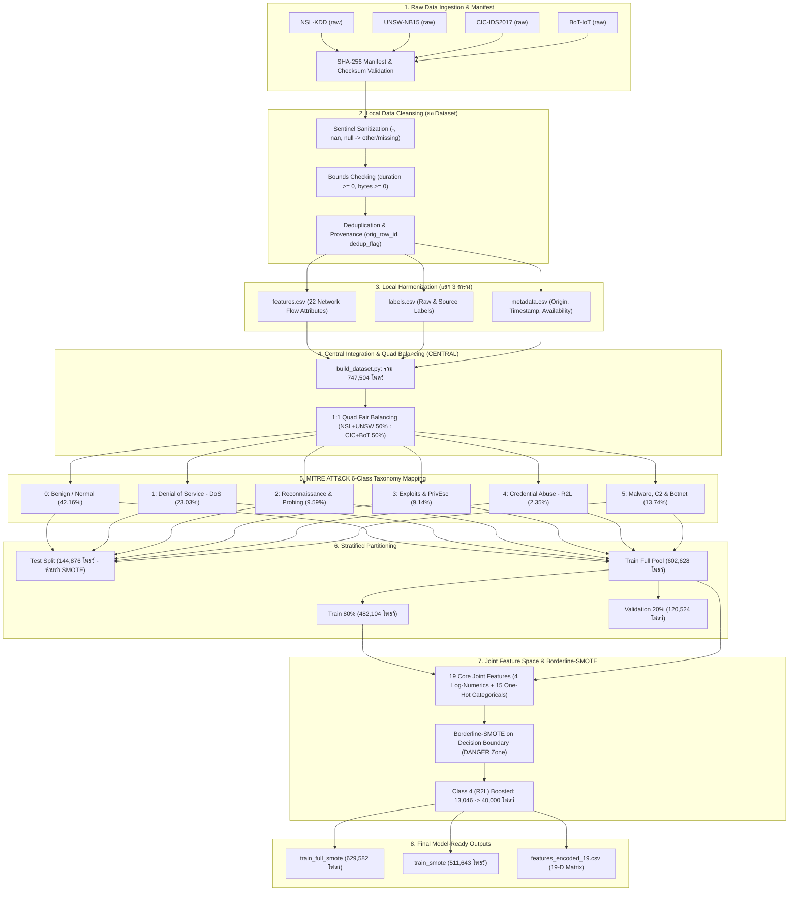

# Data Journey: Architecture and Pipeline of CENTRAL Dataset

เอกสารนี้อธิบายสถาปัตยกรรมและกระบวนการเดินทางของข้อมูลตั้งแต่ไฟล์ดิบ (Raw Data) ของทั้ง 4 ชุดข้อมูล (`NSL-KDD`, `UNSW-NB15`, `CIC-IDS2017`, `BoT-IoT`) จนถึงชุดข้อมูลรวมศูนย์ **CENTRAL Dataset (747,504 โฟลว์)** และการสังเคราะห์ตัวอย่างกลุ่มน้อยด้วย **Borderline-SMOTE** บนพื้นที่ฟีเจอร์ร่วม 19 มิติ ตามมาตรฐาน **MITRE ATT&CK 6-Class Taxonomy**

---

## 1. ภาพรวมสถาปัตยกรรมกระบวนการ (Pipeline Architecture Flowchart)



---

## 2. ขั้นตอนการประมวลผลข้อมูลอย่างละเอียด (Step-by-Step Breakdown)

### ขั้นตอนที่ 1: การตรวจรับไฟล์ดิบและควบคุมความสมบูรณ์ (Raw Data Ingestion & Manifest)
<<<<<<< HEAD
เมื่อไฟล์ดิบของทั้ง 4 ชุดข้อมูลถูกดาวน์โหลดมาไว้ใน `data-pipeline/sub-dataset/<DATASET_NAME>/raw/`:
=======
เมื่อไฟล์ดิบของทั้ง 4 ชุดข้อมูลถูกจัดเตรียมใน `data-pipeline/<DATASET_NAME>/raw/`:
* **NSL-KDD & UNSW-NB15**: ใช้ไฟล์ทางการดั้งเดิมจาก Canadian Institute for Cybersecurity และ UNSW Canberra
* **CIC-IDS2017 & BoT-IoT**: ดาวน์โหลดทราฟฟิกจริงอัตโนมัติจาก Verified Mirrors (Hugging Face / UNSW IoT 5% Mirror) ด้วยสคริปต์ `download.py --source online` พร้อมรองรับการกำหนดขนาดตัวอย่าง (`--train_samples`, `--test_samples`)
>>>>>>> 43bb5f0aa7105b19fff642e27ac43fadfe778fff
* **Immutable Raw Data Policy**: ข้อมูลดิบต้นฉบับจะถูกกำหนดสิทธิ์อ่านอย่างเดียว (Read-Only) จะไม่มีการแก้ไขหรือเขียนทับไฟล์ดิบโดยเด็ดขาด หากกระบวนการผิดพลาดจะต้องย้อนกลับมาเริ่มจากไฟล์ดิบเดิมได้เสมอ
* **Cryptographic Checksum Verification**: คำนวณค่าแฮช `SHA-256` และขนาดไฟล์ (Bytes) บันทึกไว้ใน `source_manifest.csv` เพื่อยืนยันว่าข้อมูลต้นฉบับตรงกันทุกครั้งที่มีการประมวลผล

---

### ขั้นตอนที่ 2: การทำความสะอาดข้อมูลเฉพาะชุด (Local Data Cleansing)
ไฟล์ของแต่ละชุดข้อมูลมีรูปแบบและข้อบกพร่องที่ต่างกัน:
1. **การจัดการค่า Sentinel และ Missing Values**:
   * ตรวจจับค่าว่าง, เครื่องหมาย `-`, `null`, `nan`, `none`, `n/a`, `inf`, `-inf`
   * แปลงข้อความที่ไม่มีข้อมูลให้เป็นสถานะ Missing ตามหลักสถิติ โดยไม่แทนค่าด้วยเลข 0 โดยพลการ
   * ใน UNSW-NB15 ค่า `service = '-'` ถูกแปลงเป็นหมวดหมู่ `'other'` อย่างเป็นทางการ
2. **การตรวจสอบขอบเขตทางกายภาพ (Physical Bounds Checking)**:
   * ตรวจสอบว่า $\text{duration} \ge 0$, $\text{bytes\_forward} \ge 0$, และ $\text{bytes\_backward} \ge 0$
3. **การติดตามความซ้ำซ้อนและประวัติข้อมูล (Deduplication & Provenance)**:
   * ทำการตรวจจับแถวที่มีข้อมูลซ้ำกัน โดยไม่ลบแถวทิ้งเงียบๆ แต่จะกำกับด้วย `dedup_flag = True/False`
   * สร้างรหัสประจำแถวดั้งเดิม `orig_row_id` (เช่น `UNSW-NB15:training-set:000001`) เพื่อให้ตรวจสอบย้อนกลับไปยังไฟล์ต้นฉบับได้ 100%

---

### ขั้นตอนที่ 3: การปรับเข้าสู่มาตรฐานกลางและการแยก 3 ตาราง (Harmonization)
ขั้นตอนนี้ทำหน้าที่แมปฟิลด์ต้นทางที่มีชื่อและหน่วยต่างกัน ให้เข้าสู่สกีมามาตรฐานกลาง:

| ข้อมูลเครือข่าย | NSL-KDD | UNSW-NB15 | CIC-IDS2017 | BoT-IoT | ชื่อฟิลด์มาตรฐานกลาง |
| :--- | :--- | :--- | :--- | :--- | :--- |
| **ระยะเวลาเชื่อมต่อ** | `duration` (วินาที) | `dur` (วินาที) | `flow_duration` ($\mu s \to s$) | `dur` (วินาที) | `duration` |
| **ปริมาณไบต์ขาไป** | `src_bytes` | `sbytes` | `total_fwd_bytes` | `sbytes` | `bytes_forward` |
| **ปริมาณไบต์ขากลับ** | `dst_bytes` | `dbytes` | `total_bwd_bytes` | `dbytes` | `bytes_backward` |
| **โปรโตคอล** | `protocol_type` | `proto` | `protocol` | `proto` | `protocol` (`tcp`, `udp`, `icmp`, `other`) |
| **ประเภทบริการ** | `service` | `service` | `service` | `service` | `service_group` (7 หมวดหลัก) |
| **สถานะการเชื่อมต่อ** | `flag` | `state` | `flags` | `state` | `conn_state_group` (4 หมวดหลัก) |

#### การแยกข้อมูลออกเป็น 3 ตารางอิสระ (3-Table Decoupling):
เพื่อป้องกันปัญหา **Target Leakage** และแยกหน้าที่ของข้อมูลชัดเจน:
* **`features.csv`**: มีเฉพาะข้อมูลพฤติกรรมเครือข่าย 22 คอลัมน์ที่โมเดลจะใช้เป็น Input เท่านั้น โดยไม่มี Label, Metadata หรือ ID อื่นใด (มีเพียง `record_id` สำหรับใช้ Join)
* **`labels.csv`**: เก็บคำตอบจริง (`label_raw`, `label_source_category`, `attack_category`, `label_binary`, `mitre_tactic`) แยกไว้ต่างหาก
* **`metadata.csv`**: เก็บข้อมูลแหล่งที่มา, เวลาที่ดักจับ, น้ำหนักตัวอย่าง (`sample_weight`), และ Availability Masks

---

### ขั้นตอนที่ 4: การรวบรวมเข้าสู่ CENTRAL และปรับสมดุล Quad-Dataset (`build_dataset.py`)
สคริปต์ `data-pipeline/CENTRAL/build_dataset.py` ทำการอ่านผลลัพธ์ Harmonized จากทั้ง 4 โฟลเดอร์มารวมกัน:
1. **การรวมข้อมูล 747,504 โฟลว์**:
   * `UNSW-NB15`: 257,673 โฟลว์
   * `CIC-IDS2017`: 170,657 โฟลว์
   * `BoT-IoT`: 170,657 โฟลว์
   * `NSL-KDD`: 148,517 โฟลว์
2. **การคุมสัดส่วน 1:1 แบบ Fair Quad Balancing**:
   * กลุ่มดั้งเดิม + โมเดิร์นเอนเตอร์ไพรส์ (`NSL-KDD` + `UNSW-NB15`): 301,314 โฟลว์ในพูลฝึก (50.0%)
   * กลุ่ม DoS มหาศาล + เครือข่ายเซ็นเซอร์ IoT (`CIC-IDS2017` + `BoT-IoT`): 301,314 โฟลว์ในพูลฝึก (50.0%)
3. **การตรวจสอบ Key Integrity**:
   * ตรวจสอบว่า `record_id` ทุกแถวเป็นค่าเฉพาะ (Unique) และตาราง `features`, `labels`, `metadata` เรียงลำดับตรงกันทุกประการ

---

### ขั้นตอนที่ 5: การจัดกลุ่มภัยคุกคามตาม MITRE ATT&CK (6-Class Taxonomy)
ประเภทการโจมตีดั้งเดิมที่มีความหลากหลาย ถูกแมปเข้าสู่กรอบมาตรฐานสากล **MITRE ATT&CK Enterprise Matrix** ทั้งหมด 6 คลาส ครบ 100% ของข้อมูล (ไม่มีแถว Unmapped):

| Class ID | ชื่อคลาสมาตรฐาน | MITRE ATT&CK Tactic | จำนวนแถวใน CENTRAL | สัดส่วน (%) |
| :---: | :--- | :--- | :---: | :---: |
| **0** | **Benign / Normal** | Baseline Operations | 315,111 | 42.16% |
| **1** | **Denial of Service (DoS)** | TA0040: Impact | 172,133 | 23.03% |
| **2** | **Reconnaissance & Probing** | TA0043/TA0007: Recon & Discovery | 71,697 | 9.59% |
| **3** | **Exploits & PrivEsc** | TA0001/TA0004: Initial Access & PrivEsc | 68,339 | 9.14% |
| **4** | **Credential Abuse (R2L)** | TA0006: Credential Access | 17,531 | 2.35% |
| **5** | **Malware, C2 & Botnet** | TA0011/TA0008: C2 & Lateral Movement | 102,693 | 13.74% |

---

### ขั้นตอนที่ 6: การแบ่งชุดข้อมูล (Data Partitioning)
1. **Official Test Set (`test`)**: นำเฉพาะชุดทดสอบทางการจากทุกแหล่งมารวมกัน (UNSW 82k + NSL 22.5k + CIC 20k + BoT 20k) รวมเป็น **144,876 โฟลว์** ชุดนี้ถูกกันไว้โดยห้ามนำไปสุ่มตัวอย่าง (ห้ามทำ SMOTE) และห้ามให้โมเดลเห็นตอนเทรน
2. **Training Pool (`train_full`)**: นำเฉพาะทราฟฟิกฝั่ง Training มารวมกัน ได้จำนวน **602,628 โฟลว์**
3. **Stratified Split (80/20)**:
   * **`train`**: แบ่งสัดส่วน 80% จาก Training Pool (482,104 โฟลว์)
   * **`validation`**: แบ่งสัดส่วน 20% จาก Training Pool (120,524 โฟลว์) โดยรักษาสัดส่วนคลาสเท่ากัน สำหรับจูน Hyperparameter

---

### ขั้นตอนที่ 7: การสร้างฟีเจอร์ร่วม 19 มิติ และ Borderline-SMOTE (`apply_borderline_smote.py`)

เนื่องจาก **Class 4: Credential Abuse (R2L)** มีสัดส่วนเพียง 2.16% ในชุดฝึก ทำให้โมเดลทั่วไปตรวจจับการเจาะรหัสผ่านแทบไม่ได้ จึงนำ Borderline-SMOTE เข้ามาแก้ปัญหา

#### 1. การแปลงข้อมูลเข้าสู่พื้นที่ 19 Core Features (`joint_v1`):
* **4 ฟีเจอร์ตัวเลข**:
  $$ \text{log\_duration} = \ln(1 + \text{duration}) $$
  $$ \text{log\_bytes\_forward} = \ln(1 + \text{bytes\_forward}) $$
  $$ \text{log\_bytes\_backward} = \ln(1 + \text{bytes\_backward}) $$
  $$ \text{signed\_log\_bytes\_ratio} = \ln(1 + \text{bytes\_forward}) - \ln(1 + \text{bytes\_backward}) $$
* **15 ฟีเจอร์หมวดหมู่ (One-Hot Encoded)**:
  * `proto_tcp`, `proto_udp`, `proto_icmp`, `proto_other` (4 มิติ)
  * `service_dns`, `service_ftp`, `service_http`, `service_https_ssl`, `service_smtp`, `service_ssh`, `service_other` (7 มิติ)
  * `state_established`, `state_no-reply`, `state_reset`, `state_other` (4 มิติ)

#### 2. กลไก Borderline-SMOTE (DANGER Zone Filtering):
* ต่างจาก Regular SMOTE ตรงที่ Borderline-SMOTE จะไม่สุ่มตัวอย่างในคลัสเตอร์ฝั่งลึกของคลาส ซึ่งจะไปสร้าง Noise กวนทราฟฟิกปกติ (Benign)
* อัลกอริทึมจะหาเพื่อนบ้าน $m=10$ ตัวของจุด Class 4 แต่ละจุด หากพบว่าเพื่อนบ้านครึ่งหนึ่งถึงเกือบทั้งหมดเป็นต่างคลาส ($k/2 \le m \le k$) จุดนั้นจะถูกระบุว่าอยู่ใน **Decision Boundary (DANGER Zone)**
* ทำการสังเคราะห์ตัวอย่างเฉพาะบริเวณขอบเขตนี้ ขยาย Class 4 จาก 13,046 โฟลว์ ขึ้นเป็น **40,000 โฟลว์** (+26,954 โฟลว์สังเคราะห์)

#### 3. การส่งออกผลลัพธ์:
* **`train_full_smote`** (629,582 โฟลว์): สำหรับเทรน Production Model
* **`train_smote`** (511,643 โฟลว์): สำหรับเทรนเปรียบเทียบกับ Validation Set
* **`features_encoded_19.csv`**: เมทริกซ์ 19 มิติสำเร็จรูปพร้อมสำหรับ XGBoost, LightGBM, หรือ Deep Learning ทันที

---

## 3. สรุปตำแหน่งไฟล์และคำสั่งใช้งาน

### รันสร้าง Pipeline ทั้งหมดในคำสั่งเดียว
```bash
python data-pipeline/build_quad_dataset.py
```

### สรุปตำแหน่งไฟล์ในโฟลเดอร์ CENTRAL
* **ชุด Train เต็มรูปแบบ**: `data-pipeline/CENTRAL/output/splits/train_full_smote/` (629,582 โฟลว์)
* **ชุด Train 80% (SMOTE)**: `data-pipeline/CENTRAL/output/splits/train_smote/` (511,643 โฟลว์)
* **ชุด Validation 20%**: `data-pipeline/CENTRAL/output/splits/validation/` (120,524 โฟลว์)
* **ชุด Test สากล (4 Datasets)**: `data-pipeline/CENTRAL/output/splits/test/` (144,876 โฟลว์)
* **เมทริกซ์ 19 ฟีเจอร์สำเร็จรูป**: `data-pipeline/CENTRAL/output/smote/features_encoded_19.csv`
* **รายงานสถิติ SMOTE**: `data-pipeline/CENTRAL/output/smote/smote_report.json`

