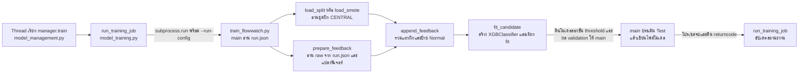
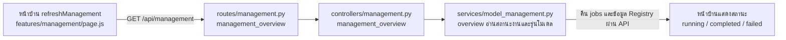

# Flowwatch — คู่มือเปิดโค้ดตอนนำเสนอ

[รับทราฟฟิกจนถึง MySQL](#รับทราฟฟิกจนถึง-mysql) · [ฝึกโมเดลด้วย-feedback](#ฝึกโมเดลด้วย-feedback)

### เปิดลิงก์ใน VS Code

- **ถ้าคลิกแล้วขึ้นป๊อปอัปแก้ลิงก์** ให้กด `Alt+Enter` ขณะเลือกอยู่บนลิงก์ ตามคีย์ที่แสดงในป๊อปอัป
- **ถ้าต้องการคลิกแล้วเปิดไฟล์เลย** เปิด Command Palette ด้วย `Ctrl+Shift+P` แล้วเลือก `Markdown: Open Preview to the Side` จากนั้นคลิกลิงก์ในแผง Preview
- **ถ้าเปิดไฟล์ได้แต่ไม่กระโดดถึงบรรทัด** ใช้ `Ctrl+P` แล้วพิมพ์ชื่อไฟล์ต่อด้วย `:เลขบรรทัด` เช่น `inference.py:83` เลือกไฟล์ใน `backend/src/services/` แล้วกด Enter

- **หน้าบ้าน (Frontend)** คือหน้าที่เห็นในเบราว์เซอร์ ปุ่ม ตาราง และโค้ดที่ส่งคำขอไปยัง API
- **หลังบ้าน (Backend)** คือส่วนที่รับข้อมูล จัดลำดับงาน เรียกโมเดล และบันทึกผล
- ในหลังบ้าน **route** รับคำขอ HTTP, **controller** ตรวจและส่งต่อคำขอ, **service** ทำงานหลัก และ **store** อ่านหรือเขียนฐานข้อมูล

## รับทราฟฟิกจนถึง MySQL

```text
Scapy → คิวแพ็กเก็ต → รวมเป็น flow → raw 6 ค่า → แปลงเป็นฟีเจอร์
      → XGBoost ให้คะแนน → บันทึก flow / prediction / alert → หน้าเว็บอ่านผล
```

### หลังบ้าน — จากแพ็กเก็ตหนึ่งตัวถึง flow

ตัวอย่างจาก [sample-b-normal-25.pcap](backend/captures/sample-b-normal-25.pcap) แพ็กเก็ตแรกเป็น Ethernet / IPv4 / TCP / Raw ขนาด 96 ไบต์ เวลาจับแบบ Unix คือ `1156534266.654692`

| ชั้น | ตัวอย่างค่าที่ Scapy อ่านได้ |
|---|---|
| Ethernet | MAC ต้นทางและปลายทาง และ EtherType ที่ระบุว่าเป็น IPv4 |
| IPv4 | ต้นทาง `192.168.1.2`, ปลายทาง `212.204.214.114`, TTL `64`, protocol `6` (TCP) รวมถึง header length, flags และ checksum |
| TCP | พอร์ตต้นทาง `2848`, พอร์ตปลายทาง `6667`, flags `PA` (PSH + ACK), sequence, acknowledgment, window และ options |
| Payload | `Raw.load` ขนาด 30 ไบต์ในแพ็กเก็ตตัวนี้ |

เมื่อรวม flow ตัวอย่างจากไฟล์เดียวกันได้ 300 แพ็กเก็ต โค้ดสร้าง `raw` ดังนี้ โดยปัดเวลาเฉพาะตอนแสดงผลในเอกสาร

```json
{
  "duration": 322.749776,
  "bytes_forward": 622,
  "bytes_backward": 102003,
  "protocol": "tcp",
  "service_group": "other",
  "conn_state_group": "other"
}
```

แพ็กเก็ตคือข้อมูลชิ้นเดียว ส่วนตัวเลขใน `raw` เป็นยอดของทั้ง flow เช่น 622 คือ payload สะสมขาไป ตัว record ยังมี IP/พอร์ต เวลา จำนวนแพ็กเก็ต หลักฐานโปรโตคอล และเลขเฟรมเมื่อมี ส่วน `raw` หกค่านี้ถูกส่งเข้าตัวทำนาย

| ขั้น | เปิดโค้ดแล้วดูคำสั่งนี้ | เชื่อมต่อกับอะไร |
|---|---|---|
| 1. เปิดตัวจับ | [`run()`](backend/src/services/live_capture.py#L216) เลือก interface และ loopback แล้วเรียก [`capture_filter()`](backend/src/services/live_capture.py#L134) ตัวกรองเลือก IP ที่เกี่ยวข้อง และเติมข้อยกเว้นพอร์ต MySQL บน loopback หรือพอร์ต HTTPS ตามการตั้งค่า | ส่งตัวกรองให้ [`start_capture_adapters()`](backend/src/services/live_capture.py#L147) สร้าง `AsyncSniffer` ต่อ interface |
| 2. ใส่คิว | [`receive(packet)`](backend/src/services/live_capture.py#L116) ถูกเรียกผ่าน `prn=self.receive` เมื่อ Scapy เห็นแพ็กเก็ต `put_nowait()` ใส่คิวทันที ถ้าคิวเต็ม `except Full` เพิ่มตัวนับตกหล่น | [`collect_packets()`](backend/src/services/live_capture.py#L164) หยิบแพ็กเก็ตจากคิวไปเรียก `collector.push(packet)` |
| 3. รวมแพ็กเก็ต | [`FlowCollector.push()`](backend/src/services/capture/flows.py#L43) ใช้ `getlayer()` อ่าน IP และ TCP, UDP หรือ ICMP แล้วใช้คู่ IP/พอร์ตกับโปรโตคอลเป็นกุญแจ `frozenset` ทำให้สลับขาไปกับขากลับแล้วหากลุ่มเดิมได้ `+=` ใช้สะสมจำนวนแพ็กเก็ตและไบต์แยกทิศ | [`drain()`](backend/src/services/capture/flows.py#L128) ใช้ `yield` ส่ง flow ที่ถึงเกณฑ์ปิดตามเวลา ส่วน `push()` ก็คืน flow เก่าได้เมื่อเริ่มการเชื่อมต่อใหม่ตามเงื่อนไข |
| 4. คัดก่อนส่งโมเดล | [`enqueue_flow()`](backend/src/services/live_capture.py#L122) เช็กว่าปลายทางอยู่ใน IP ที่เฝ้าดูเมื่อเป็นโหมด inbound โหมด both ข้ามเงื่อนไขทิศทาง ถ้าคิวยังมีที่จึง `append()` เข้า `pending_flows` | [`score_pending_flows()`](backend/src/services/live_capture.py#L182) ใช้ `popleft()` หยิบ flow ออกจากหน้าคิว |
| 5. สร้าง record | [`flow_record()`](backend/src/services/capture/flows.py#L157) ใช้เวลาจบลบเวลาเริ่ม คัดยอดไบต์สองขา และสรุปกลุ่มบริการจากข้อมูลที่อ่านพบหรือพอร์ต `return` คืน record เต็มพร้อม `raw` | `score_pending_flows()` เก็บ record ไว้บันทึก แต่หยิบเฉพาะ `[flow["raw"] for flow in batch]` ส่งให้ [`Predictor.predict()`](backend/src/services/inference.py#L83) |

**ทางเข้า PCAP** เริ่มจากหน้าบ้าน [`importCaptureFile()`](frontend/src/features/traffic/importCapture.js#L5) ส่งไฟล์ไปที่ [route อัปโหลด](backend/src/routes/captures.py#L12) → [`upload_capture()`](backend/src/controllers/captures.py#L93) รับและตรวจไฟล์ → [`save_upload()`](backend/src/controllers/captures.py#L46) เรียก [`capture_flows()`](backend/src/services/capture/pcap.py#L8) อ่านแพ็กเก็ตจากไฟล์ แล้วเรียกตัวทำนายและบันทึกผล เส้นทางนี้จึงเริ่มจากไฟล์ ส่วน Live Capture เริ่มจากอะแดปเตอร์

### หลังบ้าน — ทำนายและบันทึก

| ขั้น | เปิดโค้ดแล้วดูคำสั่งนี้ | เชื่อมต่อกับอะไร |
|---|---|---|
| 6. ตรวจและแปลงข้อมูล | [`Predictor.predict()`](backend/src/services/inference.py#L83) ใช้ `CoreFlow.model_validate()` ตรวจค่าดิบ ถ้าแถวใดใช้ไม่ได้จะได้ `not_scored` สำหรับ CENTRAL 19 ฟีเจอร์ [`transform_features()`](backend/src/models/central_contract.py#L66) เรียก [`derived()`](backend/src/models/central_contract.py#L42) คำนวณเพิ่ม แล้วใช้ scaler และ encoder จัดค่าเป็นคอลัมน์ที่โมเดลใช้ | `Predictor` อ่าน `feature_names` จาก [manifest ตอนโหลดรุ่น](backend/src/services/inference.py#L36) Baseline M9 ใช้ 19 ฟีเจอร์ ส่วน M6 Native และ M7 Imputed ใช้ 80 คอลัมน์จากการฝึกด้วย CENTRAL-UNCUT และมีวิธีเติมช่องที่ขาดใน [ทางเตรียมข้อมูล 80 คอลัมน์](backend/src/services/inference.py#L104) |
| 7. ให้คะแนน | [`predict_proba()` ใน Stage 1 และ Stage 2](backend/src/services/inference.py#L154) ให้คะแนนความเป็น attack และคะแนนแต่ละคลาส `[:, 1]` หยิบคะแนนฝั่ง attack และ `score >= threshold` ตัดสิน `flagged` โค้ดคำนวณ Stage 2 ให้ชุดที่ประเมินได้ แล้วใช้คะแนนคลาสเพื่อรายงานผลสำหรับ flow ที่ถูก flag | [`output[index]`](backend/src/services/inference.py#L210) วางคำตอบให้ตรงตำแหน่งเดิม มี `status`, `binary_score`, `threshold`, `flagged`, ข้อมูลคลาส และ Top Factors เมื่อขอคำอธิบาย |
| 8. ผูกผลกับ flow | [`score_pending_flows()`](backend/src/services/live_capture.py#L182) ใช้ `zip(batch, predictions, strict=True)` จับคู่ record กับผลทำนาย และตรวจว่าจำนวนตรงกัน | เรียก [`save_live()`](backend/src/db/mysql_store.py#L80) เพื่อเปิด transaction แล้วส่งให้ `save_records()` |
| 9. เขียนฐานข้อมูล | [`save_records()`](backend/src/db/mysql_store.py#L91) บันทึก `traffic_flows` และ `predictions` ถ้าผลเป็น `flagged` จึง [`INSERT INTO alerts`](backend/src/db/mysql_store.py#L185) โดยใช้ `prediction_id` เชื่อมกับคำตอบของโมเดล | โครงสร้างความสัมพันธ์อยู่ใน [schema.sql](backend/src/db/schema.sql) ส่วน [`MySQLStore.flows()`](backend/src/db/mysql_store.py#L199) ใช้ SQL อ่านข้อมูลมาให้ API |

ตัวอย่างสาธิตเงื่อนไข สมมติว่า `binary_score = 0.82` และ `threshold = 0.60` คำสั่ง `0.82 >= 0.60` ให้ผลจริง จึงได้ `flagged = true` ตัวเลขนี้ใช้สอนวิธีอ่านผลทำนาย ส่วนตัวเลขจาก PCAP ข้างต้นเป็นข้อมูลที่อ่านก่อนทำนาย

### หลังบ้าน — โค้ดจริงที่ควรเปิดคู่กับตาราง

**Scapy ส่งแพ็กเก็ตเข้าคิวตรงไหน**

[live_capture.py:116](backend/src/services/live_capture.py#L116)

```python
    def receive(self, packet):
        try:
            self.packets.put_nowait(packet)
        except Full:
            self.dropped += 1
```

คำสั่ง `put_nowait(packet)` ใส่แพ็กเก็ตหนึ่งชิ้นลงคิว ถ้าคิวไม่มีที่ว่าง `except Full` จะนับว่าตกหล่นหนึ่งชิ้น จากนั้น `collect_packets()` เป็นคนอ่านคิวและส่งแพ็กเก็ตให้ตัวรวม flow

**ส่งข้อมูลอะไรเข้าตัวทำนาย**

[live_capture.py:193](backend/src/services/live_capture.py#L193)

```python
            predictions = self.manager.predictor.predict(
                [flow["raw"] for flow in batch], explain=True
            )
```

`for flow in batch` เดินผ่าน flow ทีละตัว ส่วน `flow["raw"]` หยิบค่าดิบหกค่าของแต่ละตัว ลิสต์นี้คืออาร์กิวเมนต์แรกของ `Predictor.predict()` ส่วน `explain=True` ขอ Top Factors ประกอบผลทำนาย

**คะแนนกลายเป็นคำตัดสินตรงไหน**

[inference.py:166](backend/src/services/inference.py#L166)

```python
        for row, (index, item) in enumerate(valid):
            score = float(attack_scores[row])
            flagged = score >= threshold
            probabilities = category_probabilities[row]
```

`attack_scores[row]` หยิบคะแนนของแถวที่กำลังอ่าน เครื่องหมาย `>=` เช็กว่าคะแนนถึงเกณฑ์ไหม ผลเป็นจริงหรือเท็จและถูกเก็บใน `flagged` หลังบ้านใช้ค่านี้อีกครั้งตอนตัดสินใจสร้างแถว alert ใน MySQL

### หน้าบ้าน — ขอผลที่บันทึกแล้ว

[`fetchRecentTraffic()`](frontend/src/api/traffic.js#L5) ใช้ `fetch()` ขอ `GET /api/traffic/flows` ส่วนหน้า Alerts ขอผ่าน endpoint เดียวกันด้วย `alerts_only=true` คำขอเดินจาก [route](backend/src/routes/traffic.py#L14) → [controller](backend/src/controllers/traffic.py#L13) → [Store](backend/src/db/mysql_store.py#L199) เมื่อผลกลับมา [ตัวโหลดหน้าเว็บ](frontend/src/features/traffic/loadTraffic.js#L3) รวมรายการ แล้ว [`dashboardFlow()`](frontend/src/features/traffic/mapFlow.js#L3) แปลงชื่อและค่าจาก API เป็นข้อมูลที่ [`renderTable()`](frontend/src/features/traffic/table.js#L3) ใช้แสดง

---

## ฝึกโมเดลด้วย feedback

```text
Alerts → รายงานว่าเป็น Normal → บันทึก feedback
       → เลือก feedback ใน Train & Tune → เตรียมชุดฝึก → ฝึก candidate
       → ตรวจผลใน Registry → Activate เมื่อต้องการใช้งาน
```

### โฟลชาร์ตแนวนอน — กด Train แล้วโค้ดไปไหน

**1. ส่งคำขอจากหน้าเว็บและรับ ID งาน**

```mermaid
flowchart LR
    A["ผู้ใช้กด Start training"] --> B["หน้าบ้าน events.js<br/>submit → FormData"]
    B --> C["หน้าบ้าน api/management.js<br/>managementRequest"]
    C -->|"POST config และ feedback_ids"| D["API /api/management/jobs<br/>routes/management.py · job"]
    D --> E["controllers/management.py<br/>ManagementController.job"]
    E --> F["services/model_management.py<br/>manager.start"]
    F --> G["services/model_training.py<br/>start_training_job"]
    G --> H["เลือก feedback จาก ID<br/>เขียน run.json และเริ่ม Thread"]
    H --> I["start_training_job<br/>return identifier"]
    I -->|"controller คืน JSON ที่มี id"| J["หน้าบ้านแสดง Training started<br/>แล้วเรียก refreshManagement"]
```



- **หน้าบ้านส่งอะไร** — `config` มี strategy และพารามิเตอร์ของ Stage 1/2 ส่วน `feedback_ids` คือ ID ที่ติ๊กในฟอร์ม [จุดส่งคำขอใน events.js](frontend/src/features/management/events.js#L125) · [managementRequest](frontend/src/api/management.js#L1)
- **หลังบ้านคืนอะไร** — `start_training_job()` คืน `identifier` ผ่าน `manager.start()` แล้ว `ManagementController.job()` ห่อเป็น JSON รูป `{"id": "..."}` ให้หน้าเว็บอ่าน การตอบนี้หมายถึง **สร้างงานแล้ว** [start_training_job](backend/src/services/model_training.py#L82) · [controller.job](backend/src/controllers/management.py#L36)

**2. งานเบื้องหลังใช้ Dataset และ feedback อย่างไร**



- **เรียกฝึกที่ไหน** — `manager.train()` เรียก `run_training_job()` ซึ่งใช้ `subprocess.run()` เปิดสคริปต์จริง [manager.train](backend/src/services/model_management.py#L280) · [subprocess.run](backend/src/services/model_training.py#L117)
- **โมเดลเริ่มเรียนที่ไหน** — หลัง `append_feedback()` รวมข้อมูลแล้ว `fit_candidate()` ส่งตารางและป้ายกำกับให้ `stage1.fit()` กับ `stage2.fit()` ฟังก์ชันนี้คืนโมเดลสองขั้น เกณฑ์ และผล validation ให้ `main()` ภายในโปรเซสฝึก [จุดรวมและเรียกฝึก](../../model/xgboost/train_flowwatch.py#L218) · [fit_candidate](../../model/xgboost/train_flowwatch.py#L161)

**3. หน้าเว็บอ่านผลว่างานเสร็จหรือยัง**



หน้าเว็บรู้ความคืบหน้าจากการอ่านข้อมูล Management รอบถัดไป เช่น กด Refresh ส่วนโมเดลที่จะใช้ทำนายเปลี่ยนเมื่อกด Activate ใน Registry [refreshManagement](frontend/src/features/management/page.js#L12) · [overview](backend/src/services/model_management.py#L195)

### หน้าบ้าน — สิ่งที่กดและข้อมูลที่ส่ง

| หน้า | เปิดโค้ดแล้วดูคำสั่งนี้ | ส่งต่อให้ใคร |
|---|---|---|
| Alerts | [`bulkAlertAction()`](frontend/src/features/alerts/selection.js#L37) ใช้ `for...of` วนรายการที่เลือก แล้ว `await managementRequest('/feedback', {flow: {alert_id: flow.alertId}})` ส่ง ID และรอผล เมื่อสำเร็จจึงอัปเดตสถานะหน้าเว็บ | [`POST /api/management/feedback`](backend/src/routes/management.py#L17) |
| Train & Tune | [`trainingFeedbackPicker()`](frontend/src/features/management/training.js#L21) แสดงรายการให้ติ๊ก ส่วน [ตัวรับ submit](frontend/src/features/management/events.js#L113) ใช้ `FormData` อ่านฟอร์ม, `split('.')` แยกชื่อเช่น `stage1.max_depth`, `Number()` แปลงเป็นตัวเลข และ `getAll('feedback_id')` อ่าน ID ที่เลือก | [`POST /api/management/jobs`](backend/src/routes/management.py#L25) รับ `config` กับ `feedback_ids` |
| Model Registry | [ตัวส่ง Activate](frontend/src/features/management/events.js#L129) ส่ง `version` ที่เลือก แล้วโหลดข้อมูลโมเดลใหม่เมื่อสำเร็จ | [`POST /api/management/activate`](backend/src/routes/management.py#L29) |

Reference model ช่วยดูหรือคัดลอก **ค่าพารามิเตอร์** เข้าฟอร์ม พอกด Train ระบบสร้างโมเดลใหม่จากชุดฝึกกับ feedback ที่ผ่านการคัด

### หลังบ้าน — ติดตามข้าม Route, Controller, Service และสคริปต์ฝึก

| ขั้น | เปิดโค้ดแล้วดูคำสั่งนี้ | เชื่อมต่อกับอะไร |
|---|---|---|
| 1. รับรายงาน | [Route feedback](backend/src/routes/management.py#L17) รับ body แบบ `Report` แล้วเรียก [`ManagementController.feedback()`](backend/src/controllers/management.py#L27) ซึ่งตรวจ origin ด้วย `self.write(request)` แล้วคืน ID ของรายงาน | [`ModelManagement.report()`](backend/src/services/model_management.py#L94) ใช้ `alert_id` ส่งต่อไป Store และ [`feedback_queries.report()`](backend/src/db/feedback_queries.py#L60) |
| 2. เก็บ feedback และปิด alert | `feedback_queries.report()` ใช้ `SELECT` หา alert และแหล่ง flow ถ้าเป็น `central_test` จะหยุดด้วย `raise ValueError` ถ้ายังไม่มี feedback จะ `INSERT` เป็น `approved` แล้ว `UPDATE` alert เป็น `resolved` ใน transaction เดียวกัน | ตอนเลือกฝึก [`feedback()`](backend/src/db/feedback_queries.py#L9) เชื่อม feedback กับ prediction เพื่ออ่าน `snapshot.raw` ที่บันทึกไว้ |
| 3. รับคำสั่งฝึกและตรวจรายการที่ติ๊ก | [Route jobs](backend/src/routes/management.py#L25) ส่งให้ [`ManagementController.job()`](backend/src/controllers/management.py#L36) เรียก `manager.start(body)` ส่วน [`select_training_feedback()`](backend/src/services/model_training.py#L49) ใช้ `dict.fromkeys()` ตัด ID ซ้ำและตรวจ `approved` กับ `eligible` จากนั้นคืน ID แหล่งที่มา และ `raw` ของรายการที่ผ่าน | [`start_training_job()`](backend/src/services/model_training.py#L82) ใช้รายการนี้ประกอบ config ที่จะส่งให้ตัวฝึก |
| 4. เปิดงานเบื้องหลัง | `start_training_job()` เช็กว่ามีงาน `running` หรือไม่ แล้วเขียน `run.json` บันทึกสถานะงาน และเรียก `Thread(...).start()` เพื่อเริ่มฝึก จากนั้นคืน ID งานให้เว็บ | [`run_training_job()`](backend/src/services/model_training.py#L102) ใช้ `subprocess.run()` เปิดสคริปต์ฝึกด้วย `run.json` และเก็บข้อความใน `training.log` |
| 5. รวม feedback กับชุดฝึก | [`prepare_feedback()`](../../model/xgboost/train_flowwatch.py#L66) แปลง `raw` เป็นฟีเจอร์และคัดกลุ่มซ้ำ ส่วน [`append_feedback()`](../../model/xgboost/train_flowwatch.py#L89) ใช้ `pd.concat()` ต่อแถวเข้าชุดฝึก และ `np.concatenate()` ต่อป้าย benign ให้ตัวอย่าง feedback | [`fit_candidate()`](../../model/xgboost/train_flowwatch.py#L161) เรียก `stage1.fit()` และ `stage2.fit()` เพื่อให้สองโมเดลเรียนจากข้อมูลในรอบนี้ |
| 6. ตรวจผลและเก็บรุ่น | [`run_training_job()`](backend/src/services/model_training.py#L102) ตรวจ `returncode` ของสคริปต์ ถ้าสำเร็จจะลองโหลดชุดไฟล์และจัดชื่อ backup แล้วอัปเดตงานเป็น `completed` ถ้ามีข้อผิดพลาดจะเก็บข้อความกับสถานะ `failed` | รุ่นที่ฝึกเสร็จเป็น candidate เมื่อต้องการสลับ ให้ [`activate()`](backend/src/services/model_management.py#L283) โหลดรุ่นที่เลือกและบันทึกตัวชี้ Active ผ่าน [registry](backend/src/services/model_registry.py#L39) |


### อ่านโค้ดจริงจากปุ่ม Start training ถึง XGBoost

มีสามจุดที่ควรแยกตอนพูดครับ **`start_training_job()` สร้างงาน**, **`run_training_job()` เปิดโปรแกรมฝึก**, และ **`.fit()` คือคำสั่งที่ให้ XGBoost เรียนจากข้อมูลจริง**

#### 1. หน้าบ้านส่งค่าที่กรอกและ ID ที่เลือก

[events.js:117](frontend/src/features/management/events.js#L117)

```javascript
  event.preventDefault();
  const values=new FormData(form);
  if (isTrain) {
    const config={strategy:String(values.get('strategy')||'class_weighted'),max_validation_fpr:.05,stage1:{},stage2:{}};
    for (const [key,value] of values) {
      const [stage,parameter]=key.split('.');
      if (parameter) config[stage][parameter]=Number(value);
    }
    submitManagement('/jobs',{config,feedback_ids:values.getAll('feedback_id')},async()=>{
      toast('Training started');await refreshManagement();
    },form);
```

`FormData` อ่านค่าจากฟอร์ม วงลูปแยกชื่ออย่าง `stage1.max_depth` ด้วย `split('.')` แล้ว `Number(value)` แปลงเป็นตัวเลข ส่วน `values.getAll('feedback_id')` คืน ID ของช่องที่เลือก ตัวอย่างข้อมูลที่ส่ง โดยใช้ค่าและ ID สมมติ

```json
{
  "config": {
    "strategy": "class_weighted",
    "max_validation_fpr": 0.05,
    "stage1": { "max_depth": 6 },
    "stage2": { "max_depth": 5 }
  },
  "feedback_ids": ["mysql-12"]
}
```

หน้าเว็บส่งไป [route jobs](backend/src/routes/management.py#L25) ซึ่งส่งต่อให้ [controller.job()](backend/src/controllers/management.py#L36) ตรวจคำขอและเรียก `manager.start(body)` ต่อ จากนั้น [manager.start()](backend/src/services/model_management.py#L277) เรียก `start_training_job()`

#### 2. หลังบ้านเปลี่ยน ID ให้เป็นข้อมูลฝึก แล้วเริ่มงาน

[model_training.py:90](backend/src/services/model_training.py#L90)

```python
        selected = manager.training_feedback(db, body.feedback_ids)
        folder.mkdir(parents=True)
        config["feedback"] = selected
        (folder / "run.json").write_text(json.dumps(config, indent=2), encoding="utf-8")
        db.execute(
            "INSERT INTO jobs VALUES (?,?,?,?,?,?)",
            (identifier, now(), "running", json.dumps(config), None, None),
        )
    Thread(target=manager.train, args=(identifier, folder), daemon=True).start()
    return identifier
```

`manager.training_feedback(db, body.feedback_ids)` อ่าน feedback ตาม ID และตรวจว่าใช้ฝึกได้ จากนั้น `config["feedback"] = selected` ใส่รายการที่ผ่านลงใน config แต่ละรายการมี `id`, `source` และ `raw` ของ flow `write_text()` เขียน config นี้ลง `run.json` และ `Thread(...).start()` เรียก [manager.train()](backend/src/services/model_management.py#L280) เบื้องหลัง ซึ่งส่งต่อให้ `run_training_job()` ด้วย ID งานและโฟลเดอร์งาน

#### 3. หลังบ้านเรียกสคริปต์ฝึกจริง

[model_training.py:106](backend/src/services/model_training.py#L106)

```python
        command = [
            sys.executable,
            "-u",
            str(TRAINER),
            "--run-config",
            str(folder / "run.json"),
            "--output",
            str(manager.registry.bundle_path(identifier)),
            "--managed-output",
        ]
        with (folder / "training.log").open("wb") as log:
            result = subprocess.run(
                command, cwd=ROOT, stdout=log, stderr=subprocess.STDOUT
            )
```

`subprocess.run(command, ...)` คือบรรทัดที่ **เปิด Python อีกโปรเซสและเรียกสคริปต์ฝึกจริง** `TRAINER` คือพาธของ `model/xgboost/train_flowwatch.py` อาร์กิวเมนต์ `--run-config` บอกให้อ่าน `run.json` ส่วน `--output` บอกตำแหน่งเก็บโมเดลที่ได้ ข้อความที่สคริปต์พิมพ์ถูกส่งลง `training.log`

#### 4. ตัวฝึกเอา feedback ไปเรียนตรงไหน

[train_flowwatch.py:89](../../model/xgboost/train_flowwatch.py#L89)

```python
def append_feedback(data, features):
    if features is None:
        return data
    frame,binary,multi = data
    benign = np.zeros(len(features),dtype=int)
    return pd.concat([frame,features],ignore_index=True), np.concatenate([binary,benign]), np.concatenate([multi,benign])
```

[train_flowwatch.py:166](../../model/xgboost/train_flowwatch.py#L166)

```python
    stage1.fit(features, binary, sample_weight=compute_sample_weight("balanced", binary) if weighted else None)
    stage2.fit(features, multi, sample_weight=compute_sample_weight("balanced", multi) if weighted else None)
```

`features` ใน `append_feedback()` คือ feedback ที่ผ่านการแปลงและคัดแล้ว `pd.concat()` ต่อแถวเหล่านี้กับข้อมูลฝึก และ `np.concatenate()` ต่อป้าย benign ให้ทั้งสองชุดป้าย เมื่อมาถึง `fit_candidate()` ตัวแปร `features` คือฟีเจอร์ของชุดฝึกที่จัดเตรียมแล้ว `binary` คือคำตอบ Normal/Attack ส่วน `multi` คือคำตอบแบบหลายคลาส

- `stage1.fit(features, binary, ...)` สอนโมเดลให้แยก Normal กับ Attack
- `stage2.fit(features, multi, ...)` สอนโมเดลให้แยกตามคลาส
- `sample_weight=... if weighted else None` ใช้น้ำหนักเพื่อช่วยถ่วงสมดุลคลาสเมื่อสูตรฝึกเปิดตัวเลือกนี้

เมื่อฝึกสำเร็จ ตัวที่ได้เป็น candidate ใน Model Registry และจะรับงานทำนายหลังจากถูกเลือก Activate

### Dataset และพารามิเตอร์ที่ตัวฝึกใช้จริง

ในโปรเจกต์นี้ตัวฝึกคือ **XGBoost** โดยใช้ `XGBClassifier` จุดเริ่มอ่านไฟล์และเรียงขั้นตอนอยู่ใน `main()` ส่วนฟังก์ชันที่สร้างและฝึกโมเดลคือ `fit_candidate()`

#### 1. โหลดชุดข้อมูล CENTRAL จากไฟล์ CSV

ตัวฝึกอ่านจาก `data-pipeline/CENTRAL/output/` ซึ่งกำหนดใน [ตัวแปร CENTRAL](../../model/xgboost/train_flowwatch.py#L26)

| ชุด | ไฟล์ที่อ่านใต้ CENTRAL/output | ใช้ทำอะไร |
|---|---|---|
| Train | `feature_engineering/train/features.csv` และ `splits/train/labels.csv`, `splits/train/metadata.csv` | ใช้ฝึกสำหรับ Baseline และ Class weighting |
| Train SMOTENC | `splits/train_smote/features_encoded_19.csv` และ `splits/train_smote/labels.csv` | ใช้แทน Train เมื่อเลือก SMOTENC |
| Validation | `feature_engineering/validation/features.csv` และ labels/metadata จาก `splits/validation/` | ใช้เลือก threshold หลังฝึก |
| Test | `feature_engineering/test/features.csv` และ labels/metadata จาก `splits/test/` | ใช้ประเมินโมเดลหลังเลือก threshold |

[train_flowwatch.py:103](../../model/xgboost/train_flowwatch.py#L103)

```python
def load_split(split):
    folder = CENTRAL / "feature_engineering" / split
    source = CENTRAL / "splits" / split
    features = pd.read_csv(folder / "features.csv")
    labels = pd.read_csv(source / "labels.csv", usecols=["record_id", "label_binary", "attack_category_id"])
    metadata = pd.read_csv(source / "metadata.csv", usecols=["record_id", "split_group", "source_dataset"])
    if not (features.record_id.equals(labels.record_id) and labels.record_id.equals(metadata.record_id)):
        raise ValueError(f"Record alignment failed for {split}")
    return features[NAMES], labels.label_binary.to_numpy(), labels.attack_category_id.to_numpy(), metadata
```

`pd.read_csv()` อ่าน CSV เข้าตาราง ส่วน `features.record_id.equals(labels.record_id)` เช็กว่าฟีเจอร์กับคำตอบเรียงรายการตรงกัน แล้วคืน `features[NAMES]` ตามลำดับ 19 คอลัมน์ พร้อมป้ายสองชุด คือ `label_binary` สำหรับ Normal/Attack และ `attack_category_id` สำหรับหมวด ถ้าเลือก SMOTENC ตัวฝึกเปลี่ยนไปใช้ [`load_smote()`](../../model/xgboost/train_flowwatch.py#L114)

#### 2. ค่าจากหน้าบ้านเข้าโมเดลที่บรรทัดไหน

ตัวอย่าง `stage1.max_depth = 6` ถูกหน้าบ้านแยกเป็น `config.stage1.max_depth` ส่งผ่าน API ไปเขียนใน `run.json` แล้ว [`main()` อ่าน JSON](../../model/xgboost/train_flowwatch.py#L190) และเรียก [`normalize_config()`](../../model/xgboost/train_flowwatch.py#L43) เพื่อตรวจชื่อ ช่วงค่า และเติมค่าที่ไม่ได้ส่งมา

[train_flowwatch.py:161](../../model/xgboost/train_flowwatch.py#L161)

```python
def fit_candidate(features, binary, multi, validation, weighted, jobs, config):
    common = dict(tree_method="hist", n_jobs=jobs, random_state=42)
    stage1 = XGBClassifier(**common, **config["stage1"], objective="binary:logistic")
    stage2 = XGBClassifier(**common, **config["stage2"], objective="multi:softprob", num_class=6)
    max_fpr = config["max_validation_fpr"]
    stage1.fit(features, binary, sample_weight=compute_sample_weight("balanced", binary) if weighted else None)
    stage2.fit(features, multi, sample_weight=compute_sample_weight("balanced", multi) if weighted else None)
```

`**config["stage1"]` คือการคลี่ค่าจากพจนานุกรมเป็นอาร์กิวเมนต์ เช่น `max_depth=6` หรือ `learning_rate=0.12` ให้ตัวสร้าง Stage 1 ส่วน Stage 2 ใช้ค่าจาก `config["stage2"]` ของตัวเอง `XGBClassifier(...)` สร้างตัวโมเดลและตั้งค่า ส่วน `.fit(...)` เริ่มเรียนจากฟีเจอร์และป้ายคำตอบ `max_validation_fpr` ใช้ตอน [เลือก threshold จาก Validation](../../model/xgboost/train_flowwatch.py#L168)

#### 3. Feedback ถูกต่อเข้าชุดเก่าก่อนเรียกเทรนตรงไหน

[`main()`](../../model/xgboost/train_flowwatch.py#L201) โหลด `feature_engineering/preprocessor.joblib` ของ CENTRAL มาแปลงค่าดิบ feedback ให้เรียง 19 ฟีเจอร์เหมือนชุดฝึก [`prepare_feedback()`](../../model/xgboost/train_flowwatch.py#L66) ตรวจแหล่งข้อมูลและเทียบลายนิ้วมือของค่าดิบกับ Train, Validation, Test และ feedback ที่รับแล้ว เพื่อข้ามกลุ่มซ้ำ

[train_flowwatch.py:209](../../model/xgboost/train_flowwatch.py#L209)

```python
    feedback,feedback_ids,feedback_skipped = prepare_feedback(requested["feedback"],prep) if requested.get("feedback") else (None,[],[])
    candidates = {}
    candidate_sizes = {}
    selected = None
    for name, data, weighted in [
        ("baseline", train[:3], False), ("class_weighted", train[:3], True), ("smotenc", None, False)
    ]:
        if config["strategy"] not in ("compare", name):
            continue
        data = append_feedback(load_smote() if name=="smotenc" else data,feedback)
        print(f"Training {name} ({len(data[0]):,} rows)", flush=True)
        stage1,stage2,threshold,val = fit_candidate(*data,validation,weighted,args.jobs,config)
```

บรรทัด `append_feedback(..., feedback)` เอาแถวที่ผ่านไปต่อท้ายชุดฝึกที่เลือก โดยติดป้าย Normal เป็น `0` ให้ทั้ง Stage 1 และ Stage 2 ถ้าไม่มีแถวที่ผ่าน ฟังก์ชันคืนชุดฝึกเดิม จากนั้น `fit_candidate(*data, validation, weighted, args.jobs, config)` คลี่ `data` เป็นฟีเจอร์และป้ายสองชุด ส่งให้ XGBoost ฝึกโมเดลใหม่ Feedback ถูกเพิ่มในชุดฝึก ส่วน Validation และ Test ใช้แยกสำหรับเลือกเกณฑ์และวัดผล

**ประโยคสำหรับพูดตอนนำเสนอ** เมื่อกด Report false positive ระบบปิด alert และเก็บตัวอย่างไว้ก่อน เมื่อเลือกตัวอย่างใน Train & Tune ตัวฝึกจะตรวจและเพิ่มข้อมูลที่ผ่านเข้าชุดฝึกพร้อมป้าย Normal ผลฝึกจะใช้ตรวจทราฟฟิกเมื่อเราเลือก Activate รุ่นนั้น
